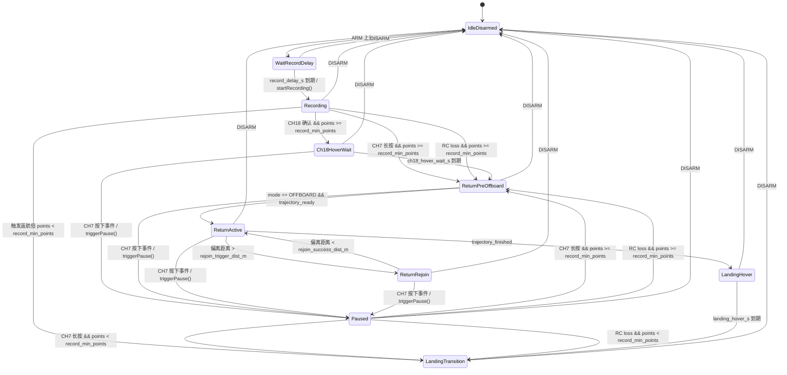
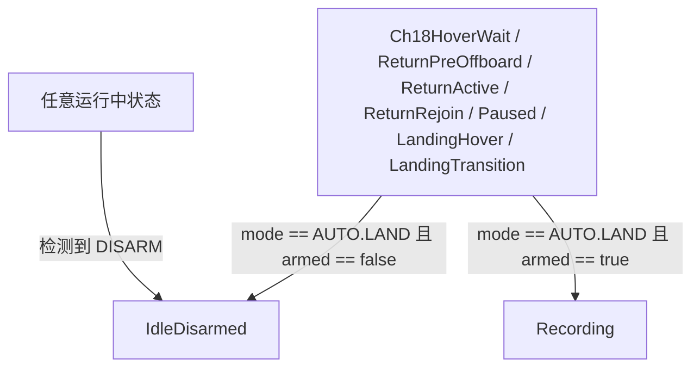
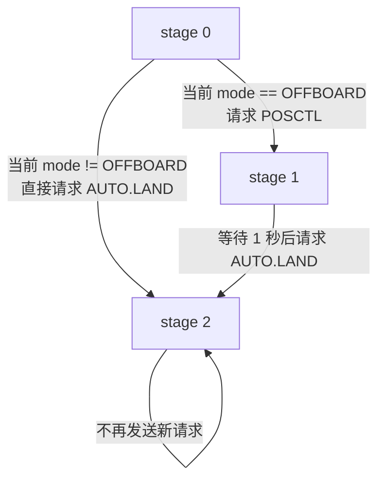

# 系统总览文档

## 1. 文档目的与依据

本文档用于说明 `px4_backtrack_optimised` 当前 C++ 实现的系统目标、输入输出、处理流程、模块划分与关键设计思想。

本文所有结论均基于仓库当前代码整理，主要依据如下：

- `src/backtrack_node.cpp`
- `src/application/backtrack_usecase.cpp`
- `src/domain/*.cpp`
- `include/px4_backtrack/**/*.hpp`
- `config/backtrack_params.yaml`
- `config/trajectory_config.yaml`

说明：

- 当前实现是 ROS1 `catkin` 工程，不是 ROS2。
- 当前实现并不是“直接订阅外部 waypoint 列表后立即优化输出轨迹”。
- 实际流程是：节点先在 `Recording` 状态录制飞行中的里程计点，再在触发返航时把这些录制点逆序重建为 `trajectory_core::Waypoint`，然后调用 `trajectory_core` 生成返航轨迹。

## 2. 系统整体目标

该系统的目标是为 PX4 飞行器提供一个“按已飞路径回退”的返航能力。

从代码可确认的功能目标如下：

1. 飞行器在正常飞行阶段持续录制自身轨迹。
2. 当满足返航触发条件时，系统基于已录制轨迹生成一条逆向返航轨迹。
3. 系统通过 MAVROS 持续发布局部位置控制 setpoint，并按需要请求切换飞控模式，使飞行器沿优化后的返航轨迹执行。
4. 当执行中发生偏离时，系统进入 rejoin 逻辑，先回归轨迹，再继续沿轨迹返航。
5. 当轨迹结束或触发条件不满足时，系统进入降落流程，最终请求 `AUTO.LAND`。

换句话说，这个节点解决的问题不是“通用路径规划”，而是“基于已录制航迹的可触发返航执行”。

## 3. 输入输出定义

### 3.1 ROS 输入

系统实际接收的外部输入来自 3 个 ROS 话题。

| 输入接口 | 消息类型 | 在代码中的处理 | 作用 |
| --- | --- | --- | --- |
| `/mavros/state` | `mavros_msgs/State` | `StateSubscriber::stateCallback()` | 提供 `armed` 和当前飞控模式 |
| `/Odometry_px4` | `nav_msgs/Odometry` | `OdomSubscriber::odomCallback()` | 提供当前位置、姿态中的 yaw、时间戳 |
| `/mavros/rc/in` | `mavros_msgs/RCIn` | `RCSubscriber::rcCallback()` | 提供 RC 通道值，用于 `CH7`、`CH18` 和 RC 丢失判定 |

其中：

- 位置使用 ENU 语义，内部类型为 `domain::Vec3`。
- yaw 从里程计四元数中提取。
- RC 使用 `channels[6]` 表示 `CH7`，`channels[17]` 表示 `CH18`。

### 3.2 内部输入数据结构

虽然外部没有直接输入 waypoint 数组，但系统内部会构造两类“轨迹输入”。

#### 3.2.1 录制点 `RecordPoint`

定义于 `include/px4_backtrack/domain/recording_buffer.hpp`：

| 字段 | 类型 | 含义 |
| --- | --- | --- |
| `position` | `Vec3` | 录制位置，ENU，单位 m |
| `yaw` | `double` | 录制时航向角，单位 rad |
| `timestamp` | `double` | 相对时间戳，首点为 0，单位 s |

这组数据由 `RecordingBuffer::addPoint()` 在 `Recording` 状态下持续积累。

#### 3.2.2 轨迹生成输入 `trajectory_core::Waypoint`

定义不在本仓库，但本仓库在 `TrajectorySession::generate()` 中明确按以下方式构造：

1. 将 `RecordPoint` 序列逆序。
2. 使用 `t_new = i * (1 / record_max_hz)` 重建时间轴。
3. 以 `position + yaw + t_new` 构造 `trajectory_core::Waypoint`。

因此，`trajectory_core` 真正收到的“waypoints”不是外部直接给入，而是系统对录制点做逆序和重采样后的结果。

### 3.3 ROS 输出

系统对外输出 2 类 ROS 话题和 1 个服务调用。

| 输出接口 | 类型 | 来源 | 作用 |
| --- | --- | --- | --- |
| `/mavros/setpoint_raw/local` | `mavros_msgs/PositionTarget` | `SetpointPublisher::publish()` | 发布悬停、返航、rejoin 控制目标 |
| `/px4_backtrack/state` | `std_msgs/String` | `StatusPublisher::publishState()` | 发布内部状态机状态 |
| `/status_rc_loss` | `std_msgs/Bool` | `StatusPublisher::publishRCLoss()` | 发布 RC 丢失持续状态 |
| `/mavros/set_mode` | `mavros_msgs/SetMode` | `SetModeClient::callSetMode()` | 请求切换 `OFFBOARD`、`POSCTL`、`AUTO.LAND` |

### 3.4 内部输出数据结构

#### 3.4.1 `TickOutput`

定义于 `include/px4_backtrack/application/backtrack_usecase.hpp`：

| 字段 | 类型 | 含义 |
| --- | --- | --- |
| `should_publish_setpoint` | `bool` | 当前周期是否应下发 setpoint |
| `setpoint` | `optional<SetpointTarget>` | 位置控制目标 |
| `mode_request` | `optional<ModeRequest>` | 模式切换请求 |
| `current_state` | `domain::State` | 当前状态机状态 |
| `rc_loss` | `bool` | RC 丢失电平状态 |

`BacktrackNode::timerCallback()` 每个周期消费该输出，再转成 ROS 行为。

#### 3.4.2 `SetpointTarget`

定义于 `include/px4_backtrack/domain/state_machine.hpp`：

| 字段 | 类型 | 含义 |
| --- | --- | --- |
| `position` | `Vec3` | 位置目标 |
| `velocity` | `Vec3` | 速度目标 |
| `yaw` | `double` | 航向角目标 |
| `yaw_rate` | `double` | 航向角速度目标 |
| `acceleration` | `optional<Vec3>` | 可选加速度目标 |
| `type_mask` | `uint16_t` | 对应 `PositionTarget.type_mask` |
| `coordinate_frame` | `uint8_t` | 对应 `PositionTarget.coordinate_frame` |

## 4. 核心处理流程

### 4.1 启动与装配

系统从 `src/backtrack_node.cpp` 启动，初始化顺序如下：

1. `ConfigLoader::loadFromROS()` 从参数服务器加载返航参数。
2. `ConfigLoader::loadTrajectoryConfig()` 加载 `trajectory_core` 配置文件。
3. 创建订阅器、发布器、模式服务客户端。
4. 创建 `BacktrackUseCase`。
5. 将 3 个订阅回调转发给 `BacktrackUseCase`。
6. 启动 20Hz 定时器，周期执行 `BacktrackUseCase::tick(now)`。

这说明系统采用“订阅回调采集数据 + 定时器驱动控制”的结构，而不是在订阅回调里直接发控制指令。

### 4.2 数据采集阶段

#### 4.2.1 状态输入

`onStateReceived(bool armed, const std::string& mode)` 更新：

- 当前是否 ARM
- 当前 PX4 模式字符串

#### 4.2.2 里程计输入

`onOdomReceived(const Vec3& position, double yaw, double stamp)` 更新当前位置与航向。

当状态机处于 `Recording` 时，还会调用 `recording_buffer_.addPoint()` 录制航迹点。

#### 4.2.3 RC 输入

`onRCReceived(const std::vector<uint16_t>& channels)` 做两件事：

1. 更新 RC 通道缓存。
2. 更新最近一次收到 RC 消息的时间，用于 RC 丢失检测。

### 4.3 周期控制阶段

`BacktrackUseCase::tick(now)` 是核心编排函数，每个周期固定按以下顺序执行：

1. `trigger_evaluator_.updateNow(now)` 更新当前时间。
2. `handleFlightCycleReset()` 检测 `DISARM -> ARM` 飞行周期切换，并重置录制与轨迹会话。
3. `handleRecordDelay(now)` 在 `WaitRecordDelay` 状态内等待 `record_delay_s`，到时进入 `Recording`。
4. `handleTriggers(now)` 检测返航、暂停、恢复、RC 丢失等触发条件。
5. `handleTrajectoryGeneration()` 在 `ReturnPreOffboard` 内请求并执行轨迹生成。
6. `handleWaypointFallbackProgress()` 在退化 waypoint 返航期间推进当前目标索引。
7. `handleRejoin()` 在返航过程中检查偏离与回归成功。
8. 组装 `TickInput` 驱动 `BacktrackStateMachine::tick()`。
9. 根据状态机输出计算本周期 setpoint 与模式请求。

### 4.4 返航触发阶段

系统在 `Recording` 状态下支持 3 类返航触发：

1. `CH7` 长按
2. `CH18` 故障确认
3. RC 消息丢失

处理规则由 `handleReturnTrigger()` 统一实现：

- 若录制点数 `>= record_min_points`，则锁定当前位置，进入返航流程，并标记需要生成轨迹。
- 若录制点数不足，则不生成轨迹，直接进入 `LandingTransition`，后续请求降落。

这说明“点数不足时直接降落”是当前实现中的明确降级策略。

### 4.5 轨迹生成阶段

轨迹只会在以下条件同时满足时生成：

1. 当前状态为 `ReturnPreOffboard`
2. `trajectory_generation_requested_ == true`
3. 当前 `trajectory_session_` 尚未持有有效轨迹

生成动作位于 `TrajectorySession::generate()`，核心步骤如下：

1. 先调用 `TrajectoryConfig::validate()`，非法配置直接返回 `InvalidConfig`。
2. 检查录制点数是否至少为 2。
3. 基于 `max(min_point_dist_m, ds_m * 0.5)` 对录制点做空间抽稀。
4. 将录制点逆序。
5. 将逆序后的录制时间戳镜像映射为新的单调递增时间轴。
6. 构造 `trajectory_core::Waypoint` 数组。
7. 调用 `trajectory_core::TrajectoryGenerator::generate()`。
8. 若成功，保存轨迹对象并重置执行进度。

生成失败时的处理也已分流：

- 点过近/起终点几何退化：直接降级为原地降落
- 其它可恢复失败：切到 `WaypointFallbackSession` 做退化 waypoint 返航
- 非法配置：记录错误并停留在 `ReturnPreOffboard`，不进入 fallback

### 4.6 OFFBOARD 切换与轨迹执行阶段

在返航真正开始之前，状态机会先进入 `ReturnPreOffboard`：

1. 发布锁定位置的固定点 setpoint。
2. 累积 `pre_offboard_setpoint_count` 次预发送。
3. 满足次数后，以 1 秒节流频率请求切换到 `OFFBOARD`。
4. 当模式已进入 `OFFBOARD` 且轨迹已就绪时，进入 `ReturnActive`。

进入 `ReturnActive` 后：

1. 若当前是退化返航，则直接从 `WaypointFallbackSession` 取当前位置对应的 sparse waypoint 目标。
2. 否则，`computeSetpoint()` 调用 `trajectory_session_.evaluate(now)`。
3. 将轨迹状态或 waypoint 目标转成 `SetpointTarget`。
4. 通过 `/mavros/setpoint_raw/local` 持续下发。
5. 当正常轨迹或退化 waypoint 会话完成时，进入 `LandingHover`。

### 4.7 偏离检测与回归阶段

在 `ReturnActive` 中，系统会将“当前位置”和“轨迹当前进度点位置”做欧氏距离比较：

- 大于 `rejoin_trigger_dist_m`，进入 `ReturnRejoin`
- 小于 `rejoin_success_dist_m`，退出 `ReturnRejoin` 回到 `ReturnActive`

`ReturnRejoin` 的 setpoint 由 `RejoinPolicy` 计算：

1. 使用进入 rejoin 时冻结的轨迹进度点作为目标位置。
2. 速度方向从当前位置指向冻结点。
3. 速度大小采用比例收敛：`speed = min(rejoin_v_max_m_s, 1.0 * distance)`。
4. yaw 和 yaw_rate 复用冻结点上的轨迹姿态，不额外计算朝向。

这样 `ReturnRejoin` 的 setpoint 目标和退出判据使用同一个轨迹点，避免“控制目标追最近点预瞄，退出判据看冻结点”的不一致。

### 4.8 暂停、恢复与降落阶段

#### 4.8.1 暂停

在 `Ch18HoverWait`、`ReturnPreOffboard`、`ReturnActive`、`ReturnRejoin` 中：

- 若检测到 `CH7` 按下事件，则进入 `Paused`
- 同时冻结轨迹进度 `trajectory_session_.freezeProgress()`
- 状态机会请求 `POSCTL`

#### 4.8.2 恢复

在 `Paused` 中：

- `CH7` 长按可恢复返航
- RC 丢失也可强制恢复返航

恢复时系统不是直接回到 `ReturnActive`，而是：

1. 重新锁定当前位置
2. 调用 `triggerReturn(...)`
3. 调用 `trajectory_session_.resumeProgress(now)`
4. 再次经过 `ReturnPreOffboard`

#### 4.8.3 降落

降落相关逻辑分两段：

1. `LandingHover`：轨迹结束后在当前位置固定点悬停 `landing_hover_s`
2. `LandingTransition`：执行模式切换

`LandingTransition` 的行为是：

- 若当前不在 `OFFBOARD`，直接请求 `AUTO.LAND`
- 若当前仍在 `OFFBOARD`，先请求 `POSCTL`
- 等待 1 秒后再请求 `AUTO.LAND`

另外，`AUTO.LAND` 在状态机中具有全局高优先级。一旦检测到当前模式已经是 `AUTO.LAND`，系统会清理返航控制输出并让控制权让渡给飞控。

## 5. 模块划分与职责

### 5.1 入口层

文件：`src/backtrack_node.cpp`

职责：

- 加载配置
- 创建各层对象
- 绑定订阅回调
- 通过 20Hz 定时器驱动 `tick`
- 将 `TickOutput` 转换为 ROS 发布与服务调用

### 5.2 Application 层

文件：

- `include/px4_backtrack/application/backtrack_usecase.hpp`
- `src/application/backtrack_usecase.cpp`

职责：

- 维护系统级上下文快照
- 串联录制、触发、轨迹生成、rejoin、状态机
- 决定什么时候请求轨迹生成
- 决定什么时候冻结/恢复轨迹进度
- 计算最终 setpoint 输出

这一层是整个系统的编排中心。

### 5.3 Domain 层

#### `BacktrackStateMachine`

职责：

- 管理系统状态迁移
- 给出是否发布 setpoint
- 给出模式切换请求
- 管理固定点悬停、OFFBOARD 预发送、降落过渡等流程态

#### `RecordingBuffer`

职责：

- 节流录制里程计点
- 存储位置、yaw、相对时间戳
- 为轨迹生成提供原始录制数据

#### `TriggerEvaluator`

职责：

- 维护 `CH7`、`CH18`、RC 丢失判定状态
- 提供边沿触发事件和持续电平状态

#### `TrajectorySession`

职责：

- 将录制点转换为 `trajectory_core` 输入
- 调用 `trajectory_core` 生成轨迹
- 维护轨迹执行进度
- 提供暂停/恢复能力
- 对外提供轨迹评估结果

#### `RejoinPolicy`

职责：

- 判断是否偏离轨迹
- 搜索最近轨迹时刻
- 计算 rejoin 目标
- 对回归速度限幅

### 5.4 Adapters 层

文件：

- `src/adapters/ros_subscribers.cpp`
- `src/adapters/ros_publishers.cpp`
- `src/adapters/ros_services.cpp`

职责：

- 负责 ROS 消息与领域对象之间的适配
- 屏蔽订阅、发布、服务调用细节
- 将 `SetpointTarget` 转成 `mavros_msgs/PositionTarget`

### 5.5 Infrastructure 层

文件：

- `src/infrastructure/config_loader.cpp`

职责：

- 从 ROS 参数服务器组装 `UseCaseConfig`
- 从 YAML 文件加载 `trajectory_core::TrajectoryConfig`

## 6. 关键设计思想

### 6.1 “录制轨迹”与“返航轨迹”解耦

系统没有直接把录制时间戳原样作为返航执行时间轴，而是在轨迹生成时按 `record_max_hz` 重建新时间轴。

这意味着：

- 录制阶段关注的是采样稳定和时间单调性
- 执行阶段关注的是可控、规则、适合优化器处理的 waypoint 时序

### 6.2 采用“逆序回退”而不是重新全局规划

从 `TrajectorySession::generate()` 可以明确看出，返航 waypoints 来自录制点逆序。

因此当前设计假设是：

- 已飞路径本身是可回退参考
- 优化重点在于把离散录制点变成平滑、受约束、可执行的返航轨迹

### 6.3 控制循环与事件采集分离

订阅回调只负责更新输入缓存，不直接控飞。

真正的控制输出在 20Hz `tick()` 中统一生成，这样做的价值是：

- 触发逻辑和状态迁移有统一时序
- 模式切换和 setpoint 发布在一个控制周期内统一协调
- 更容易维护暂停、恢复、降落等跨事件流程

### 6.4 触发逻辑采用边沿事件与电平状态分离

代码中对 RC 丢失做了显式区分：

- `checkRCLossEvent()` 用于“一次性触发返航”
- `isRCLost()` 用于“持续对外发布 RC 丢失状态”

这是一个明确的工程化设计，避免控制触发和状态显示互相干扰。

### 6.5 返航执行采用“固定点预发送 + OFFBOARD 切换”策略

在进入轨迹执行前，系统先持续发送固定点 setpoint，再请求进入 `OFFBOARD`。

从代码上看，这个策略的目的很明确：

- 满足 PX4/MAVROS 对 OFFBOARD 前置 setpoint 的要求
- 避免刚触发返航时直接切入动态轨迹控制

### 6.6 偏离后不直接跳轨迹，而是进入受限 rejoin

`RejoinPolicy` 不是简单把当前点投影到轨迹上，而是：

1. 找最近时间点
2. 加一个预瞄时间
3. 取该轨迹状态作为目标
4. 对速度限幅

这体现的设计思想是：回归要尽量平滑，且速度受控，避免大偏差时产生激进追踪。

### 6.7 约束与优化思想的代码可见边界

关于“优化目标、约束类型”，本仓库能直接确认的是“传给 `trajectory_core` 的配置项”，包括：

- 走廊偏差约束：`max_deviation_m`
- 拐角处理参数：`corner_angle_threshold_deg`、`corner_blend_len_m`、`corner_blend_ratio`
- yaw 平滑与 yaw 速率限制：`enable_yaw_smooth`、`max_yaw_deviation_rad`、`yaw_rate_max`
- 末端收敛参数：`enable_end_converge`、`s_stop_m`、`r_stop_m`、`v_end_max`
- 速度约束：`v_max`、`vz_max`
- 加速度约束：`a_tan_max`、`a_lat_max`、`az_up_max`、`az_down_max`
- 输出形式控制：`enable_output_acc`

但需要明确：

- 本仓库并不包含 `trajectory_core` 的优化器实现细节。
- 因此，本文只能确认“系统向优化库声明了哪些约束和行为参数”，不能从本仓库单独推出其精确目标函数形式。

## 7. 结论

`px4_backtrack_optimised` 当前实现是一个以 `BacktrackUseCase` 为核心编排层、以 `BacktrackStateMachine` 为流程控制核心、以 `trajectory_core` 为轨迹生成核心的 ROS1 PX4 返航节点。

其本质工作方式是：

1. 录制飞行轨迹
2. 在触发时逆序构造轨迹输入
3. 调用 `trajectory_core` 生成平滑返航轨迹
4. 通过 MAVROS 进入 `OFFBOARD` 并沿轨迹执行
5. 在偏离、暂停、恢复、结束等情况下通过状态机维持完整控制流程

如果后续需要继续扩展系统文档，建议下一步补充 `trajectory_core` 外部配置项与飞行行为的对应关系表。

## 8. 状态机状态转移图

以下状态图依据 `src/domain/state_machine.cpp` 与 `src/application/backtrack_usecase.cpp` 整理。

### 8.1 主状态迁移

### 8.2 全局覆盖规则

`BacktrackStateMachine::tick()` 在正常状态逻辑之前，还会先处理两类“全局覆盖”条件。

说明：

- `AUTO.LAND` 的这条全局覆盖规则不会作用于 `IdleDisarmed`、`WaitRecordDelay`、`Recording`。
- 一旦命中 `AUTO.LAND`，状态机会清空 setpoint 与 mode request，把控制权让渡给飞控。

### 8.3 `LandingTransition` 内部阶段

`LandingTransition` 虽然在状态图里是一个状态，但内部还包含 3 个阶段：

说明：

- 这部分不是状态机枚举层面的独立状态，而是 `LandingTransition` 内部的子阶段变量 `landing_transition_stage`。
- 对应实现位于 `src/domain/state_machine.cpp` 的 `tickLandingTransition()`。
