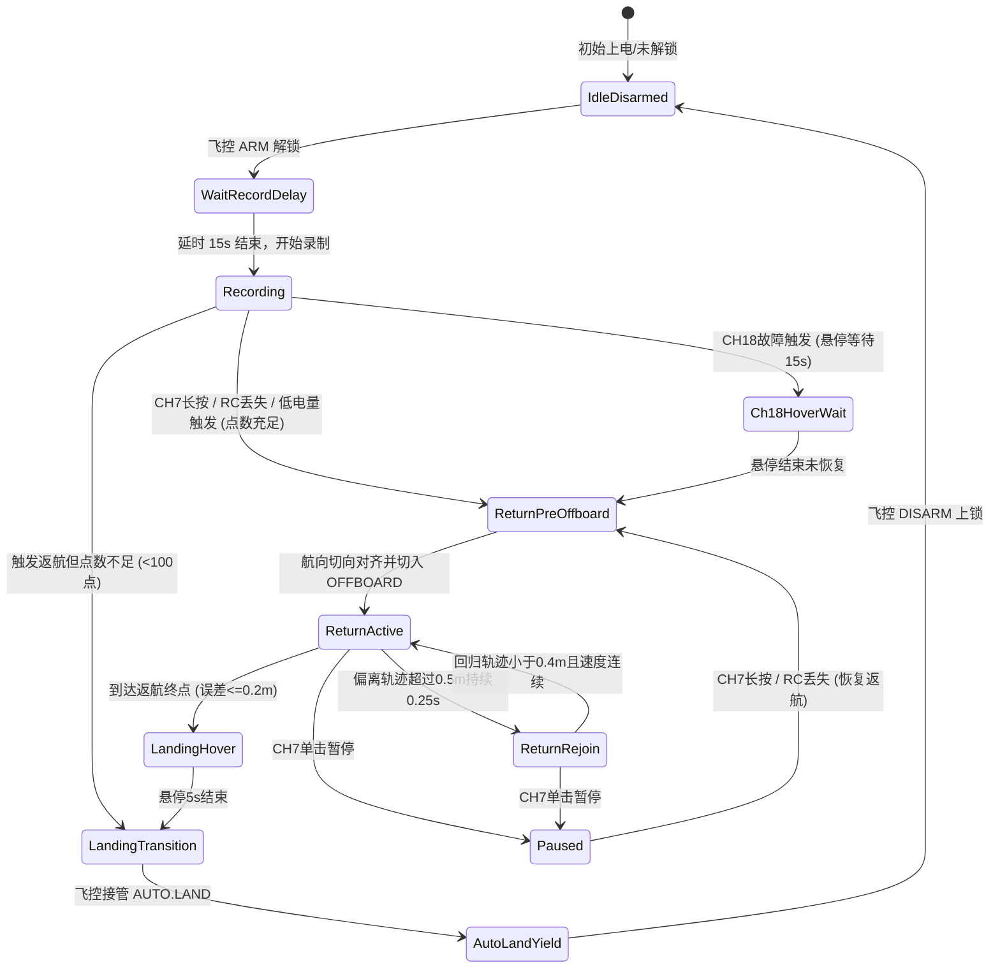

# PX4 返航模块前端对接与开发指南

本文档为地面站（GCS）、Web 监控端、移动端 APP 等前端开发团队提供与 `px4_backtrack_optimised` 原路平滑返航模块进行数据对接、状态监控、UI 展示及交互告警的完整技术规范。

---

## 1. 核心架构与交互总览

返航模块在无人机飞行期间持续以不超过 10Hz 录制飞行轨迹点，当满足触发条件（遥控器 CH7 长按、CH18 失控、RC 信号丢失或**低电量触发**）后，利用轨迹优化算法逆序生成平滑轨迹，通过 MAVROS 驱动无人机沿原路安全飞回起飞点并就地降落。

### 1.1 系统状态流转图



---

## 2. ROS 话题通信协议

前端通常通过 `rosbridge_websocket`（默认端口 `9090`，使用 `roslibjs`）或原生 ROS 客户端订阅以下话题。

### 2.1 返航模块输出话题（前端重点订阅）

| 话题名称 | 消息类型 (`msg`) | 频率 | 信号类型 | 业务用途与前端交互说明 |
|---|---|---|---|---|
| `/px4_backtrack/state` | `std_msgs/String` | 20 Hz | 字符串枚举 | **核心状态**：反映当前返航生命周期状态，用于主界面状态标签、流程指示灯渲染 |
| `/px4_backtrack/low_battery` | `std_msgs/Bool` | 20 Hz | 电平锁存 | **低电量报警**：`true` 表示电量持续低于阈值已锁定报警，前端**必须弹出高优先级警示窗** |
| `/status_rc_loss` | `std_msgs/Bool` | 20 Hz | 电平信号 | **遥控信号丢失**：`true` 表示遥控链路超时丢失，`false` 表示正常 |
| `/px4_backtrack/debug/waypoints` | `visualization_msgs/MarkerArray` | 轨迹生成时触发 (latched) | 可视化标记 | **历史录制点**：用于 2D/3D 地图上绘制已录制的航点散点 |
| `/px4_backtrack/debug/trajectory` | `nav_msgs/Path` | 轨迹生成时触发 (latched) | 路径曲线 | **返航平滑路径**：用于 2D/3D 地图上渲染规划出的平滑返航轨迹线 |

### 2.2 飞行基础数据话题（辅助展示）

| 话题名称 | 消息类型 (`msg`) | 频率 | 关键字段 | 业务用途 |
|---|---|---|---|---|
| `/mavros/state` | `mavros_msgs/State` | 1 Hz | `armed` (bool), `mode` (string), `connected` (bool) | 解锁状态与飞控当前工作模式（如 `POSCTL`, `OFFBOARD`, `AUTO.LAND`） |
| `/Odometry_px4` | `nav_msgs/Odometry` | 30~50 Hz | `pose.pose.position` (x,y,z), `twist.twist.linear` | 无人机实时 ENU 坐标位置与速度（用于地图图标定位与朝向） |
| `/mavros/battery` | `sensor_msgs/BatteryState` | 1~5 Hz | `percentage` (float32, 0.0~1.0), `voltage` (float32) | 原始电池电量与电压（百分比 `0.15` 代表 15%） |

---

## 3. 状态机枚举与 UI 展现规范

前端订阅 `/px4_backtrack/state`，消息体为字符串（`msg.data`）。请按照下表映射前端 UI 视觉与操作状态：

| 状态字符串 (`data`) | UI 显示文案 | 状态标签颜色建议 | 状态语义与业务逻辑 | 允许的用户界面操作 |
|---|---|---|---|---|
| `IdleDisarmed` | **待机（未解锁）** | 灰色 (`#9E9E9E`) | 飞机处于上锁状态，算法待机 | 不可返航 |
| `WaitRecordDelay` | **起飞等待中** | 蓝色 (`#2196F3`) | 刚解锁，等待起飞初期 15s 颠簸延时结束 | 暂未开始录制 |
| `Recording` | **航迹录制中** | 绿色 (`#4CAF50`) | 正常飞行，正在以 ≤10Hz 空间节流采样航迹 | 可手动触发返航（若有指令入口） |
| `Ch18HoverWait` | **失控悬停等待** | 橙色闪烁 (`#FF9800`) | CH18 触发后就地悬停等待 15s 链路恢复 | 显示 15s 倒计时进度条 |
| `ReturnPreOffboard` | **准备返航中** | 橙色 (`#FF9800`) | 正在计算平滑轨迹并对齐起始航向切角 | 禁止操作，等待对齐 |
| `ReturnActive` | **正在原路返航** | 绿色呼吸灯 (`#4CAF50`) | 沿生成的优化轨迹平滑逆序飞回 | **允许点击【暂停返航】** |
| `ReturnRejoin` | **轨迹偏离回归** | 黄色闪烁 (`#FFC107`) | 受外力/风阻偏离超过0.5m，慢速向轨迹收敛 | **允许点击【暂停返航】** |
| `Paused` | **返航已暂停** | 红色常亮 (`#F44336`) | 返航中断，飞机就地定点悬停 | **允许点击【恢复返航】/【原地降落】** |
| `LandingHover` | **到达终点悬停** | 蓝色 (`#2196F3`) | 已顺利飞回初始录制点附近，悬停准备降落 | 准备着陆 |
| `LandingTransition` | **正在降落** | 紫色 (`#9C27B0`) | 切换到 `AUTO.LAND` 垂直平稳降落 | 显示降落进度 |
| `AutoLandYield` | **降落接管中** | 紫色 (`#9C27B0`) | 飞控内环完全接管降落流程，直至落地停桨 | 禁止算法操作 |

---

## 4. 关键交互设计与异常告警规范

### 4.1 低电量触发与弹窗交互（P0 级告警）

- **信号源**：`/px4_backtrack/low_battery`（值为 `true`）。
- **信号特性**：**电平锁存**。一旦确认低电量（持续低于 15% 超过 3 秒），该值变为 `true` 且**不会因电压波动回弹而消失**，直到下一次解锁复位。
- **UI 呈现建议**：
  1. 顶部全局告警横幅（红色）：`⚠️ 电池电量过低（<15%），返航保护已激活！`
  2. 弹出 Modal 强提示，伴随报警音效。
  3. **不同飞行阶段的业务提示区别**：
     - **正常飞行中（`Recording` 点数足够）**：弹窗提示“正在自动规划原路返航”，状态标签自动跳转为 `ReturnActive`。
     - **刚起飞/点数不足（`Recording` 点数 < 100）**：弹窗警示“录制航迹不足以返航，系统已自动执行**原地直接降落**”，状态标签切为 `LandingTransition`。
     - **暂停状态下（`Paused`）**：
       > **重要设计**：当无人机处于暂停悬停（`Paused`）时，检测到低电量**不会自动恢复飞行**（防止在飞手未准备好的情况下贸然运动）。前端界面必须弹出显著警告：“**警告：当前处于暂停悬停，无人机电量严重不足！请立即点击【恢复返航】或切换手动接管降落！**”，并在弹窗中提供快捷操作按钮。

### 4.2 遥控信号丢失告警（RC Loss）

- **信号源**：`/status_rc_loss`（值为 `true` 时丢失，`false` 时恢复）。
- **UI 呈现建议**：在界面右上角连接状态栏以黄色图标或文字提示“遥控链路中断”，若持续中断，系统将自动进入 `ReturnActive`。

---

## 5. 3D/2D 地图轨迹可视化对接规范

如果前端包含三维视图（如 Cesium、Three.js、Leaflet 等），可通过如下话题渲染轨迹图层：

1. **坐标系约定**：
   - 算法发布的轨迹位置均为本地 **ENU 坐标系**（东-北-天，单位：米），以起飞点作为原点 `(0, 0, 0)`。
2. **绘制已录制航迹（历史脚印）**：
   - 订阅 `/px4_backtrack/debug/waypoints` (`visualization_msgs/MarkerArray`)。
   - 提取各点的 `pose.position.x`, `y`, `z`，以半透明黄色小球或散点画出已记录路径。
3. **绘制返航平滑曲线**：
   - 订阅 `/px4_backtrack/debug/trajectory` (`nav_msgs/Path`)。
   - 提取 `poses` 数组，渲染一条连续的青色/绿色发光曲线，表示无人机正在跟随的轨迹。
4. **绘制当前机体位置与朝向**：
   - 订阅 `/Odometry_px4` (`nav_msgs/Odometry`)。
   - 提取位置渲染飞机模型，提取四元数 `pose.pose.orientation` 转换为 Heading/Yaw 航向角，更新飞机机头朝向。

---

## 6. 前端本地模拟与联调指南（Mock 教程）

前端工程师在无需连接真机或运行重型 Gazebo 仿真环境的情况下，只需在终端运行几条 ROS 命令，即可完整模拟各种状态以验证前端界面渲染与弹窗逻辑。

### 6.1 启动 WebSocket 桥接（提供给前端页面连接）

```bash
# 启动 rosbridge 服务端，前端 roslibjs 即可连接 ws://<IP>:9090
roslaunch rosbridge_server rosbridge_websocket.launch
```

### 6.2 模拟状态变化

```bash
# 1. 模拟进入正常返航中
rostopic pub -r 20 /px4_backtrack/state std_msgs/String "data: 'ReturnActive'"

# 2. 模拟返航中暂停
rostopic pub -r 20 /px4_backtrack/state std_msgs/String "data: 'Paused'"

# 3. 模拟进入轨迹偏离回归状态
rostopic pub -r 20 /px4_backtrack/state std_msgs/String "data: 'ReturnRejoin'"

# 4. 模拟就地降落中
rostopic pub -r 20 /px4_backtrack/state std_msgs/String "data: 'LandingTransition'"
```

### 6.3 模拟低电量报警与 RC 丢失

```bash
# 模拟触发低电量警报（测试前端弹窗逻辑）
rostopic pub -r 20 /px4_backtrack/low_battery std_msgs/Bool "data: true"

# 模拟解除低电量（正常待机状态）
rostopic pub -r 20 /px4_backtrack/low_battery std_msgs/Bool "data: false"

# 模拟遥控信号丢失
rostopic pub -r 20 /status_rc_loss std_msgs/Bool "data: true"
```

### 6.4 模拟电池百分比上报（测试仪表盘电量百分比）

```bash
# 模拟电量为 12%
rostopic pub -r 2 /mavros/battery sensor_msgs/BatteryState "{percentage: 0.12, voltage: 14.8}"
```

---

## 7. 接口协议技术规格一览表（Cheat Sheet）

```json
{
  "topics": {
    "state": {
      "name": "/px4_backtrack/state",
      "type": "std_msgs/String",
      "values": [
        "IdleDisarmed",
        "WaitRecordDelay",
        "Recording",
        "Ch18HoverWait",
        "ReturnPreOffboard",
        "ReturnActive",
        "ReturnRejoin",
        "Paused",
        "LandingHover",
        "LandingTransition",
        "AutoLandYield"
      ]
    },
    "low_battery": {
      "name": "/px4_backtrack/low_battery",
      "type": "std_msgs/Bool",
      "values": [true, false]
    },
    "rc_loss": {
      "name": "/status_rc_loss",
      "type": "std_msgs/Bool",
      "values": [true, false]
    }
  }
}
```
