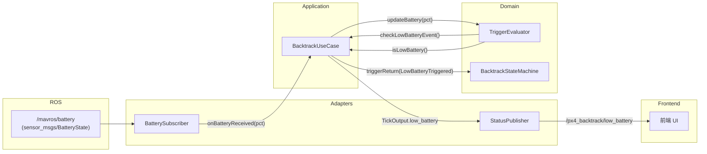

# 低电量返航触发功能规划实现文档

本文档记录了 `px4_backtrack_optimised` 增加低电量返航触发功能的规划与完整实现方案。

## 1. 需求与背景

在现有返航触发链路（`CH7` 长按 / `CH18` 故障确认 / RC 消息丢失）之上，增加基于 `/mavros/battery` 电量百分比的低电量返航触发。
当电池电量百分比（`percentage`，范围 0.0~1.0）持续低于可配置阈值时触发返航，整体遵循现有的“边沿触发 + 确认延时 + 不可逆锁存”语义，避免竞态。
同时新增 `/px4_backtrack/low_battery` 状态话题，以 20Hz 频率持续广播低电量电平状态，供前端实时弹出告警。

## 2. 核心设计决策

| 决策项 | 设计结论 | 说明 |
|---|---|---|
| **确认延时** | `3.0s`（参数 `low_battery_confirm_s`） | 持续低于阈值超过该时间才确认触发，避免大机动瞬间电压跌落误触发 |
| **阈值默认值** | `0.15`（参数 `low_battery_threshold`） | 即 15% 电量触发 |
| **恢复语义** | 不可逆锁存（`low_battery_triggered_`） | 电池电量不可逆消耗，触发后即使电压回弹也不取消返航防护 |
| **Paused 状态行为** | **不自动恢复返航** | 仅通过 `/px4_backtrack/low_battery` 广播 `true`，由操作人员与前端界面确认 |
| **触发优先级** | 最低（在 RC 丢失之后检测） | `Recording` 状态下依序检测：CH7 -> CH18 -> RC loss -> 低电量 |
| **状态话题命名** | `/px4_backtrack/low_battery` | 遵循 `/模块名称/功能名称` 规则，消息类型 `std_msgs/Bool` |

## 3. 分层实现方案

### 3.1 Domain 层

1. **`TriggerConfig`（[`include/px4_backtrack/domain/trigger_evaluator.hpp`](../../include/px4_backtrack/domain/trigger_evaluator.hpp)）**
   新增字段：
   - `enable_low_battery`: 是否启用低电量触发
   - `low_battery_threshold`: 低电量阈值（0.0~1.0）
   - `low_battery_confirm_s`: 确认时间 (s)

2. **`TriggerEvaluator`（[`src/domain/trigger_evaluator.cpp`](../../src/domain/trigger_evaluator.cpp)）**
   新增接口与状态变量：
   - `updateBattery(double percentage)`：更新电量缓存，标记 `has_received_battery_ = true`
   - `checkLowBatteryEvent()`：边沿触发判定；首次满足持续低电量时长时返回一次 `true` 并锁存
   - `isLowBattery()`：电平状态查询，锁存后持续返回 `true`
   - 包含启动保护（未收到电池消息时不触发）和配置禁用分支

3. **`Event` 枚举（[`include/px4_backtrack/domain/state_machine.hpp`](../../include/px4_backtrack/domain/state_machine.hpp)）**
   新增事件枚举：`Event::LowBatteryTriggered`。

### 3.2 Application 层

1. **`BacktrackUseCase`（[`include/px4_backtrack/application/backtrack_usecase.hpp`](../../include/px4_backtrack/application/backtrack_usecase.hpp)、[`src/application/backtrack_usecase.cpp`](../../src/application/backtrack_usecase.cpp)）**
   - 新增回调：`onBatteryReceived(double percentage)`，转发至 `TriggerEvaluator::updateBattery`
   - `TickOutput` 新增 `bool low_battery` 状态字段
   - `handleTriggers()` 在每周期开头提取 `low_battery_event` 边沿，并在 `Recording` 状态下执行 `handleReturnTrigger(Event::LowBatteryTriggered, ...)`
   - `Paused` 状态下仅广播状态，不执行恢复返航

### 3.3 Adapters 层

1. **`BatterySubscriber`（[`include/px4_backtrack/adapters/ros_subscribers.hpp`](../../include/px4_backtrack/adapters/ros_subscribers.hpp)、[`src/adapters/ros_subscribers.cpp`](../../src/adapters/ros_subscribers.cpp)）**
   - 线程安全订阅 `/mavros/battery`（`sensor_msgs/BatteryState`）
   - 提取 `msg->percentage` 并调用回调

2. **`StatusPublisher`（[`include/px4_backtrack/adapters/ros_publishers.hpp`](../../include/px4_backtrack/adapters/ros_publishers.hpp)、[`src/adapters/ros_publishers.cpp`](../../src/adapters/ros_publishers.cpp)）**
   - 创建发布者：`/px4_backtrack/low_battery`（`std_msgs/Bool`）
   - 新增 `publishLowBattery(bool low_battery)` 方法

### 3.4 Infrastructure 层

1. **`ConfigLoader`（[`include/px4_backtrack/infrastructure/config_loader.hpp`](../../include/px4_backtrack/infrastructure/config_loader.hpp)、[`src/infrastructure/config_loader.cpp`](../../src/infrastructure/config_loader.cpp)）**
   - 新增 `loadLowBatteryParams`，必填读取：
     - `enable_trigger_low_battery`
     - `low_battery_threshold`
     - `low_battery_confirm_s`

### 3.5 节点入口与配置文件

1. **`BacktrackNode`（[`src/backtrack_node.cpp`](../../src/backtrack_node.cpp)）**
   - 实例化 `BatterySubscriber` 并绑定回调到 `usecase_->onBatteryReceived`
   - 在 20Hz `timerCallback` 中发布 `status_pub_->publishLowBattery(output.low_battery)`

2. **参数配置（[`config/backtrack_params.yaml`](../../config/backtrack_params.yaml)）**
   新增低电量触发配置段：
   ```yaml
   # ============================
   # 低电量触发参数
   # ============================
   enable_trigger_low_battery: true
   low_battery_threshold: 0.15
   low_battery_confirm_s: 3.0
   ```

3. **构建配置（`CMakeLists.txt`、`package.xml`）**
   添加 `sensor_msgs` 依赖。

---

## 4. 数据流与时序架构



### 防竞态设计要点
- 回调线程只写入基础类型变量，并通过 mutex 保护；
- 触发判定逻辑严格由 20Hz 定时器驱动的主线程 `tick()` 执行；
- 单周期内统一获取一次边沿事件并缓存，避免多次查询造成事件被过早消费。

---

## 5. 自动化测试验证

### 5.1 TriggerEvaluator 单元测试（7 组）
- `LowBatteryTriggersAfterConfirmDuration`：持续满足时间后触发
- `LowBatteryDoesNotTriggerBeforeConfirmDuration`：未到时间不触发，回弹后重置计时
- `LowBatteryEdgeSemanticsFiresOnce`：边沿语义仅触发一次
- `LowBatteryLevelRemainsLatched`：电平语义触发后持续为 true
- `LowBatteryDoesNotResetOnRecovery`：电量回升后锁存不重置
- `LowBatteryStartupProtection`：未收到消息时不触发
- `LowBatteryDisabledByConfig`：开关关闭时不触发

### 5.2 BacktrackUseCase 集成测试（3 组）
- `LowBatteryTriggersReturnDuringRecording`：录制期低电量触发正常返航
- `LowBatteryFallsBackToLandingWithInsufficientPoints`：点数不足降级为原地降落（`AUTO_LAND`）
- `LowBatteryInPausedBroadcastsButDoesNotResume`：暂停状态下广播低电量状态但不自动恢复
