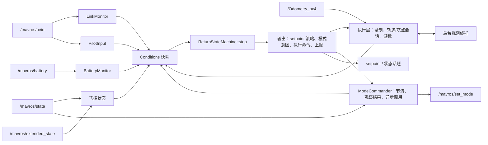
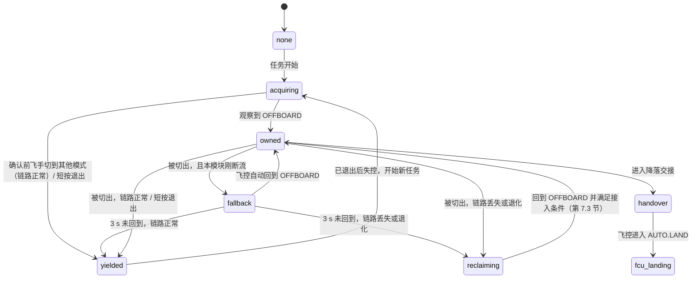
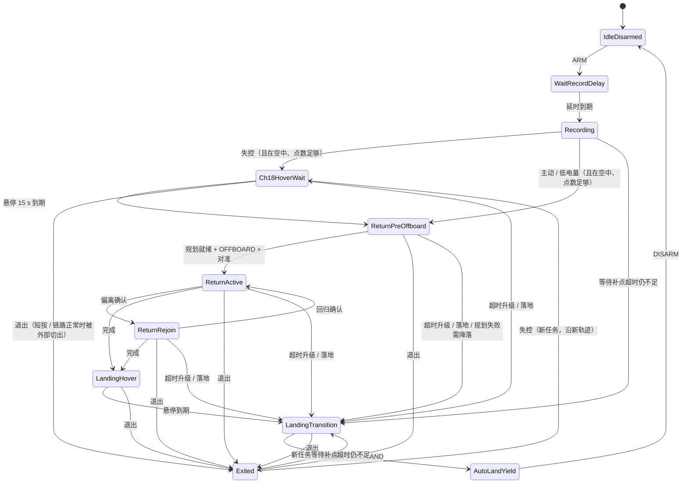

# 返航触发与状态机重构方案

| 项 | 内容 |
| --- | --- |
| 状态 | 已确认（2026-10-20）：第 17 节 Q1–Q12、系统性分析的 M1–M7 全部确认，按第 13 节分阶段实施 |
| 代码基线 | `dev` @ `b3db1c2`（实飞版本） |
| 工作分支 | `feat/return-state-policy` |
| 算法库 | `trajectory_core` `origin/dev` @ `f27f3ad`（dev 依赖其弧长查询接口；机载按 dev 版本，D13） |
| 适用平台 | PX4 v1.15.4（已改固件：`sbus_failsafe` 强制为 false，屏蔽原生 RC 失控保护；CH18 正常为 1400、失控为 800，由 RK3588 判定）、MAVROS 1.x、ROS Noetic、RK3588 |

## 0. 摘要

本方案重构返航模块的触发处理和状态机，解决实飞中"低电量返航过程中失控后不再返航"一类组合触发问题，并把状态机整理为可验证、可维护的结构。核心变化：

1. 任一条件触发返航后，只运行一个返航任务；其余条件每个周期都评估，只记录和上报，不打断返航。
2. 暂停改为退出。退出后模块继续录制；退出后失控时，沿"截断后的轨迹 + 手动飞行段"返航，不直线拉回。
3. 链路丢失期间被外部切出 OFFBOARD 时，重新申请控制权。
4. 所有等待点都有超时，超时后按统一阶梯升级。
5. 状态转移只在状态机内部发生；状态机分为任务阶段、控制权、跟随方式三个并行区域；条件每周期全量评估；输出逐周期计算；轨迹规划移到后台线程，模式请求统一由 `ModeCommander` 发出并观察结果。
6. 固件屏蔽了 PX4 原生 RC 失控保护，失控帧在飞控看来仍是有效遥控输入（第 1.4 节）。接收机失控时摇杆回中，所以手动模式下失控表现为悬停；OFFBOARD 丢失时飞控切到 POSCTL，同样悬停（D10）。方案据此对 CH7 做逐帧门控。超时升级按"悬停优先"调整：返航无法继续时保持悬停，确认低电量才降落（D11）。
7. 实飞中"低电量后失控原地降落"的直接原因还没有确定，需要在 dev 上复现（第 1.4 节、FT0）。
8. 2026-10-20 按危害分析和闭环仿真复审，已按修改建议 M1–M7 修订（D22–D28），依据见[返航程序系统性分析](../reviews/返航程序系统性分析_2026-10-20.md)。

审核中另外发现 4 项必须处理的问题：落地保护缺失、同步规划阻塞控制循环、电量无效值被当作低电量、重新申请控制权后的局部投影窗口。详见第 15 节，需确认的事项见第 17 节。

## 1. 背景与现状问题

### 1.1 实飞现象

低电量触发返航后，遥控器失控（CH18 拉低），飞机原地降落或不再继续返航。单独触发任何一种条件时表现正常。代码层面的问题见第 1.2 节；可能的直接原因和日志区分方法见第 1.4 节末尾。

### 1.2 代码审核结论（dev @ b3db1c2）

| 编号 | 问题 | 位置 | 后果 |
| --- | --- | --- | --- |
| A1 | CH18 只在 `Recording` 状态检测 | [backtrack_usecase.cpp:268](../../src/application/backtrack_usecase.cpp#L268) | 返航中、暂停中失控，模块完全不响应 |
| A2 | RC 超时和低电量的边沿在每周期开头取出，非 `Recording` 状态直接丢弃 | [backtrack_usecase.cpp:252-253](../../src/application/backtrack_usecase.cpp#L252-L253) | 起飞前或录制延时内确认的低电量，本次飞行不再触发返航；同一周期多个触发时，低优先级的被丢弃 |
| A3 | CH7 按下事件没有去抖，返航态内单帧低于 1500 即暂停 | [trigger_evaluator.cpp:73-76](../../src/domain/trigger_evaluator.cpp#L73-L76)、[:117](../../src/domain/trigger_evaluator.cpp#L117) | 失控瞬间的通道跳变可以暂停返航 |
| A4 | 返航开始前已经按下的 CH7，在返航开始后被当作暂停 | 同上 | 飞手按 CH7 想主动返航时恰好被低电量抢先触发，返航立即被暂停 |
| A5 | 暂停后只认 RC 超时或 CH7 长按来恢复，而实机失控时 RC 消息不会中断 | [backtrack_usecase.cpp:308-354](../../src/application/backtrack_usecase.cpp#L308-L354) | 失控期间一旦暂停，永久放弃返航 |
| A6 | 转移权分散：UseCase 通过 6 个命令式接口驱动约一半的转移，其中 `triggerReturn`、`triggerPause`、`triggerLanding` 没有状态守卫；外部转移进入新状态时用的是上一拍输入 | [state_machine.cpp:99-162](../../src/domain/state_machine.cpp#L99-L162) | 行为依赖调用顺序，难以验证 |
| A7 | 输出是跨周期残留的成员变量；`ReturnActive` 拿不到目标时兜底为原点 (0,0,0)、`type_mask=0` | [backtrack_usecase.cpp:634](../../src/application/backtrack_usecase.cpp#L634) | 结构性隐患，目前路径上不可达 |
| A8 | 返航途中被外部切出 OFFBOARD 无处理 | [state_machine.cpp:296-325](../../src/domain/state_machine.cpp#L296-L325) | 既不重新申请，也不让出 |
| A9 | 等待点没有超时升级 | 多处 | OFFBOARD 申请失败、起始对准失败、降落交接失败时无限悬停或重试 |
| A10 | 死代码：`Event` 枚举 18 个值只用到 4 个；`paused_from_state` 只写不读；`detectArmStateChange`、`clearModeRequest` 未调用 | [state_machine.hpp:81-135](../../include/px4_backtrack/domain/state_machine.hpp#L81-L135) | 误导阅读者 |
| A11 | 非触发参数在头文件、ConfigLoader、YAML 三处都有默认值且不一致，例如 `record_min_points` 为 100/100/30 | [config_loader.cpp:69-71](../../src/infrastructure/config_loader.cpp#L69-L71) | YAML 漏键时静默改变行为 |
| A12 | 电量有效性不检查。飞控上报电量未知（`battery_remaining=-1`）时，MAVROS 换算出 `percentage=-0.01` | [trigger_evaluator.cpp:207](../../src/domain/trigger_evaluator.cpp#L207) | 被当作低电量 |

### 1.3 本次审核新增发现

| 编号 | 问题 | 依据 |
| --- | --- | --- |
| B1 | 没有落地保护。手动降落后、自动上锁前，如果失控或低电量被确认，会触发返航，飞机可能起飞并重放整条录制轨迹 | `Recording` 中触发不检查是否在地面 |
| B2 | 轨迹在 20Hz 控制循环里同步生成，生成期间不发 setpoint。生成耗时随点数超线性增长（附录 A：10 分钟录制约 0.61 s，30 分钟约 4.8 s，amd64）。如果当时已在 OFFBOARD（例如失控悬停后进入准备态），超过飞控的 OFFBOARD 丢失超时会回退到 POSCTL，直到 setpoint 恢复后才自动回到 OFFBOARD | [backtrack_usecase.cpp:377](../../src/application/backtrack_usecase.cpp#L377)，附录 A |
| B3 | 局部投影窗口很窄：向后 0.3 m，向前约 0.8 m（Rejoin 时加倍）。飞机漂出窗口后投影失败，现有逻辑会转入 Rejoin 并保持最后合法目标，以不超过 0.3 m/s 的速度朝旧目标直线移动 | [trajectory_session.cpp:16](../../src/domain/trajectory_session.cpp#L16)、[:243](../../src/domain/trajectory_session.cpp#L243) |
| B4 | 降落交接中，只要模式不是 OFFBOARD 就请求 AUTO.LAND。飞手拨开关接管会被每秒一次的请求覆盖 | [state_machine.cpp:355-387](../../src/domain/state_machine.cpp#L355-L387) |
| B5 | RC 消息通道数不足 18 时，CH18 取默认值 1500，被视为"正常"，失控检测静默失效 | [trigger_evaluator.cpp:55-61](../../src/domain/trigger_evaluator.cpp#L55-L61) |
| B6 | 生成失败的分类依赖匹配错误消息里的字符串 | [trajectory_session.cpp:162-165](../../src/domain/trajectory_session.cpp#L162-L165) |
| B7 | `/mavros/state` 由飞控 1 Hz 心跳驱动，模式变化最长约 1 s 后才被感知 | MAVROS sys_status |
| B8 | （复审后撤回）原判断为"`ch7_pressed_threshold=1500` 位于通道中位，余量为零"。CH7 是两档按钮（用户确认），1500 正好是两档的中点，余量最大；只需在台架检查中确认按下、松开的实际值分别落在 1500 两侧 | [backtrack_params.yaml:30](../../config/backtrack_params.yaml#L30) |
| B9 | 前端文档与代码不一致：点数阈值写成 100（实际 30）；"暂停/恢复/原地降落"按钮没有后端接口 | [前端对接开发文档.md](../reference/前端对接开发文档.md) |
| B10 | 定位突跳没有检测，录制轨迹里可能出现跳变段，返航时会沿跳变段直线飞行。按 D15 不处理 | `onOdomReceived` 直接录制 |

### 1.4 固件前提与推论

**固件改动（用户提供）：**
- 在 `sbus_decode` 中把 `*sbus_failsafe` 强制置为 false，PX4 不再触发原生 RC 失控保护。
- 失控通过 CH18 传递，由 RK3588 上的本模块判定：
  ```c
  values[17] = (frame[SBUS_FLAGS_BYTE] & (1 << SBUS_FAILSAFE_BIT)) ? 800 : 1400;
  ```

**接收机设置（用户确认）：**
- 失控时持续输出 SBUS 帧（接收机默认）；
- 开关通道的失控值为保持；
- CH7 是按钮；
- 横滚、俯仰、偏航、油门四个摇杆通道失控时回中，目前失控时的飞行表现是悬停。

对照 PX4 `v1.15.4` 标签的源码，得到以下推论。参数值均为 v1.15.4 默认值，机载以实际为准（第 14.4 节核对）。

| 编号 | 事实 | 依据（PX4 v1.15.4） | 对本方案的影响 |
| --- | --- | --- | --- |
| F1 | 原生解码中，CH17、CH18 是 SBUS 数字通道，只会是 998 或 1998。改动后的固件把 CH18 改写为失控标志：正常帧 1400，失控帧 800。CH18 是离散值，阈值 900 与两侧的距离为 100 和 500 | `src/lib/rc/sbus.cpp`（`sbus_decode` 数字通道解码） | 增加值域检查；出现 998 或 1998 说明飞控刷的可能是原生固件（第 5.1 节） |
| F2 | CH18 = 800 与其余通道来自同一个 SBUS 帧。经 `input_rc` → MAVLink `RC_CHANNELS` → `/mavros/rc/in` 后仍在同一条消息里，`RC_CHANNELS` 直接取 `input_rc` 的原始值 | `src/modules/mavlink/streams/RC_CHANNELS.hpp` | 可以逐帧门控：CH18 低的那一帧里，其余通道都是接收机的失控输出，不是飞手输入 |
| F3 | `rc_failsafe` 恒为 false，`rc_update` 把失控帧当作有效遥控输入：摇杆值照常进入 `manual_control_setpoint`，开关值照常进入 `manual_control_switches` | `src/modules/rc_update/rc_update.cpp`（`signal_lost` 判定） | 见 F4–F7 |
| F4 | 手动模式（POSCTL、ALTCTL、STABILIZED）在失控期间按接收机失控输出飞行，即失控预设值或保持的最后值。油门失控值低于中位时，POSCTL 会持续下降直到落地 | 同上 | 摇杆失控值回中（用户确认），所以失控时 POSCTL 是悬停。悬停不会返航，本模块仍需重新取得 OFFBOARD（D2） |
| F5 | 开关通道按变化动作：模式开关、解锁/急停开关、返航/悬停/OFFBOARD 开关的值一旦变化，飞控立即执行。失控输出如果改变了这些通道的值，失控瞬间和恢复瞬间各执行一次 | `src/modules/manual_control/ManualControl.cpp`（`processSwitches`） | 开关通道失控值为保持（用户确认），失控瞬间不会变化。恢复瞬间，如果飞手在失控期间拨过开关，飞控会在恢复时执行；模式变化由 reclaim 处理（D2、第 16 节） |
| F6 | 摇杆超控：`COM_RC_OVERRIDE` 第 0 位（默认开）使自动模式（含 AUTO.LAND）在摇杆变化超过 `COM_RC_STICK_OV`（默认 30%）时切到 POSCTL。实时值与失控值之间的跳变也算摇杆变化。第 1 位默认关，OFFBOARD 不受影响 | `src/modules/commander/Commander.cpp`（"Pilot took over using sticks"）、`ManualControl.cpp`（`sticks_moving`） | 链路丢失期间，AUTO.LAND 可能被切到 POSCTL 并一直悬停，降落中断（第 7.6 节） |
| F7 | OFFBOARD 丢失（setpoint 中断超过 `COM_OF_LOSS_T`，默认 1.0 s）后按 `COM_OBL_RC_ACT` 处理，默认 0 = 位置模式。遥控在飞控看来始终可用，所以会切到 POSCTL。这是模式回退，不改变用户意图，setpoint 恢复后 PX4 自动回到 OFFBOARD（`failsafe.cpp` 的 `checkModeFallback`；见系统性分析 N1） | `src/modules/commander/commander_params.c` | 用户决定保持 POSCTL（D10）。同步规划阻塞（B2）或节点异常时，飞机进入 POSCTL；链路丢失时摇杆失控值回中，所以是悬停 |
| F8 | 改动不覆盖两种情形：SBUS 帧完全中断时，PX4 仍按 RC 超时触发原生失控保护（`NAV_RCL_ACT`，默认 2 = Return）；`RC_FAILS_THR` 大于 0 时（默认 0），油门阈值失控判定也仍然生效。接收机失控时持续输出帧（用户确认），所以帧中断只剩硬件故障：断线、接收机掉电 | `rc_update.cpp`、`src/drivers/rc_input/RCInput.cpp` | 此时原生保护与本模块同时动作（第 16 节、Q6）；`RC_FAILS_THR` 在台架检查中核对（第 14.4 节） |
| F9 | SBUS 没有 RSSI 来源时，`RC_CHANNELS` 的 rssi 恒为 255（未知），`/mavros/rc/in` 的 rssi 不能当作链路质量 | `RCInput.cpp`（`fill_rc_in`） | 维持 D6：只有 CH18 |

**系统层面的结论：** 原生失控保护被屏蔽后，失控处理完全依赖"本模块 + 接收机失控输出"。
- 本模块不在运行时（未启动、崩溃、MAVROS 中断），OFFBOARD 丢失后飞控切到 POSCTL（D10），之后按摇杆通道的失控值飞行（F4、F7）。
- POSCTL 中，横滚、俯仰杆控制水平移动，回中时刹停定点；油门杆控制升降，中位定高。四个摇杆失控时回中（用户确认），所以失控时 POSCTL 就是悬停。
- 这一前提由接收机设置保证，本模块不读取这些通道。更换接收机或改设置后，按第 14.4 节重新检查。

**对实飞现象的说明（原因待实飞复现）：**
- 摇杆失控值回中，失控时 POSCTL 是悬停。所以 dev 的"暂停"路径（A3、A5）表现为原地悬停、不再返航，而不是降落。
- 开关通道失控值为保持、CH7 是按钮，失控帧中的 CH7 是失控瞬间的值，通常是松开，"失控输出让 CH7 跳变、触发暂停"的可能性也不大。

能导致"原地降落"、需要排除的路径：

| 路径 | 条件 | 日志特征 |
| --- | --- | --- |
| 点数不足 | 触发时，或暂停中恢复时，录制点数少于 30，直接请求 AUTO.LAND（[backtrack_usecase.cpp:357-375](../../src/application/backtrack_usecase.cpp#L357-L375)、[:308-354](../../src/application/backtrack_usecase.cpp#L308-L354)） | 节点日志 "triggering AUTO.LAND"；状态进入 `LandingTransition` |
| 规划失败 | 判定"点过近"，或航点降级也构建失败（[backtrack_usecase.cpp:409-427](../../src/application/backtrack_usecase.cpp#L409-L427)） | 节点日志 "too-close geometry" 或 "waypoint fallback construction also failed" |
| 其他节点请求 AUTO.LAND | 航线模块（px4_mimic_recorder dev）回放结束时，每 1 s 请求一次 AUTO.LAND（`src/core/fsm_controller.cpp` 的 `updateLandingRequest`）。实飞时航线模块在运行就需要排除 | 航线节点日志 "Mission finished, requesting AUTO.LAND" |
| 飞控自身的其他保护 | 例如数传与遥控共用一条无线链路时的数据链丢失保护（`NAV_DLL_ACT`），或电池保护 | PX4 日志中有 failsafe 事件；模式切换不是任何节点请求的 |

复现方法见第 14.5 节 FT0。原因如果在本模块之外（其他节点或飞控保护），本次重构解决不了，需要单独处理。

## 2. 目标与范围

### 2.1 目标

- G1：单一返航逻辑。返航开始后，其他触发只记录和上报，不打断。
- G2：可预测的退出。只有明确、可靠的飞手指令能结束返航。
- G3：失控可靠。链路丢失期间保证处于返航；退出后失控时，沿新轨迹返航。
- G4：所有等待都有上限（时间或电量），超时后有确定的升级动作。
- G5：结构上，条件每周期全量评估，转移只在状态机内，输出逐周期计算，支持表驱动测试。

### 2.2 不在本轮范围

- 不修改 `trajectory_core` 算法；不做轨迹环路裁剪。
- 不解决航线模块与返航模块同时发 setpoint 的仲裁问题（风险仍在，见第 16 节）。
- 不改变 `AutoLandYield` 的锁存语义。
- 不接入链路质量信号（目前只有 CH18，D19）。
- 不检测定位突跳（D15）。
- 不移植 fix 分支的原路偏移预算、输入时钟体系和数据新鲜度框架；只移植第 12.3 节列出的几项。

## 3. 已确认的决策

| 编号 | 决策 |
| --- | --- |
| D1 | 暂停改为退出。原因：恢复机制不可靠，直线拉回原轨迹危险。退出后，低电量和 CH7 长按只告警 |
| D2 | 链路丢失时被外部切出 OFFBOARD：重新申请控制权，确保仍在返航 |
| D3 | 不管哪个条件触发，只运行一个返航逻辑，状态全部上报，状态机必须知悉所有条件；失控触发的 15 s 悬停不因低电量跳过；链路恢复后继续返航 |
| D4 | 录制开始前确认的低电量只告警，进入 `Recording` 后再返航（起飞阶段打断容易出意外） |
| D5 | 超时升级动作由本方案定义（第 8 节） |
| D6 | 链路信号只有 CH18，做累计判定和退化判定 |
| D7 | 退出后失控：沿新轨迹返航（截断 + 续录） |
| D8 | 测试使用 ROS Noetic Docker，贴合机载环境 |
| D9 | dev 是实飞版本，在 dev 上开分支；fix 和 diagnostics 分支只作参考 |
| D10 | `COM_OBL_RC_ACT` 保持 POSCTL：不了解下方环境时，悬停比直接降落安全得多（2026-10-19） |
| D11 | 超时升级悬停优先：返航无法继续时保持悬停，确认低电量才原地降落；链路丢失且电量读数无效时也保持悬停；里程计中断时无法定点悬停，仍原地降落（2026-10-19，Q12） |
| D12 | PX4 的低电量动作保持只告警（`COM_LOW_BAT_ACT = 0`），低电量动作由本模块负责（2026-10-19，Q10） |
| D13 | 机载 `trajectory_core` 按 `origin/dev`（当前 `f27f3ad`），部署说明中固定版本（2026-10-19，Q1） |
| D14 | 需要落地保护，保证正常降落：在地面不启动返航；任务中检测到落地则直接请求 AUTO.LAND，不起飞（2026-10-19，Q3） |
| D15 | 不检测定位突跳，也不做轨迹断点（2026-10-19，Q5） |
| D16 | 只有失控（CH18 确认或 RC 消息超时）先悬停 15 s；主动和低电量直接返航（2026-10-19，Q6） |
| D17 | Docker 测试脚本和生成耗时基准放进仓库 `scripts/`（2026-10-19，Q7） |
| D18 | `AutoLandYield` 维持锁存（2026-10-19，Q8） |
| D19 | 暂不在固件中导出丢帧标志（2026-10-19，Q11） |
| D20 | 退出方式：返航中 CH7 短按（0.3～2 s，松开时生效）或链路正常时拨模式开关；返航中长按不动作；取消恢复（2026-10-20，Q2） |
| D21 | 采用后台规划，移植 `PlanningWorker`（2026-10-20，Q4） |
| D22 | 本模块自身断流引起的 OFFBOARD 回退不算外部切出：保持任务、继续发布、不申请模式，告警 `OFFBOARD_FALLBACK`（2026-10-20，M1） |
| D23 | 落地保护改为"在空中"的正向判定：飞控未报告落地，且比解锁高度高出 0.5 m 以上（2026-10-20，M2） |
| D24 | 新增 `ModeCommander` 统一发出模式请求：节流、观察是否生效、超时告警，服务调用移出控制回调（2026-10-20，M3） |
| D25 | OFFBOARD 确认前，链路正常时飞手把模式切到 OFFBOARD 以外的模式，视为接管，进入 `Exited`（2026-10-20，M4） |
| D26 | 状态机按任务阶段、控制权、跟随方式三个并行区域组织，上报字符串不变（2026-10-20，M5） |
| D27 | 申请 OFFBOARD 前的预发帧数从 20 改为 6（0.3 s）（2026-10-20，M6） |
| D28 | 系统性分析的闭环场景 H01–H14 作为 R3 起的验收测试，dev 的结果作为反例对照（2026-10-20，M7） |

## 4. 总体设计

### 4.1 分层与数据流



### 4.2 设计原则

- P1：检测与决策分离。条件层只输出电平值，以及带编号的按键指令，自己不做取舍；状态机决定是否响应，不会丢弃条件。
- P2：单一转移入口。所有转移都在 `step(conditions)` 中完成，UseCase 不直接改状态。
- P3：输出逐周期计算。setpoint 策略和模式意图由当前状态和条件算出；拿不到目标时保持当前位置，绝不输出原点。
- P4：安全不对称。让飞机更安全的指令（主动返航）在信号退化时照常接受；降低安全的指令（退出、外部切出）只在链路正常时接受。
- P5：控制线程不阻塞：规划放在后台线程，模式服务调用异步执行（D24）。
- P6：一切等待都有上限（时间或电量）。不了解下方环境时，悬停优先于降落（D10、第 8 节）。
- P7：控制权显式化。是否发布 setpoint、是否请求模式，取决于区域 B 的控制权状态；模式变化要区分来源：飞手、飞控回退、本模块自身（D22、D25、D26）。

## 5. 条件层

条件层的组件只做检测，每周期输出一份 `Conditions` 快照，不包含任何状态转移。

### 5.1 LinkMonitor（链路）

输入：每帧 RC 消息的 CH18 值和接收时间。CH18 与其余通道同帧到达（F2），逐帧判定。

| 输出 | 判定 |
| --- | --- |
| `ch18_low_now` | 当前帧 CH18 < `ch18_failsafe_threshold`（900） |
| 值域检查 | 正常帧 CH18 应为 1400，失控帧为 800（F1）。出现其他值时告警 `CH18_UNEXPECTED`，仍按阈值判定。998 或 1998 是原生解码的值，说明飞控刷的可能是原生固件：模块的失控检测失效，由 PX4 原生保护处理 |
| 漏桶 `loss_bucket_s` | CH18 低时每秒加 1，正常时每秒减 `link_loss_leak_rate`（0.2），最小为 0 |
| `link_lost`（来源 ch18） | `loss_bucket_s` ≥ `ch18_confirm_s`（1.0）。连续掉线 1 s 时，结果和现有判定完全一致 |
| `link_lost`（来源 rc_timeout） | 沿用 `rc_loss_timeout_s` + `rc_loss_debounce_s` |
| `link_lost` 清除 | CH18 连续正常至少 `link_recover_s`（2.0），且 RC 消息正常。漏桶不清零，按泄漏率继续下降，所以恢复后短时间内再次掉线会更快确认 |
| `link_degraded` | 最近 `link_degraded_window_s`（5.0）内出现过 CH18 低或 RC 消息超时，或 `link_lost` 为真 |
| 通道检查 | 启用了 CH18，但 RC 消息通道数少于 18 时，告警 `CH18_UNAVAILABLE`，不再静默视为正常 |

几个时序示例：
- 连续掉线：1.0 s 确认。
- 每秒掉 0.3 s：约 6 s 确认。
- 每 2 s 掉 0.1 s：不会确认，只报退化。

局限：CH18 只反映接收机宣布的失控。接收机宣布失控前有自己的保持时间，期间输出最后一帧的值。丢包时长不足以让接收机宣布失控时，模块看不到（见第 16 节）。

### 5.2 PilotInput（CH7）

- 每帧更新：`pressed = CH7 < ch7_pressed_threshold`。
- 链路门控（逐帧，依据 F2）：当前帧 `ch18_low_now` 为真或 RC 超时时，该帧的通道值是接收机失控输出，视为不可信：不计时、不产生指令，当前按下作废。
- 按下沿：只有前一帧和当前帧都是正常帧、前一帧松开、当前帧按下，才算一次新按下：`press_id` 加 1，并记录按下开始时间。门控结束后，必须先在正常帧中看到松开，才接受下一次按下。这样：
  - 失控帧中 CH7 为"按下"时（例如失控瞬间飞手正按着，接收机保持了这个值），恢复瞬间跳回松开不会被当作一次短按；
  - 恢复时飞手正按着 CH7，这次按下也不算。
- 指令以 `press_id` 标识，同一次按下最多生效一次。由状态机消费，并记录已消费的 `press_id`。

| 指令 | 条件 |
| --- | --- |
| `return_request` | 同一次按下持续 ≥ `ch7_hold_s`（2.0 s）；链路未丢失（允许退化） |
| `exit_request` | 同一次按下持续 ≥ `ch7_exit_min_s`（0.3 s），并在 `ch7_hold_s` 之前松开（**短按，松开时生效**）；按下开始时间晚于当前返航任务的开始时间；按下全程链路正常，没有退化 |

为什么退出要求"短按、松开时生效"：
- 返航中长按 CH7 不会误退出。飞手可能并不知道返航已经被其他条件触发，又按 CH7 想"触发返航"（对应现状问题 A4）。
- 紧急接管可以直接拨模式开关，链路正常时立即生效（第 7.2 节）。

### 5.3 BatteryMonitor（电量）

- 有效性：`percentage` 为 NaN、小于 0 或大于 1 时视为无效，不参与判定，并告警 `BATTERY_INVALID`。
- `battery_low`：有效读数持续低于 `low_battery_threshold` 达到 `low_battery_confirm_s` 后置位，锁存到本次飞行结束（新的飞行周期复位）。
- 读数无效期间，`battery_low` 保持原值。超时升级不把"无效"当作低电量（D11），相应风险见第 16 节。
- 是电平语义，不存在"被消费"。

### 5.4 落地与在空中判定

新增订阅 `/mavros/extended_state`（`mavros_msgs/ExtendedState`）。

`airborne`（在空中）是正向判定，两个条件同时满足才为真（D23）：
- `landed_state ≠ ON_GROUND`；没有收到消息或状态未定义时，视为满足；
- 当前里程计高度比解锁高度 `z_arm` 高出 `airborne_min_height_m`（0.5 m）。`z_arm` 在每个飞行周期开始（解锁）时记录。

不能只看 `landed_state` 的原因（系统性分析 N2）：PX4 判定落地需要"指令下降 + 低推力"。触地瞬间关遥控器时摇杆回中，OFFBOARD 原地保持时 setpoint 不带下降速度，这两种情况下 PX4 都不会报告落地，也不会自动上锁（仿真 H06a）。

落地保护有两层：
- `airborne` 为假时不启动任务（第 6.4 节）。
- 任务的悬停、准备阶段 `airborne` 变为假时，直接请求 AUTO.LAND，不起飞（第 6.3 节规则 3）。AUTO.LAND 会给出下降指令，飞控随后判定落地，并按 `COM_DISARM_LAND` 上锁。跟随、到点、交接阶段只看 `landed_state == ON_GROUND`，因为返航路径的末端本来就可能贴近起飞高度。

局限：降落在比起飞点高的平台上时，高度条件不起作用，只能依赖 PX4 的判定；SLAM 的高度漂移需要在实飞中评估（第 16 节）。

### 5.5 输入新鲜度

| 条件 | 判定 |
| --- | --- |
| `odom_stale` | 距最近一次 odom 超过 `odom_stale_s`（0.25 s） |
| `odom_lost` | 距最近一次 odom 超过 `odom_timeout_s`（2.0 s） |
| `fcu_state_stale` | 距最近一次 `/mavros/state` 超过 `fcu_state_stale_s`（3.0 s）；MAVROS 心跳为 1 Hz |

接收时间统一取回调时刻的 `ros::Time::now()`。dev 的 `onRCReceived` 已经是这样做的。

### 5.6 执行事实

以下事实由执行层提供，作为条件的一部分：

| 事实 | 含义 |
| --- | --- |
| `has_min_points` | 录制点数 ≥ `record_min_points` |
| `plan_status` | none / pending / ready / ready_fallback / failed_too_close / failed_config / failed_fallback / timeout |
| `aligned` | 起始或重新接入时 yaw 误差 ≤ 15° |
| `remaining_m` | 剩余路径长度，用于停滞判定 |
| `deviation_confirmed` / `rejoin_confirmed` | 沿用现有的持续判定 |
| `finished` | 轨迹或航点降级会话完成 |
| `projection_ok`、`cross_track_m` | 局部投影是否有效、横向偏差 |
| `stream_gap_recent` | 最近 `fallback_window_s`（3 s）内，本模块相邻两次发布 setpoint 的最大间隔 ≥ `fallback_gap_s`（0.5 s）。用于区分飞控回退和外部切出（D22） |
| `mode_request` | `ModeCommander` 提供：最近一次请求的模式、发出时间和结果（已生效 / 未生效 / 失败） |

## 6. 状态机

### 6.1 结构：三个并行区域

状态机按职责分成三个并行区域（D26）。每个区域只回答一个问题，各自的转移表都很小，可以分别穷举；组合行为只由下面几条耦合决定。

| 区域 | 状态 | 回答的问题 |
| --- | --- | --- |
| A 任务阶段 | 未解锁、录制前、录制、任务（悬停 → 准备 → 跟随 → 到点 → 交接）、已退出、飞控降落 | 现在要做什么 |
| B 控制权 | `none`、`acquiring`、`owned`、`fallback`、`reclaiming`、`handover`、`yielded`、`fcu_landing`（第 6.2 节） | 现在能不能做 |
| C 跟随方式 | 在路径上、回归路径 | 怎么跟踪路径；只在"跟随"阶段有效 |

区域之间的耦合：
1. 区域 B 不处于 `owned` 时，区域 C 冻结进度，停滞计时和准备计时也冻结（R-18）。
2. 区域 B 判定为飞手接管（第 6.3 节规则 4b、4c），或收到短按退出 → 区域 A 进入"已退出"，区域 B 进入 `yielded`。
3. 区域 B 的 `reclaiming` 超时 → 按第 8.1 节升级 → 区域 A 进入"交接"。
4. 区域 A 的悬停、准备阶段让区域 B 从 `none` 进入 `acquiring`；交接阶段让区域 B 进入 `handover`，把控制交给 AUTO.LAND。
5. 任务中判定落地（第 5.4 节）→ 区域 A 进入"交接"，直接请求 AUTO.LAND。

上报给前端的状态字符串由三个区域推导。现有字符串保持不变；删除 `Paused`，新增 `Exited`。

| 状态字符串 | 区域 A | 区域 B | 区域 C | 语义 |
| --- | --- | --- | --- | --- |
| `IdleDisarmed` | 未解锁 | `none` | — | 未解锁 |
| `WaitRecordDelay` | 录制前 | `none` | — | 解锁后的录制延时 |
| `Recording` | 录制 | `none` | — | 录制中 |
| `Ch18HoverWait` | 任务·悬停 | `acquiring` 或 `owned` | — | 失控触发后悬停 `ch18_hover_wait_s`（15 s）；后台规划同时进行 |
| `ReturnPreOffboard` | 任务·准备 | `acquiring` 或 `owned` | — | 等规划、进 OFFBOARD、起始对准 |
| `ReturnActive` | 任务·跟随 | `owned` 等 | 在路径上 | 沿轨迹返航 |
| `ReturnRejoin` | 任务·跟随 | `owned` 等 | 回归路径 | 沿路径低速回归 |
| `LandingHover` | 任务·到点 | `owned` 等 | — | 到点悬停 |
| `LandingTransition` | 任务·交接 | `handover` | — | 降落交接 |
| `Exited` | 已退出 | `yielded` | — | 飞手退出后：不控制、继续录制、只告警；失控时启动新任务 |
| `AutoLandYield` | 飞控降落 | `fcu_landing` | — | 飞控降落已接管，锁存到上锁 |

"`owned` 等"指任务中区域 B 也可能处于 `fallback` 或 `reclaiming`。此时状态字符串不变，由上报字段 `control` 区分。

### 6.2 区域 B：控制权（上报字段 `control`）

| 值 | 含义 |
| --- | --- |
| `none` | 未参与控制 |
| `acquiring` | 正在申请 OFFBOARD，尚未确认 |
| `owned` | 本任务内已确认 OFFBOARD，且当前就是 OFFBOARD |
| `fallback` | 本模块刚断流，飞控回退到 POSCTL；继续发布，等飞控自动回到 OFFBOARD（D22） |
| `reclaiming` | 链路丢失或退化时被切出，正在重新申请（第 7.3 节） |
| `handover` | 降落交接中，正把控制交给 AUTO.LAND |
| `yielded` | 已退出，控制交还飞手 |
| `fcu_landing` | 飞控降落已接管（`AutoLandYield`） |

"OFFBOARD 已确认"是任务级标志：本任务内一旦观察到 `mode == OFFBOARD` 就置位，新任务开始时清零。



图中省略了：任意值在上锁时回到 `none`；任意值在飞控进入 AUTO.LAND 时进入 `fcu_landing`；升级降落或任务中落地时进入 `handover`。

### 6.3 转移规则（每周期按优先级判定，命中后不再继续）

1. 未解锁：进入 `IdleDisarmed`。新的飞行周期（从未解锁到解锁）开始时，复位任务、轨迹、电量锁存和按键编号，并记录解锁高度 `z_arm`（第 5.4 节）。
2. 已解锁且 `mode == AUTO.LAND`：进入 `AutoLandYield`，锁存到上锁（与现在相同）。PX4 的 Descend 也上报为 AUTO.LAND。锁存期间链路丢失、模式离开 AUTO.LAND 时，重新请求 AUTO.LAND（第 7.6 节）。
3. 任务中落地（D23）：悬停或准备阶段 `airborne` 为假，或其他阶段 `landed_state == ON_GROUND`：进入 `LandingTransition`，直接请求 AUTO.LAND，告警 `MISSION_LANDED`（第 5.4 节）。
4. 任务中的模式变化（`/mavros/state` 新鲜时判定）：
   - a. 回退（D22）：OFFBOARD 已确认，当前模式不是 OFFBOARD，且 `stream_gap_recent` 为真（第 5.6 节）→ 区域 B 进入 `fallback`：保持任务、继续发布 setpoint、不申请模式，告警 `OFFBOARD_FALLBACK`。飞控在 setpoint 恢复后会自动回到 OFFBOARD（F7）。`fallback_timeout_s`（3 s）内仍未回到 OFFBOARD 时，按 b 处理。
   - b. 外部切出：OFFBOARD 已确认，当前模式不是 OFFBOARD，且不属于 a：
     - 链路正常（没有退化）：进入 `Exited`，原因 `EXTERNAL_MODE`；
     - 链路丢失或退化：进入 `reclaiming`（第 7.3 节）。
   - c. 确认前接管（D25）：OFFBOARD 尚未确认，链路正常，当前模式既不是任务开始时的模式，也不是 OFFBOARD → 进入 `Exited`，原因 `EXTERNAL_MODE`。
   - 例外：`LandingTransition` 中我方已经请求了 POSCTL 或 AUTO.LAND，所以 POSCTL 属于预期模式，不算切出。链路丢失或退化时，`LandingTransition` 中出现其他模式也不进入 `reclaiming`，而是继续请求 AUTO.LAND（第 7.6 节）。
5. 任务中收到 `exit_request`：进入 `Exited`，原因 `PILOT_EXIT`。
6. 命中超时升级（第 8 节）：进入 `LandingTransition`，直接请求 AUTO.LAND。
7. 执行当前状态自身的规则（见第 6.6 节状态图）。

### 6.4 策略矩阵（条件 × 状态）

| 条件 | 录制前（Idle / WaitRecordDelay） | Recording | 返航任务中 | Exited |
| --- | --- | --- | --- | --- |
| `return_request`（CH7 长按） | 忽略 | 启动任务，原因：主动 | 记录，不动作 | 告警 |
| `exit_request`（CH7 短按） | — | — | 进入 `Exited` | — |
| `link_lost` | 告警 | 启动任务，原因：失控，先悬停 | 记录并上报，继续返航 | 启动新任务，原因：失控，先悬停，沿新轨迹 |
| `link_degraded` | 告警 | 告警 | 告警，拒绝退出 | 告警 |
| `battery_low` | 告警 | 启动任务，原因：低电量 | 记录并上报，继续返航 | 告警 |
| `airborne` 为假 | — | 不启动任务，告警；恢复后重新判定 | 按第 6.3 节规则 3 直接请求 AUTO.LAND，不起飞 | 不启动新任务 |
| 飞控回退（本模块刚断流） | — | — | 保持任务，继续发布，告警 | — |
| 外部切出（链路正常） | — | — | 进入 `Exited`，含 OFFBOARD 确认前飞手切换模式 | — |
| 外部切出（链路丢失或退化） | — | — | 重新申请 | — |
| `AUTO.LAND` | 让步 | 让步 | 让步 | 让步 |
| 点数不足 | — | 最多等 `return_pending_max_s`（3 s）补点，仍不足则原地降落 | — | 同左 |
| `odom_stale` / `odom_lost` | 告警 | 告警，暂停录制 | 冻结并保持，超时按第 8 节 | 告警 |
| 模式请求未生效（第 7.7 节） | — | — | 告警，按间隔重发 | — |

补充规则：
- **同周期多个条件成立：** `Recording` 中同一周期有多个条件成立时，只启动一个任务。只要其中有失控，就走悬停路径。原因记录第一个成立的条件，其余写入任务的"已出现条件"。
- **点数不足时的等待：** `Recording` 中触发但点数不足时，状态保持为 `Recording`，上报 `RETURN_PENDING`，等待期间其他条件照常累计。这一条保证 D4：进入 `Recording` 时已经成立的低电量，会在补足点数后返航（30 点约 2 s），而不是直接降落。失控触发时，等待期间飞机处于 POSCTL，摇杆失控值回中，所以是悬停。

### 6.5 每周期输出

状态机每周期输出 setpoint 和"模式意图"；何时真正发送模式请求，由 `ModeCommander` 决定（第 7.7 节）。

| 状态 / 区域 B | setpoint | 模式意图 |
| --- | --- | --- |
| Idle / WaitRecordDelay / Recording | 无 | 无 |
| `Ch18HoverWait` | 保持触发点 | 预发 `pre_offboard_setpoint_count`（6 帧，0.3 s）后为 OFFBOARD |
| `ReturnPreOffboard` | 保持触发点；规划就绪后 yaw 改为路径起始切向 | OFFBOARD |
| `ReturnActive` | 轨迹目标；拿不到目标时保持当前位置 | OFFBOARD |
| `ReturnRejoin` | 限速后的轨迹目标；拿不到目标时保持当前位置 | OFFBOARD |
| `fallback`（区域 B） | 照常输出当前状态的 setpoint（跟随进度冻结） | 无，等飞控自动回到 OFFBOARD |
| `reclaiming`（区域 B） | 保持进入 `reclaiming` 时的位置；yaw 在跟随阶段为路径目标切向，其他阶段沿用原保持 yaw | OFFBOARD |
| `LandingHover` | 保持到点位置 | OFFBOARD |
| `LandingTransition` | 飞控离开 OFFBOARD 之前保持 | 链路正常：POSCTL → AUTO.LAND；链路丢失、升级降落或已落地：直接 AUTO.LAND |
| `Exited` | 飞控离开 OFFBOARD 之前保持当前位置 | 处于 OFFBOARD 时为 POSCTL，之后无 |
| `AutoLandYield` | 无 | 无；链路丢失且模式不是 AUTO.LAND 时为 AUTO.LAND |

`Ch18HoverWait` 和 `ReturnPreOffboard` 的输出由同一个函数计算：保持位置、预发 setpoint、申请 OFFBOARD。两者只差离开条件：前者是悬停时长到期，后者是规划就绪、进入 OFFBOARD 并完成对准。dev 中这两段重复的预发和切 OFFBOARD 逻辑（[state_machine.cpp:219-294](../../src/domain/state_machine.cpp#L219-L294)）由此合并（D16、R-37）。

预发帧数从 20 改为 6（D27）：PX4 进入 OFFBOARD 只要求最近 1 s 内有 setpoint（`offboardCheck.cpp`），0.3 s 的连续发布已经足够，失控后能更快进入 OFFBOARD。

是否录制：只在 `Recording` 和 `Exited` 中录制。

是否发布 setpoint：录制前和 `Recording` 中都不发布。`Recording` 中航线模块可能正在用 OFFBOARD 飞行，本模块在任务开始前发布 setpoint 会提前与航线模块冲突（R-33）。

### 6.6 区域 A 状态图



图中省略了两类转移：任意状态在 DISARM 时回到 `IdleDisarmed`；任意已解锁状态在 `AUTO.LAND` 时进入 `AutoLandYield`。区域 B 的回退和重新申请不改变区域 A 的状态，见第 6.2 节。

## 7. 关键机制

### 7.1 返航任务（mission）

- 同一时刻最多一个任务。
- 任务开始时记录：
  - `id`：本次飞行内递增；
  - 原因：首个成立的条件；
  - 开始时刻的条件集合和开始时间；
  - 轨迹快照：任务期间不录制，录制缓存就是快照。
- 任务期间新出现的条件，写入"已出现条件"并记录首次出现时间，同时上报，但不改变流程（D3）。
- 任务以 `AutoLandYield`、`Exited` 或上锁结束。在 `Exited` 中失控会开始新任务（`id + 1`）。

### 7.2 退出

**进入退出的四种情况：**
- 收到 `exit_request`；
- 链路正常时被外部切出 OFFBOARD，不含本模块自身断流引起的回退（D22）；
- OFFBOARD 确认前，链路正常时飞手把模式切到 OFFBOARD 以外的模式（D25）；
- 里程计中断超时且链路正常（第 8 节）。

**退出时的动作：**
1. 取消规划；
2. 截断轨迹（第 7.4 节）；
3. 恢复录制；
4. 飞控离开 OFFBOARD 之前，保持当前位置并请求 POSCTL。3 s 仍未生效就告警并继续请求，飞手也可以直接拨开关。

**退出后：** 低电量和 CH7 长按只告警；失控启动新任务。

### 7.3 链路丢失时重新申请控制权（reclaim）

- **进入条件：** 任务中，OFFBOARD 已确认，当前模式不是 OFFBOARD 也不是 AUTO.LAND，链路丢失或退化，并且不是本模块自身断流引起的回退（D22）。
- **期间动作：**
  - 保持进入时的位置，模式意图为 OFFBOARD，由 `ModeCommander` 按间隔发送（第 7.7 节）；
  - yaw：任务处于 `ReturnActive` 或 `ReturnRejoin` 时设为路径目标切向，其他状态沿用该状态原本的保持 yaw；
  - 冻结返航进度、游标、停滞计时和准备计时，由 reclaim 自己的超时负责升级，避免重复升级；
  - 失控悬停的 15 s 照常计时。
- **结束条件：**
  - 所有状态都要求观察到 OFFBOARD。
  - 任务处于 `ReturnActive` 或 `ReturnRejoin` 时，还必须同时满足：
    1. yaw 误差 ≤ 15°；
    2. 局部投影有效，且横向偏差 ≤ `reclaim_max_offset_m`（1.0 m）。

  满足后：横向偏差 ≤ `rejoin_trigger_dist_m` 时回到原状态；否则进入 `ReturnRejoin`，沿路径低速收敛。
- **投影失败或偏差超过 1.0 m：** 原地保持并告警 `RECLAIM_OFFSET`，不直线拉回；从此刻起计时 `reclaim_timeout_s`，到时按第 8.1 节升级。这一条处理的是 B3：飞机漂出投影窗口时，现有逻辑会朝旧目标直线移动。
- **超时：** 3 s 告警；10 s 仍未回到 OFFBOARD，按第 8.1 节升级。
- **不与飞控降落争夺控制：** 对 AUTO.LAND（PX4 的 Descend 也上报为 AUTO.LAND）始终让步。

### 7.4 退出后沿新轨迹返航

**游标：** 用来定位返航已经走到哪个录制点。
- 任务开始时，`cursor` 指向轨迹末点，即触发点。
- `ReturnActive` 和 `ReturnRejoin` 中每个周期：从 `cursor` 往前 `cursor_window_m`（2.0 m）弧长范围内，找离"路径投影点"最近的录制点（航点降级时改用飞机位置）。
- `cursor` 只减不增；距离相同时取更小的索引。
- 窗口按弧长划分，所以悬停时堆积的密集点能一次跨过；只做局部搜索并且单调推进，路径自交时也不会误判。

**截断：**
- 退出时只保留 `[0, cursor]` 段。
- 退出位置与 `p[cursor]` 之间由规划直接连接。退出前飞机一直在沿路径跟踪，这段连接通常很短；不做检测（D15，第 16 节）。

**续录：**
- `Exited` 中继续录制。
- 时间戳平移接续：第一个新点 = 末点时间 + 1/`record_max_hz`。这样可以避免 `trajectory_core` 因大间隙报告时间回退。

**新任务：** `Exited` 中链路丢失时，走与 `Recording` 相同的启动检查：在地面不启动，点数不足先等待补点。检查通过后进入 `Ch18HoverWait`，后台规划"截断后的轨迹 + 手动段"，然后返航。

**特例：**
- 在准备阶段退出（飞机还没沿返航路径移动）：不截断。
- 在 `LandingHover` 或 `LandingTransition` 退出：截断到起点。

**局限：** 不做环路裁剪。如果手动段绕回了起点附近，新任务仍会先沿手动段飞回截断点，再回起点。

### 7.5 后台规划

**依据：** 附录 A 的实测数据和问题 B2。

**设计：** 移植 fix 分支的 `PlanningWorker`：
- 单工作线程，最多一个待处理请求；
- 用代次号丢弃过期结果；
- 正在运行的求解无法强行终止，取消时只丢弃结果。

**流程：**
- 任务一开始就提交规划，所以失控悬停的 15 s 期间规划在同时进行；
- 控制线程持续发布保持点；
- UseCase 持有的 `TrajectorySession` 改为 `unique_ptr`，规划结果在控制线程里接收。

**结果的处理时机：** `Ch18HoverWait` 期间返回的规划结果先保存，悬停结束、进入 `ReturnPreOffboard` 后再处理，包括需要降落的失败结果。这样 15 s 悬停不会被提前结束（D3）。

**失败处理（保留 dev 策略）：**

| 规划结果 | 处理 |
| --- | --- |
| 点过近 | 原地降落 |
| 配置非法 | 改为启动时校验并退出（R7）；运行时若仍出现，保持并告警，由准备阶段超时兜底 |
| 其他失败 | 航点降级，降级会话在后台线程构建 |
| 航点降级也构建失败 | 原地降落 |

**规划超时：** 超过 `planning_timeout_s`（30 s）就丢弃结果，在控制线程直接构建航点降级。这一步是 O(n)，很快。

**其他：**
- CSV 和 RViz 导出也移到后台线程。
- 单测注入同步规划器，保证结果确定。

### 7.6 降落交接

- **链路正常：** 沿用 OFFBOARD → POSCTL → AUTO.LAND，以规避直接切 AUTO.LAND 时的航向突变。POSCTL 3 s 未生效则直接请求 AUTO.LAND。
- **链路丢失、升级降落或已落地：** 直接请求 AUTO.LAND。链路丢失时不经过 POSCTL，不依赖接收机的失控设置（F4）。
- **飞手接管：** 只在链路正常（没有退化）时判定。交接期间收到 `exit_request`，或模式变成 OFFBOARD、POSCTL、AUTO.LAND 以外的其他模式，视为飞手接管，进入 `Exited`。这一条处理问题 B4。链路丢失或退化时出现其他模式，不视为飞手接管，继续请求 AUTO.LAND。
- **AUTO.LAND 迟迟不生效：** 5 s 告警，持续请求。
- **AUTO.LAND 被切走（`AutoLandYield` 中）：**
  - 链路丢失期间，AUTO.LAND 可能被摇杆超控（F6）或恢复瞬间的模式通道变化（F5）切到 POSCTL。摇杆失控回中，飞机会一直悬停，降落中断。
  - 处理：`AutoLandYield` 中只要链路丢失、模式不是 AUTO.LAND，模式意图就是 AUTO.LAND，由 `ModeCommander` 按间隔（1 s）发送，并告警 `AUTOLAND_OVERRIDDEN`。不发 setpoint，不重启返航（锁存语义不变，Q8）。
  - 链路正常时维持现有语义：飞手从 AUTO.LAND 接管后，模块不再干预。
  - 判定用的是"链路丢失"，不含退化：失控瞬间的跳变发生在确认之前，但确认后按电平补发请求；短暂掉线（不足以确认）时，飞手很快恢复控制，模块不干预。

### 7.7 模式请求（ModeCommander）

所有 `set_mode` 都由 `ModeCommander` 发出，状态机只输出"模式意图"（D24）。依据是系统性分析 N3：dev 中所有模式请求共用一个 1 s 节流，被节流时状态机并不知道；`set_mode` 返回成功只表示"已发出"；服务在 20 Hz 控制回调里同步调用。

- **发送：** 意图改变时立即发送；意图不变时按 `mode_request_interval_s`（1.0 s）重发，直到观察到目标模式。
- **异步：** 服务调用放在单独线程，不阻塞控制回调。
- **观察：** 在 `/mavros/state` 中看到目标模式即为生效。`mode_request_timeout_s`（2.0 s）内没看到，告警 `MODE_REQUEST_FAILED`，并作为条件提供给状态机。
- **失败：** `mode_sent=false` 或服务不可用时立即告警，同样按间隔重试。
- **上报：** 最近一次请求的模式、发出时间和结果。

## 8. 超时与升级

**原则：** 不了解下方环境时，悬停优先于降落（D10、D11）。升级阶梯是：**告警 → 降级（换更简单的方法） → 保持等待 → 原地降落**。

### 8.1 返航无法继续

| 等待点 | 起算时刻 | 告警 | 超时 | 超时后：电量正常或读数无效 | 超时后：低电量 | 参数 |
| --- | --- | --- | --- | --- | --- | --- |
| 后台规划 | 提交规划 | 10 s | 30 s | 改为航点降级 | 同左 | `planning_warn_s` / `planning_timeout_s` |
| 准备：OFFBOARD + 起始对准 | 规划就绪且失控悬停结束 | 10 s | 30 s | 保持并告警，继续尝试 | 原地降落 | `prepare_warn_s` / `prepare_timeout_s` |
| 重新申请控制权（只在链路丢失或退化时出现；含偏差超限后的保持） | 进入 reclaiming，或偏差超限 | 3 s | 10 s | 保持并告警，继续申请 | 原地降落 | `reclaim_warn_s` / `reclaim_timeout_s` |
| 返航进度停滞 | 剩余路径最近一次缩短 ≥ `stall_min_progress_m`（0.2 m） | 20 s | 60 s | 保持并告警 | 原地降落 | `stall_warn_s` / `stall_timeout_s` |

规则：
- "保持并告警"期间，链路正常时由飞手决定是否退出；链路丢失时等待链路恢复。
- 保持期间一旦确认低电量，立即原地降落。所以保持的上限是电量。
- 电量读数无效时同样保持（D11）。这时电池耗尽前没有降落兜底，所以起飞前要确认电量读数有效（第 14.4 节、第 16 节）。
- 与上一版相比有两处变化（R-29）：链路丢失但电量正常或读数无效时，超时后不再原地降落，改为保持等待；里程计中断只看链路，链路正常时一律退出、交给飞手（上一版在低电量时会原地降落）。
- 靠近起点的降落保留 dev 策略：点数不足、"点过近"、航点降级也构建失败（第 6.4、7.5 节）。

### 8.2 交接与输入中断

| 等待点 | 起算时刻 | 告警 | 链路丢失时 | 链路正常时 | 参数 |
| --- | --- | --- | --- | --- | --- |
| 里程计中断 | 最近一次 odom | 0.25 s：告警，同时冻结进度并保持 | 2 s：原地降落（无法定点保持，不等电量） | 2 s：退出，交给飞手 | `odom_stale_s` / `odom_timeout_s` |
| 降落交接：POSCTL | 请求 POSCTL | — | 不经过 POSCTL | 3 s：直接请求 AUTO.LAND | `handover_posctl_timeout_s` |
| 降落交接：AUTO.LAND | 请求 AUTO.LAND | 5 s | 持续请求 | 同左 | `autoland_warn_s` |
| 退出时 POSCTL 生效 | 请求 POSCTL | 3 s | — | 持续请求，飞手可直接拨开关 | `exit_posctl_warn_s` |
| 飞控状态中断 | 最近一次 `/mavros/state` | 3 s | 冻结所有依赖模式的判定 | 同左 | `fcu_state_stale_s` |
| 飞控回退后等待自动恢复 | 进入 `fallback` | 进入时告警 | 3 s 未回到 OFFBOARD：重新申请 | 3 s 未回到 OFFBOARD：退出 | `fallback_timeout_s` |
| 模式请求未生效 | 发出请求 | 2 s：告警 `MODE_REQUEST_FAILED` | 按间隔重发 | 同左 | `mode_request_timeout_s` / `mode_request_interval_s` |

"原地降落"指：从当前模式直接请求 AUTO.LAND，飞控离开 OFFBOARD 之前继续发保持点；飞控进入 AUTO.LAND 后，走现有的 `AutoLandYield`。链路丢失期间 AUTO.LAND 被切走时，按第 7.6 节重新请求。

## 9. 状态上报与告警

| 话题 | 类型 | 变化 |
| --- | --- | --- |
| `/px4_backtrack/state` | `std_msgs/String` | 新增 `Exited`，删除 `Paused` |
| `/status_rc_loss` | `std_msgs/Bool` | 含义改为"链路丢失"：CH18 累计确认或 RC 超时 |
| `/px4_backtrack/low_battery` | `std_msgs/Bool` | 不变，锁存到新的飞行周期 |
| `/px4_backtrack/status`（新增） | `std_msgs/String`（JSON） | 20 Hz 发布，内容见下例 |

```json
{
  "state": "ReturnActive",
  "control": "owned",
  "mission": {"id": 1, "reason": "low_battery", "started_at": 1234.5,
              "conditions_seen": {"link_lost": 1260.2}},
  "conditions": {"link": "lost", "link_source": "ch18", "battery_low": true,
                 "odom": "ok", "landed": "in_air", "airborne": true, "fcu_state": "ok"},
  "mode_request": {"mode": "OFFBOARD", "sent_at": 1236.0, "result": "applied"},
  "alerts": ["LOW_BATTERY", "LINK_LOST"],
  "last_event": "RETURN_STARTED"
}
```

告警码：

| 告警码 | 含义 |
| --- | --- |
| `LINK_LOST` / `LINK_DEGRADED` / `CH18_UNAVAILABLE` / `CH18_UNEXPECTED` | 链路丢失 / 链路退化 / CH18 通道不可用 / CH18 出现 800、1400 以外的值（998、1998 说明可能是原生固件） |
| `LOW_BATTERY` / `BATTERY_INVALID` | 低电量 / 电量值无效 |
| `RETURN_PENDING` | 已触发，等待补足录制点 |
| `TRIGGER_IGNORED_LANDED` | 不在空中（`airborne` 为假），触发被忽略 |
| `MISSION_LANDED` | 任务中判定落地，改为直接降落 |
| `EXIT_REJECTED_LINK` | 链路异常，拒绝退出 |
| `RETURN_EXITED` | 已退出返航 |
| `RECLAIMING` / `RECLAIM_OFFSET` / `RECLAIM_TIMEOUT` | 正在重新申请 / 偏差超限 / 重新申请超时 |
| `OFFBOARD_FALLBACK` | 本模块断流，飞控回退到 POSCTL，正在等待自动恢复 |
| `MODE_REQUEST_FAILED` | 模式请求超时未生效、被拒或服务不可用 |
| `PLANNING_SLOW` / `PLANNING_TIMEOUT_FALLBACK` | 规划慢 / 规划超时已改为航点降级 |
| `PREPARE_SLOW` / `PREPARE_TIMEOUT` | 准备慢 / 准备超时 |
| `PROGRESS_STALL` | 返航进度停滞 |
| `ODOM_STALE` / `ODOM_LOST` | 里程计延迟 / 里程计中断 |
| `HANDOVER_DIRECT_LAND` / `AUTOLAND_NOT_ACCEPTED` / `AUTOLAND_OVERRIDDEN` | 交接改为直接降落 / AUTO.LAND 未生效 / 链路丢失期间 AUTO.LAND 被切走，正在重新请求 |
| `ESCALATED_LAND` | 已升级为原地降落 |
| `FCU_STATE_STALE` | 飞控状态中断 |

## 10. 参数

所有参数改为 YAML 必填，代码中不再保留默认值（解决 A11）。下表是新增参数及写入 YAML 的建议初值：

| 参数 | 建议初值 | 说明 |
| --- | --- | --- |
| `link_loss_leak_rate` | 0.2 | 漏桶每秒泄漏量 |
| `link_recover_s` | 2.0 | 链路恢复所需的连续正常时间 |
| `link_degraded_window_s` | 5.0 | 退化判定窗口 |
| `ch7_exit_min_s` | 0.3 | 退出短按的最短按下时间 |
| `return_pending_max_s` | 3.0 | 点数不足时最长等待 |
| `cursor_window_m` | 2.0 | 游标搜索的弧长窗口 |
| `reclaim_max_offset_m` | 1.0 | 重新接入允许的最大偏移 |
| `planning_warn_s` / `planning_timeout_s` | 10 / 30 | 规划告警 / 超时 |
| `prepare_warn_s` / `prepare_timeout_s` | 10 / 30 | 准备告警 / 超时 |
| `reclaim_warn_s` / `reclaim_timeout_s` | 3 / 10 | 重新申请告警 / 超时 |
| `stall_min_progress_m` / `stall_warn_s` / `stall_timeout_s` | 0.2 / 20 / 60 | 停滞判定 |
| `odom_stale_s` / `odom_timeout_s` | 0.25 / 2.0 | 里程计新鲜度 |
| `fcu_state_stale_s` | 3.0 | 飞控状态新鲜度 |
| `handover_posctl_timeout_s` | 3.0 | 交接中 POSCTL 超时 |
| `autoland_warn_s` / `exit_posctl_warn_s` | 5 / 3 | 告警阈值 |
| `airborne_min_height_m` | 0.5 | 在空中判定：比解锁高度至少高出的距离（D23） |
| `fallback_gap_s` / `fallback_window_s` / `fallback_timeout_s` | 0.5 / 3.0 / 3.0 | 回退判定：自身断流阈值 / 回看窗口 / 等待自动恢复的上限（D22） |
| `mode_request_interval_s` / `mode_request_timeout_s` | 1.0 / 2.0 | 模式请求的重发间隔 / 生效超时（D24），取代状态机里的 `offboard_attempt_interval_s` |

现有参数 `pre_offboard_setpoint_count` 从 20 改为 6（D27）。`ch7_pressed_threshold` 保持 1500：CH7 是两档按钮，1500 是两档的中点（B8 已撤回）。`ch18_failsafe_threshold` 保持 900：CH18 只有 800 和 1400 两个值（F1）。

## 11. 场景与期望行为

以下场景都写成 UseCase 级单测，规划器在单测中注入为同步实现。

| 编号 | 场景 | 期望行为 |
| --- | --- | --- |
| S1 | 低电量返航中失控，CH7 不变 | 继续返航；上报 `link_lost`，`control=owned` |
| S2 | 失控瞬间 CH7 出现单帧低值 | 不退出：链路门控，且单帧不满足短按条件 |
| S3 | 失控后 CH7 持续为低值，恢复瞬间跳回松开 | 不退出：链路丢失期间通道无效；恢复瞬间的松开不算一次短按 |
| S4 | 单独失控（`Recording` 中） | 从第一帧失控帧到进入 OFFBOARD ≤ 1.5 s（D27）；悬停 15 s 后返航；从 R4 起，规划在悬停期间后台进行 |
| S5 | 飞手按住 CH7 时低电量先触发 | 启动低电量任务；这次按下早于任务开始，不算退出；松开后重新短按才退出 |
| S6 | 返航中，链路正常时 CH7 短按 | 进入 `Exited`：截断轨迹，继续录制，请求 POSCTL |
| S7 | 返航中，链路正常时飞手拨模式开关 | 约 1 s 内感知，进入 `Exited` |
| S8 | 返航中长按 CH7 超过 2 s | 不退出、不暂停；记录 `return_request` |
| S9 | 录制延时内低电量 | 只告警；进入 `Recording` 并补足点数后返航 |
| S10 | `Recording` 中 CH18 与低电量同一周期确认 | 失控任务，悬停 15 s；低电量记入任务条件 |
| S11 | 退出后失控 | 新任务：悬停 15 s，沿截断轨迹 + 手动段返航，起点就是当前位置 |
| S12 | 链路丢失时被切出 OFFBOARD | 重新申请：偏移 ≤ 0.5 m 继续；0.5～1.0 m 进入 Rejoin；超过 1.0 m 或投影失败时保持并告警，10 s 后电量正常则继续保持，低电量则原地降落 |
| S13 | 落地未上锁时失控或低电量，包括触地瞬间关遥控器、飞控尚未报告落地的情形 | 不启动任务（高度差 < 0.5 m），告警 `TRIGGER_IGNORED_LANDED`（仿真 H06a、H06b） |
| S14 | 电量值为 -0.01 | 不判为低电量，告警 `BATTERY_INVALID` |
| S15 | 30 分钟录制后失控 | 悬停期间完成后台规划，控制循环不停发 setpoint |
| S16 | 规划超时 | 改为航点降级返航 |
| S17 | 链路丢失时返航进度停滞 60 s | 电量正常或读数无效：保持并告警，不降落；之后确认低电量时原地降落 |
| S18 | 降落交接中飞手拨开关 | 进入 `Exited`，不再请求 AUTO.LAND |
| S19 | 链路丢失期间 odom 中断 2 s | 原地降落 |
| S20 | 每秒掉 0.3 s 的间歇失控 | 约 6 s 后确认失控并返航；之前只报退化 |
| S21 | 链路丢失期间，`AutoLandYield` 中模式被切到 POSCTL（摇杆超控） | 每 1 s 请求 AUTO.LAND，告警 `AUTOLAND_OVERRIDDEN`；链路恢复后停止请求 |
| S22 | CH18 出现 800、1400 以外的值（含原生固件的 998、1998） | 告警 `CH18_UNEXPECTED`，按阈值判定 |
| S23 | 降落交接中链路丢失，模式变为 ALTCTL | 不进入 `Exited`，继续请求 AUTO.LAND |
| S24 | `Recording` 中 CH18 低但未确认（漏桶未满） | 不发布任何 setpoint，不请求模式，只告警退化 |
| S25 | 失控在触地前一刻确认，任务开始后、悬停阶段高度差降到 0.5 m 以下 | 直接请求 AUTO.LAND，上锁，不起飞；告警 `MISSION_LANDED` |
| S26 | 返航中控制循环卡顿 1.3 s，飞控回退 POSCTL（链路正常） | 不退出；继续发布，飞控自动回到 OFFBOARD；告警 `OFFBOARD_FALLBACK`（D22，仿真 H13） |
| S27 | 返航开始、OFFBOARD 确认前飞手把开关拨到 ALTCTL（链路正常） | 进入 `Exited`，不再申请 OFFBOARD（D25，仿真 H14） |
| S28 | 飞控拒绝 OFFBOARD 请求 | 2 s 内告警 `MODE_REQUEST_FAILED`，按间隔重发（D24） |

## 12. 代码改动清单

### 12.1 新增

| 文件 | 内容 |
| --- | --- |
| `domain/link_monitor.{hpp,cpp}` | CH18 漏桶、RC 超时、退化判定、恢复、通道检查 |
| `domain/pilot_input.{hpp,cpp}` | CH7 解析、`press_id`、长按/短按、链路门控 |
| `domain/battery_monitor.{hpp,cpp}` | 有效性检查、确认、锁存 |
| `domain/return_trail.{hpp,cpp}` | 游标、截断、续录时间平移 |
| `domain/return_conditions.hpp` | `Conditions` 结构 |
| `application/planning_worker.{hpp,cpp}` | 从 fix 分支移植，按 dev 的失败策略调整 |
| `application/mode_commander.{hpp,cpp}` | 模式请求：发送、节流、观察结果、超时告警（D24） |
| `domain/airborne_monitor.{hpp,cpp}` | 在空中判定：飞控落地状态 + 与解锁高度的差（D23） |
| `scripts/docker/{Dockerfile,run_tests.sh}` | ROS Noetic 容器编译与单测（已加入，D17） |
| `scripts/bench/{gen_bench.cpp,run_gen_bench.sh}` | 轨迹生成耗时基准（已加入，D17） |
| `scripts/analysis/{hazard_scenarios.cpp,run_hazard_scenarios.sh}` | 闭环危害场景：假飞控 + 真实 UseCase（已加入，见[系统性分析](../reviews/返航程序系统性分析_2026-10-20.md)）；R3 起改为驱动新实现 |

### 12.2 修改

| 文件 | 内容 |
| --- | --- |
| `domain/state_machine.{hpp,cpp}` | 改为 `step(TickInput{conditions})`，按任务阶段、控制权、跟随方式三个区域组织（D26）；删除 `triggerReturn`、`triggerPause`、`triggerLanding`、`enterRejoin`、`exitRejoin`、`startRecording` 和死代码；状态 `Paused` 改为 `Exited`；增加任务数据、回退判定、确认前接管、超时、`AutoLandYield` 链路丢失时重新请求 AUTO.LAND；录制延时计时从 UseCase 移入状态机；输出逐周期计算，模式只输出意图 |
| `domain/recording_buffer.{hpp,cpp}` | 增加截断和时间戳平移 |
| `domain/trajectory_session.{hpp,cpp}` | 增加投影点位置查询；Rejoin 增加完成出口 |
| `domain/waypoint_fallback_session.{hpp,cpp}` | 删除 `restart`（恢复功能已取消） |
| `application/backtrack_usecase.{hpp,cpp}` | 改为"组装条件 + 执行命令"；删除 `handleTriggers` 里的分发；`TrajectorySession` 改为 `unique_ptr`；拿不到目标时保持当前位置 |
| `adapters/ros_subscribers.*` | 新增 `ExtendedStateSubscriber`；回调时记录接收时间 |
| `adapters/ros_services.*` | `set_mode` 改为异步调用；节流和结果观察移到 `ModeCommander` |
| `adapters/ros_publishers.*` | 新增 JSON 状态话题 |
| `src/backtrack_node.cpp` | 接线；`publish_hz` 改为必填；模式请求改由 `ModeCommander` 发出，不在定时器回调里同步调用服务 |
| `infrastructure/config_loader.*`、`config/backtrack_params.yaml` | 全部参数必填，加入新增参数；启动时调用 `TrajectoryConfig::validate()`，非法则节点退出 |
| `domain/trigger_evaluator.*` | 迁移完成后删除，测试一并迁移 |
| `CMakeLists.txt`、`package.xml` | 新增源文件与测试；显式声明 tf2 依赖 |

### 12.3 从 fix 分支移植的内容

| 内容 | 处理 |
| --- | --- |
| `PlanningWorker` | 移植，按 dev 的失败策略调整 |
| 电量有效性过滤、触发器按飞行周期复位 | 移植思路，按新组件重写 |
| 拿不到目标时保持当前位置、Rejoin 完成出口 | 移植 |

以下 fix 分支内容不移植：原路偏移预算、输入时钟体系、`ControlYield`（由本方案的 `Exited` 和 reclaim 替代）。

## 13. 实施阶段

每个阶段单独提交，并在 Docker amd64 中通过全部单测。标注"arm64 复核"的阶段，额外在 QEMU arm64 中复核。

| 阶段 | 内容 | 验收 |
| --- | --- | --- |
| R1 | 条件层：`LinkMonitor`、`PilotInput`、`BatteryMonitor`、在空中判定及单测（此时不接入流程） | 条件层单测通过，覆盖 S2、S3、S13、S14、S20、S22 的检测部分 |
| R2 | 状态机核心：三个区域、`step`、策略矩阵、输出计算、任务数据（纯逻辑，此时不接入流程） | 状态 × 条件表驱动单测通过；穷举所有状态与条件组合，系统性分析的 SC1–SC7、SC9 无违反 |
| R3 | UseCase 接线：条件组装、执行命令、`ModeCommander`、`Exited`（暂不截断）、回退判定、确认前接管、reclaim、落地保护、`AutoLandYield` 重新请求，删除旧分发和 `Paused`；规划暂时保持同步；闭环仿真改为驱动新实现 | S1–S5、S7–S10、S12（不含超时部分）、S13、S14、S18、S21、S23–S28 通过；闭环场景除 H07 外全部通过；现有用例迁移完毕（arm64 复核） |
| R4 | 后台规划 | S15、S16 通过；规划期间 setpoint 不中断；悬停期间到达的结果在悬停结束后才处理；闭环场景 H07：30 分钟录制时 setpoint 最大间隔 < 0.2 s，飞控回退 0 次 |
| R5 | 退出后新轨迹：游标、截断、续录、新任务 | S6、S11 通过 |
| R6 | 超时与升级 | S12 的超时部分、S17、S19 及第 8 节每一行通过；随机长序列检查 SC8（每个等待都在时间或电量上限内结束）（arm64 复核） |
| R7 | 上报、参数必填、清理死代码 | 话题和参数检查通过；节点在容器中能启动 |
| R8 | 文档：README、LLM_MAP、SYSTEM_OVERVIEW、前端对接、测试文档、部署说明（固定 `trajectory_core` 版本，D13）；SITL 和实飞测试清单 | 文档评审通过（arm64 复核） |

建议在 R6 完成后做 SITL，在 R7 完成并通过第 14.4 节台架检查后上实飞。

## 14. 测试计划

### 14.1 单元与场景测试（Docker ROS Noetic）

- **组件单测：** 每个条件组件、轨迹截断与游标、状态机。状态机按"状态 × 条件"表驱动。
- **场景单测：** UseCase 级覆盖第 11 节全部场景，注入同步规划器。
- **穷举不变量：** 对 `step()` 遍历所有"状态 × 条件组合"，检查系统性分析第 4 节的 SC1–SC7、SC9；SC8 用随机长序列检查。
- **闭环场景（D28）：** `scripts/analysis/run_hazard_scenarios.sh`，场景 H01–H14，新实现必须全部通过。dev 的结果作为反例对照：26 项检查中 17 项失败；H13 在 dev 上通过，因为 dev 不处理被切出，它防止的是新实现把回退误判为接管。
- **现有用例：**
  - 状态机 8 个、触发器 10 个、UseCase 13 个，按新接口迁移；
  - 与暂停/恢复相关的用例改为退出语义，或者删除；
  - 其余用例的断言保持不变。
- **环境：**
  - 镜像为 `ros:noetic-ros-base-focal` 加装 mavros 和 Eigen（GCC 9.4，CMake 3.16）；
  - 算法库用 `git archive` 导出 `origin/dev` 后挂载；
  - 一条命令完成编译和单测：`scripts/docker/run_tests.sh [amd64|arm64] [trajectory_core 引用]`；
  - dev 基线为返航 62 个、算法库 111 个用例，全部通过。

### 14.2 性能

- 在 RK3588 上运行生成耗时基准（`scripts/bench/gen_bench.cpp`，编译命令见 `scripts/bench/run_gen_bench.sh`），确认实际的规划时间和超时参数。
- 规划移到后台后，测量控制循环周期的抖动。

### 14.3 SITL

PX4 v1.15.4 SITL + MAVROS，注入 `/mavros/rc/in`（CH7、CH18）和电量数据，回放第 11 节中涉及飞控交互的场景：S1、S4、S6、S7、S11、S12、S13、S15、S18、S21、S26、S27。

在 R3 之前，先在 SITL 中确认系统性分析的两条源码结论，它们分别是 D22 和 D23 的前提：
- N1：本模块断流超过 `COM_OF_LOSS_T` 时飞控回退 POSCTL，setpoint 恢复后自动回到 OFFBOARD；
- N2：触地后摇杆回中（或 OFFBOARD 原地保持）时，飞控不会判定落地。

另外验证 F8：在 SITL 中停止遥控输入，观察 PX4 原生失控保护与本模块悬停、reclaim 的交互（Q6）。

### 14.4 台架检查（拆桨，上实飞前；更换接收机、改接收机设置或刷固件后重做）

1. 关遥控器，记录 `/mavros/rc/in` 的 18 个通道：CH18 应为 800，重新打开后回到 1400。
2. 开关通道的失控值为保持：确认关遥控器前后档位不变（F5）。
3. 确认关遥控器后四个摇杆回中（Q9）。CH7 按下、松开的实际值分别落在 1500 两侧（B8），关遥控器时为松开。
4. 关遥控器和重新打开的瞬间，`/mavros/state` 的模式不变；PX4 日志中没有模式切换或 "Pilot took over using sticks"（F6）。
5. 记录从关遥控器到 CH18 变为 800 的时间，即接收机自身的保持时间。这段时间内接收机输出最后一帧的值，模块看不到失控；短于这个时间的丢包，模块都看不到（第 16 节"部分丢包检测不到"）。
6. 核对机载参数：
   - `RC_FAILS_THR` 为 0（F8）；
   - `COM_RC_OVERRIDE` 第 1 位关闭，失控跳变不会把 OFFBOARD 超控到 POSCTL；
   - `COM_OBL_RC_ACT` 为 0（D10），`COM_LOW_BAT_ACT` 为 0（D12）；
   - 数传与遥控共用一条无线链路时，记录 `NAV_DLL_ACT`；
   - `COM_RC_STICK_OV`、`COM_OF_LOSS_T`、`NAV_RCL_ACT`、`COM_RCL_EXCEPT` 记录在案。

每次起飞前：确认状态话题中没有 `BATTERY_INVALID`、`CH18_UNEXPECTED`、`CH18_UNAVAILABLE` 告警。电量读数无效时，链路丢失后模块不会因为电量而降落（D11）。

### 14.5 实飞（逐项，每项都保留 rosbag，`/mavros/rc/in` 记录全部通道）

| 编号 | 内容 |
| --- | --- |
| FT0 | 在 dev 上复现"低电量返航中关遥控器"，按第 1.4 节确定原地降落的原因。记录 rosbag、各节点日志（航线模块在运行时也要记录）和 PX4 ulog。不依赖本次重构，可以尽早进行；原因如果不在本模块，单独处理 |
| FT1 | 单独触发：CH7、关遥控器失控、低电量（阈值临时调高）。关遥控器后、模块接管前，确认飞机在 POSCTL 下保持悬停 |
| FT2 | 组合触发：低电量 → 失控、主动 → 失控、失控 → 低电量 |
| FT3 | 退出：CH7 短按、拨模式开关、返航中长按 CH7 不退出 |
| FT4 | 退出后关遥控器：沿新轨迹返航 |
| FT5 | 关遥控器的同时由地面站切模式：验证重新申请控制权 |
| FT6 | 拉远距离制造信号不稳：观察退化告警与累计确认 |
| FT7 | 落地未上锁时关遥控器（需安全措施）：不应起飞 |

## 15. 方案审核记录

对照当前代码和上一版计划逐项审核，发现的问题及处理如下。

| 编号 | 审核发现 | 处理 |
| --- | --- | --- |
| R-01 | 落地后未上锁时触发返航，可能起飞重放轨迹（B1） | 加入落地保护（第 5.4 节） |
| R-02 | 同步规划可能阻塞超过 OFFBOARD 丢失超时（B2，附录 A） | 后台规划（第 7.5 节）；规划超时改为航点降级 |
| R-03 | 电量无效值 -0.01 在新的电平语义下会直接触发返航（A12） | 有效性过滤和按飞行周期复位（第 5.3 节） |
| R-04 | 重新申请控制权后，飞机若在投影窗口外，会朝旧目标直线移动（B3） | 偏移和投影检查，超限时保持并按超时降落（第 7.3 节） |
| R-05 | 上一版计划中"返航中按下 0.3 s 即退出"，会让以为在触发返航的长按变成退出 | 改为短按松开时生效；返航中长按不动作（第 5.2 节） |
| R-06 | 按键事件在不能处理的状态下被吞掉（A2 的同类问题） | 用 `press_id` 加电平语义，由状态机消费 |
| R-07 | 降落交接中飞手拨开关接管会被 AUTO.LAND 请求覆盖（B4） | 交接中允许退出（第 7.6 节） |
| R-08 | 失控时 POSCTL 会按接收机失控输出飞行 | 链路丢失时降落不经过 POSCTL |
| R-09 | RC 超时和 CH18 失控走不同流程 | 统一为同一失控流程，都先悬停（D16） |
| R-10 | CH18 通道缺失时静默视为正常（B5） | 增加告警 |
| R-11 | 退出后续录的时间戳间隙会让 `trajectory_core` 报告时间回退 | 时间戳平移 |
| R-12 | 退出点偏离轨迹较多时，连接段是一条没飞过的直线 | 不做检测（D15），记入第 16 节 |
| R-13 | 准备阶段超时若把规划时间也算进去，长航时会误降落 | 规划超时与准备超时分开计时 |
| R-14 | MAVROS 状态为 1 Hz（B7） | 所有依赖模式的超时都 ≥ 3 s；外部切出的感知延迟约 1 s，记为残留风险 |
| R-15 | 前端文档与代码不一致（B9） | 在 R8 阶段同步 |
| R-16 | 定位突跳会污染录制轨迹（B10） | 不做检测（D15），记入第 16 节 |
| R-17 | 后台规划在 15 s 悬停期间就可能返回结果（包括需要降落的失败），提前处理会缩短悬停，违背 D3 | 悬停期间的结果先保存，悬停结束后再处理（第 7.5 节） |
| R-18 | reclaim 期间若准备计时继续走，会和 reclaim 超时重复升级 | reclaim 期间冻结准备计时和停滞计时（第 7.3 节） |
| R-19 | dev 启动时不校验轨迹配置，非法配置要到运行时生成才暴露 | 启动时校验，非法则退出（第 12.2 节） |
| R-20 | `Exited` 中启动新任务时，若不做落地检查和点数检查，会绕过与 `Recording` 相同的保护 | 统一为同一套启动检查（第 7.4 节） |

2026-10-19 按固件前提（第 1.4 节）和用户对 Q9–Q12 的答复复审，新增：

| 编号 | 审核发现 | 处理 |
| --- | --- | --- |
| R-21 | 原生失控保护被屏蔽后，失控帧被飞控当作有效遥控输入（F3），手动模式按失控输出飞行（F4） | 链路丢失时不进入手动模式；接收机失控设置和 PX4 参数列为前提（Q9、Q10）；台架检查（第 14.4 节） |
| R-22 | CH7 失控值为"按下"时，恢复瞬间跳回松开可能被当作一次短按，触发退出 | 按下沿必须发生在两个正常帧之间（第 5.2 节） |
| R-23 | 链路丢失期间 AUTO.LAND 可能被摇杆超控切到 POSCTL（F6），之后一直悬停，降落中断。dev 和上一版方案的 `AutoLandYield` 都不干预，电量耗尽前没有任何降落动作 | 链路丢失时重新请求 AUTO.LAND（第 7.6 节） |
| R-24 | 上一版方案中，降落交接里链路丢失时出现的非预期模式会被当作飞手接管，进入 `Exited` | 只在链路正常时判定接管（第 7.6 节） |
| R-25 | 失控确认前，飞机在手动模式下按失控输出飞行：确认 1 s，加上预发 1 s | 预热：第一个 CH18 低帧起预发保持点，确认后立即请求 OFFBOARD。已撤销，见 R-33 |
| R-26 | 上一版方案中，点数不足时失控也要等 3 s 补点，期间按失控输出飞行 | 失控不等待，直接悬停。已撤销，见 R-34 |
| R-27 | CH18 是离散值（F1）。只做阈值判定，发现不了通道映射、协议变化或误刷原生固件 | 增加值域检查和 `CH18_UNEXPECTED` 告警。正常值是 1400，原生解码是 998 或 1998，所以误刷原生固件也能被发现（第 5.1 节） |
| R-28 | OFFBOARD 丢失时，飞控按 `COM_OBL_RC_ACT` 切到 POSCTL（F7）；后台规划（第 7.5 节）完成后，本模块在 OFFBOARD 中从不停发 setpoint，所以 OFFBOARD 丢失意味着本模块或机载计算机已经异常 | 上一版建议评估改为 Land；用户决定保持 POSCTL（D10）。摇杆失控值回中（用户确认），所以是悬停；PX4 低电量动作保持只告警（D12），本模块不在运行时的电量耗尽风险见第 16 节 |
| R-29 | 上一版的超时升级在链路丢失时直接原地降落，与"悬停优先"（D10）不一致 | 返航无法继续时保持悬停，确认低电量才降落，电量读数无效时也保持；里程计中断只看链路（第 8 节，D11） |
| R-30 | B8 判断有误：CH7 是两档按钮，1500 是两档中点，余量最大 | 撤回 B8，阈值不变；台架确认实际值（第 14.4 节） |
| R-31 | 上一版对实飞现象的解释依赖"失控时 CH7 跳变"。开关通道失控为保持、CH7 是按钮，这条路径的可能性下降 | 改为列出 dev 中所有能导致原地降落的路径及日志特征，原因待日志确认（第 1.4 节） |
| R-32 | 上一版 Q9 要求设置 CH7 和开关通道的失控值，超出本模块需要关心的范围 | 开关通道和 CH7 维持保持；只保留四个摇杆通道，因为它们决定了本模块未掌握控制权时飞机怎么飞。用户确认摇杆失控回中 |
| R-33 | 预热（R-25）的前提是失控确认前飞机按失控输出乱飞。摇杆失控回中后，这段时间是悬停，预热只能早约 1 s 开始返航。另一方面，预热会在 `Recording` 中发布 setpoint；航线模块此时可能正在用 OFFBOARD 飞行，链路一退化两者就会冲突，即使最后没有触发返航 | 删除预热，任务开始前不发布 setpoint（第 6.5 节，S24） |
| R-34 | 失控不等补点（R-26）的前提同样是手动模式下乱飞。摇杆回中后，等待期间是悬停；而且等待期间按时间补点，3 s 内通常能补足，飞机可以沿短轨迹返回录制起点，而不是原地降落 | 恢复统一规则：所有触发都最多等 3 s 补点（第 6.4 节） |
| R-35 | 链路丢失、返航无法继续且电量读数无效时一直悬停（D11），PX4 低电量动作只告警（D12），电池耗尽前没有任何降落动作 | 按用户决定保留；起飞前检查电量读数有效（第 14.4 节），记入第 16 节 |
| R-36 | 只在任务开始时检查落地还不够：触发可能恰好在触地前确认，任务开始后地面检测才完成，飞机会在地面申请 OFFBOARD，随后沿轨迹起飞 | 任务中检测到落地即直接降落（第 5.4、6.3 节，D14） |
| R-37 | dev 中 `Ch18HoverWait` 与 `ReturnPreOffboard` 各有一份预发和切 OFFBOARD 逻辑 | 两个状态都保留，便于上报和测试；输出由同一函数计算，只差离开条件（第 6.5 节，D16） |

2026-10-20 按[返航程序系统性分析](../reviews/返航程序系统性分析_2026-10-20.md)复审，新增：

| 编号 | 审核发现 | 处理 |
| --- | --- | --- |
| R-38 | 飞控在本模块断流时回退 POSCTL，setpoint 恢复后自动回到 OFFBOARD；原规则 4 会把这种回退误判为飞手接管（系统性分析 N1，仿真 H13） | 区分本模块自身断流引起的回退（D22） |
| R-39 | PX4 判定落地依赖指令下降，触地瞬间关遥控器时不会报告落地，原 D14 失效（N2，仿真 H06a） | 改为"在空中"正向判定（D23） |
| R-40 | 模式请求共用 1 s 节流、可能被静默丢弃，`mode_sent` 只表示已发出，且服务在控制回调里同步调用（N3） | 新增 `ModeCommander`（D24） |
| R-41 | OFFBOARD 确认前的飞手接管没有处理，会被随后的 OFFBOARD 请求覆盖（G1，仿真 H14） | 视为接管，进入 `Exited`（D25） |
| R-42 | 控制权叠加在任务状态上，回退和重新申请没有明确位置，状态组合难以穷举 | 三个并行区域（D26） |
| R-43 | 预发 1 s 偏保守：PX4 只要求最近 1 s 内有 setpoint（N4） | 改为 0.3 s（D27） |
| R-44 | 验收缺少基于真实代码的闭环证据 | 闭环场景 H01–H14 作为验收，dev 结果作为反例对照（D28） |
| R-45 | 第 12.2 节仍写着已撤销的"失控预热" | 删除（随 D26 重写该行） |

## 16. 残留风险与后续

| 风险 | 说明与建议 |
| --- | --- |
| 本模块不在运行时没有失控保护 | 原生保护已屏蔽。节点未启动、崩溃或 MAVROS 中断时，OFFBOARD 丢失后飞控切到 POSCTL（D10）；摇杆失控回中，所以是悬停。PX4 低电量动作只告警（D12），链路不恢复时，飞机会悬停到电池耗尽 |
| 电量读数无效时没有降落兜底（D11、D12） | 链路丢失、返航无法继续且电量读数无效时，本模块一直悬停，PX4 也不会因电量降落，电池耗尽前没有任何降落动作。缓解：起飞前确认没有 `BATTERY_INVALID` 告警（第 14.4 节） |
| 恢复瞬间执行失控期间拨过的开关（F5） | 开关通道失控值为保持，失控瞬间不会变化。但飞手在失控期间拨过的开关，会在链路恢复的瞬间执行：模式变化由 reclaim 处理，其他开关按飞手的意图执行 |
| SBUS 帧完全中断时原生保护介入（F8） | 接收机失控时持续输出帧，所以只剩硬件故障（断线、接收机掉电）。此时 PX4 先进入 Hold，再按 `NAV_RCL_ACT` 动作，与本模块的悬停、reclaim 同时发生；PX4 进入 AUTO.LAND 时模块让步。需在 SITL 中验证（第 14.3 节） |
| 部分丢包检测不到 | CH18 只反映接收机宣布的失控。改动后的 `sbus_decode` 已经能拿到 SBUS 的丢帧标志（frame lost 位）。建议后续把它也编码进一个通道，例如丢帧帧把 CH17 写为 800，由 `LinkMonitor` 统计丢帧比例判定退化。本轮不接入（D6、D19） |
| 退化窗口内飞手无法用开关接管 | 链路恢复后 `link_degraded_window_s`（5 s）内，飞手拨开关会被 reclaim 覆盖，需要在窗口结束后再拨一次。这是 P4 的代价 |
| 链路丢失期间地面站的模式指令也会被覆盖 | reclaim 和 `AutoLandYield` 的重新请求不区分指令来源（FT5 验证的就是这一行为） |
| 误刷原生固件 | CH18 变为 998 或 1998，模块不再感知失控，改由 PX4 原生保护处理。值域检查会告警 `CH18_UNEXPECTED`，起飞前就能在状态话题（第 9 节）中看到 |
| 在空中判定的局限（D23） | 降落在比起飞点高的平台上时，高度条件不起作用，只能依赖飞控的落地判定；SLAM 高度漂移可能让判定偏差，需要在实飞中评估 |
| 模块之外的断流无法识别为回退（D22） | 回退判定依据本模块自己的发布时间。如果断流发生在 MAVROS 或串口，本模块看不到，链路正常时会把飞控回退当作外部切出而退出返航；链路丢失时会重新申请，行为正确 |
| 外部切出感知延迟约 1 s | 受 MAVROS 状态频率限制 |
| 不做环路裁剪 | 退出后手动段较长或绕回时，新返航路径较长。后续可按小半径做 SmartRTL 式环路裁剪 |
| 定位突跳不检测（D15） | SLAM 重定位跳变会在录制轨迹中留下跳变段，返航时沿跳变段直线飞行 |
| 退出后的连接段为直线（D15） | 退出位置与截断点之间由规划直接连接。退出前飞机一直在沿路径跟踪，这段通常很短 |
| `AutoLandYield` 仍然锁存 | 飞手从 AUTO.LAND 接管后，本次飞行不再受返航保护（维持现状，D18）。链路丢失时只会重新请求 AUTO.LAND（第 7.6 节） |
| 航线模块并发发布 setpoint | 本轮不处理，仍需要仲裁节点 |
| 失败分类依赖字符串（B6） | 建议后续由 `trajectory_core` 提供明确的错误码 |
| 机载规划耗时未知 | 需要在 RK3588 上实测（第 14.2 节） |

## 17. 待确认事项

| 编号 | 事项 | 建议 |
| --- | --- | --- |
| Q1 | 机载 `trajectory_core` 版本 | 已确认：按 dev 版本（D13） |
| Q2 | 退出方式 | 已确认（D20） |
| Q3 | 落地保护 | 已确认（D14），并补充任务中落地的处理（R-36） |
| Q4 | 后台规划 | 已确认（D21） |
| Q5 | 定位突跳检测与轨迹断点 | 已确认：不需要（D15） |
| Q6 | 失控悬停的适用范围 | 已确认：只有失控（CH18 确认或 RC 消息超时）先悬停 15 s，主动和低电量直接返航（D16）。两个准备状态共用输出（R-37） |
| Q7 | 测试脚本放进仓库 | 已完成：`scripts/docker/`、`scripts/bench/`（D17） |
| Q8 | `AutoLandYield` 维持锁存 | 已确认（D18） |
| Q9 | 四个摇杆通道（横滚、俯仰、偏航、油门）的失控值 | 已确认：失控时回中，飞行表现为悬停；持续输出 SBUS 帧，开关通道保持，CH7 是按钮 |
| Q10 | `COM_LOW_BAT_ACT` 改为危急电量时降落 | 已驳回：低电量动作由本模块负责（D12）。其余参数改为台架检查时核对（第 14.4 节） |
| Q11 | 固件导出 SBUS 丢帧标志 | 已确认：暂不需要（D19） |
| Q12 | "悬停优先"是否同样适用于本模块的超时升级（第 8.1 节） | 已确认（D11），并修改：链路丢失且电量读数无效时也保持悬停；里程计中断时无法定点悬停，仍降落 |

系统性分析的修改建议 M1–M7 已全部确认，对应决策 D22–D28（2026-10-20）。

## 附录 A：轨迹生成耗时实测

方法：
- 复现命令：`scripts/docker/run_tests.sh amd64` 之后运行 `scripts/bench/run_gen_bench.sh amd64`（2026-10-19，本开发机 amd64，Docker ROS Noetic）。
- 调用 dev 的 `TrajectorySession::generate`，使用仓库当前的 `trajectory_config.yaml`。
- 输入为合成出航路径（`scripts/bench/gen_bench.cpp`，固定随机种子）：0.8 m/s，每 5 s 随机转向 ±69° 以内，约 1/6 的路段为悬停；里程计 30 Hz，经 `RecordingBuffer` 按 15 Hz 节流录制。
- 抽稀后点数取自生成时的日志。

| 录制时长 | 录制点数 | 抽稀后点数 | 生成耗时 |
| --- | --- | --- | --- |
| 1 min | 665 | 396 | 5 ms |
| 5 min | 3138 | 2377 | 149 ms |
| 10 min | 6313 | 4891 | 610 ms |
| 30 min | 19937 | 13010 | 4818 ms |

结论：
- 耗时随点数超线性增长，接近 O(n²)。2026-10-11 用临时程序测得的结果与此一致（10 分钟约 0.57 s，30 分钟约 4.9 s）。
- 与飞控的 OFFBOARD 丢失超时（`COM_OF_LOSS_T`，默认 1.0 s，以机载参数为准）相比：在 amd64 上，10 分钟录制约 0.61 s，已接近；30 分钟约 4.8 s，远超。
- RK3588 上的耗时需要实测（第 14.2 节）。

## 附录 B：与 fix 分支的关系

`fix/return-engineering-contracts` 和 `feat/return-diagnostics` 在 SITL 中验证过若干修复，但不是实飞版本。本方案只按第 12.3 节移植其中几项；`ControlYield`、原路偏移预算、输入时钟体系不移植，因为与本方案的退出、reclaim 设计重叠，或者超出本轮范围。
