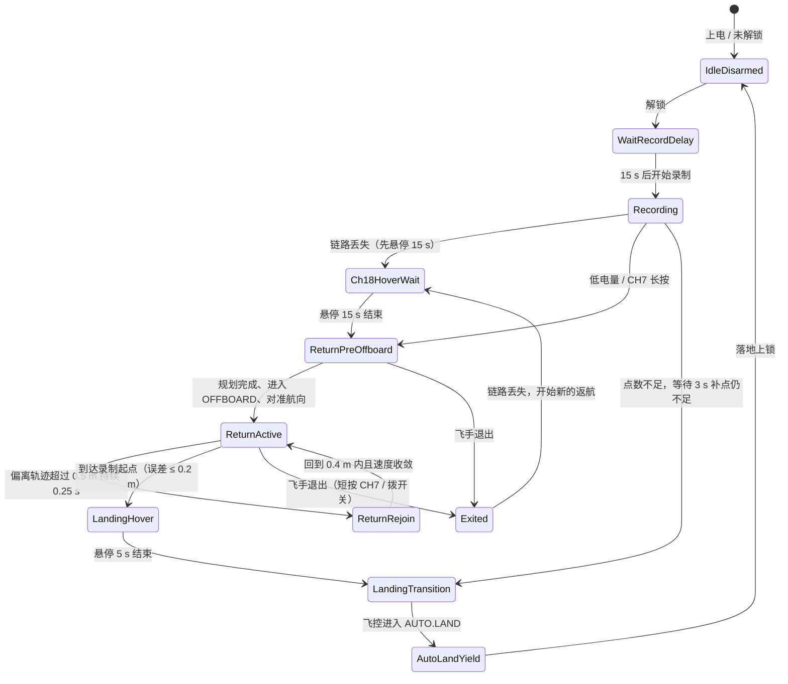

# PX4 返航模块前端对接与开发指南

> 适用范围：本文对应返航重构实施到 R5b 的上报（2026-10-22；R4 起没有改变对外话题，R5b 新增的告警 `PATH_OFFSET`、`TRAIL_GAP` 在 R7 的状态话题中上报）。R7 将新增 JSON 状态话题 `/px4_backtrack/status`（控制权、任务、告警码等，见[重构方案](../design/返航触发与状态机重构方案.md)第 9.1 节），届时更新本文。

本文档为地面站（GCS）、Web 监控端、移动端 APP 等前端开发团队提供与 `px4_backtrack_optimised` 原路返航模块进行数据对接、状态监控、UI 展示及告警的技术规范。

---

## 1. 核心架构与交互总览

返航模块在飞行期间以不超过 15 Hz 录制飞行轨迹点。满足触发条件（遥控链路丢失、低电量、遥控器 CH7 长按）时启动返航任务：逆序生成平滑轨迹，通过 MAVROS 驱动无人机沿原路飞回录制起点，悬停后交给飞控 `AUTO.LAND` 降落。

模块不提供前端控制接口，飞手只能通过遥控器操作：长按 CH7（≥ 2 s）请求返航，返航中短按 CH7（0.3～2 s）或拨模式开关退出。

### 1.1 系统状态流转图



图中省略了：任何状态在上锁时回到 `IdleDisarmed`；任何已解锁状态在飞控进入 `AUTO.LAND` 时进入 `AutoLandYield`；返航中的各状态都可能因飞手退出进入 `Exited`，或因判定落地进入 `LandingTransition`。

---

## 2. ROS 话题通信协议

前端通常通过 `rosbridge_websocket`（默认端口 `9090`，使用 `roslibjs`）或原生 ROS 客户端订阅以下话题。

### 2.1 返航模块输出话题（前端重点订阅）

| 话题名称 | 消息类型 (`msg`) | 频率 | 信号类型 | 业务用途与前端交互说明 |
|---|---|---|---|---|
| `/px4_backtrack/state` | `std_msgs/String` | 20 Hz | 字符串枚举 | **核心状态**：返航生命周期状态（第 3 节），用于状态标签和流程指示 |
| `/px4_backtrack/low_battery` | `std_msgs/Bool` | 20 Hz | 电平锁存 | **低电量**：`true` 表示电量持续低于阈值已确认，锁存到下一次解锁 |
| `/status_rc_loss` | `std_msgs/Bool` | 20 Hz | 电平信号 | **遥控链路丢失**：`true` 表示接收机报告失控（CH18 失控帧累计 1 s）或 RC 消息中断 0.35 s；恢复后持续正常 2 s 才回到 `false` |
| `/px4_backtrack/debug/waypoints` | `visualization_msgs/MarkerArray` | 规划完成时 (latched) | 可视化标记 | **录制点**：可选，需打开 `debug_enable_rviz_publish` |
| `/px4_backtrack/debug/trajectory` | `nav_msgs/Path` | 规划完成时 (latched) | 路径曲线 | **返航轨迹**：可选，同上 |

### 2.2 飞行基础数据话题（辅助展示）

| 话题名称 | 消息类型 (`msg`) | 频率 | 关键字段 | 业务用途 |
|---|---|---|---|---|
| `/mavros/state` | `mavros_msgs/State` | 1 Hz | `armed`、`mode`、`connected` | 解锁状态与飞控模式（如 `POSCTL`、`OFFBOARD`、`AUTO.LAND`） |
| `/mavros/extended_state` | `mavros_msgs/ExtendedState` | 约 5 Hz | `landed_state` | 飞控落地状态（1 在地面、2 在空中） |
| `/Odometry_px4` | `nav_msgs/Odometry` | 30～50 Hz | `pose.pose.position`、`twist.twist.linear` | 实时 ENU 位置与速度 |
| `/mavros/battery` | `sensor_msgs/BatteryState` | 1～5 Hz | `percentage`（0.0～1.0）、`voltage` | 原始电量与电压（`0.15` 代表 15%） |

---

## 3. 状态枚举与 UI 展现规范

前端订阅 `/px4_backtrack/state`，消息体为字符串（`msg.data`）：

| 状态字符串 (`data`) | UI 显示文案 | 状态标签颜色建议 | 状态语义 | 飞手可做的操作（遥控器） |
|---|---|---|---|---|
| `IdleDisarmed` | **待机（未解锁）** | 灰色 (`#9E9E9E`) | 未解锁 | — |
| `WaitRecordDelay` | **起飞等待中** | 蓝色 (`#2196F3`) | 解锁后 15 s 内不录制；期间的失控、低电量只告警 | — |
| `Recording` | **航迹录制中** | 绿色 (`#4CAF50`) | 正常飞行，录制航迹 | 长按 CH7 请求返航 |
| `Ch18HoverWait` | **失控悬停等待** | 橙色闪烁 (`#FF9800`) | 链路丢失后原地悬停 15 s，同时规划返航轨迹；链路恢复不会取消返航 | 链路恢复后可短按 CH7 或拨开关退出 |
| `ReturnPreOffboard` | **准备返航中** | 橙色 (`#FF9800`) | 原地保持，等待规划、切入 OFFBOARD 并对准返航方向 | 短按 CH7 或拨开关退出 |
| `ReturnActive` | **正在原路返航** | 绿色呼吸灯 (`#4CAF50`) | 沿返航轨迹飞行 | 短按 CH7 或拨开关退出 |
| `ReturnRejoin` | **轨迹偏离回归** | 黄色闪烁 (`#FFC107`) | 偏离轨迹超过 0.5 m，低速回到轨迹 | 同上 |
| `LandingHover` | **到达终点悬停** | 蓝色 (`#2196F3`) | 已回到录制起点附近，悬停 5 s 后降落；如果录制轨迹在途中断开，停在断点处一直悬停、不降落（第 4.4 节） | 同上 |
| `LandingTransition` | **正在降落** | 紫色 (`#9C27B0`) | 请求飞控降落（链路正常时先切 POSCTL 再切 AUTO.LAND） | 同上 |
| `AutoLandYield` | **飞控降落中** | 紫色 (`#9C27B0`) | 飞控 AUTO.LAND 已接管；状态保持到上锁，期间不再自动返航。链路丢失时若 AUTO.LAND 被切走，模块会重新请求 | 链路正常时可拨开关接管 |
| `Exited` | **已退出返航** | 红色常亮 (`#F44336`) | 模块请求 POSCTL 交还控制，此后不再控制，继续录制；再次丢失链路时自动开始新的返航：先沿退出后的飞行路径回到退出位置，再沿原路回到录制起点 | 手动飞行；长按 CH7 不会再次返航 |

---

## 4. 关键交互设计与告警规范

### 4.1 低电量（P0 级告警）

- **信号源**：`/px4_backtrack/low_battery` 为 `true`。
- **信号特性**：电平锁存。电量持续 3 s 低于 15% 后变为 `true`，电压回弹也不会消失，直到下一次解锁。电量读数无效（如 -0.01）时不会判为低电量。
- **UI 呈现建议**：顶部红色横幅"⚠️ 电池电量过低（<15%），返航保护已激活"，并弹窗提示。按状态区分提示：
  - `Recording`：自动返航，状态依次变为 `ReturnPreOffboard`、`ReturnActive`；录制点不足时最多等待 3 s 补点，仍不足则原地降落（`LandingTransition`）。
  - `WaitRecordDelay`：只告警；延时结束进入 `Recording`、录够点数（约 2 s）后自动返航。此时录制的航迹很短，原地悬停时会因起终点过近直接原地降落。
  - 返航中：继续当前返航，不改变流程。
  - `Exited`：只告警，不会自动返航。界面应提示"电量严重不足，请手动返航或降落"。

### 4.2 遥控链路丢失

- **信号源**：`/status_rc_loss`（`true` 丢失，`false` 正常）。
- **按状态区分**：
  - `Recording`：自动开始返航，先原地悬停 15 s（`Ch18HoverWait`）。
  - 返航中：继续返航；飞手此时无法用遥控器退出。
  - `Exited`：自动开始新的返航。
  - 飞机在地面（未离地 0.5 m 以上或飞控报告已落地）时不会启动返航。

### 4.3 退出返航

飞手短按 CH7 或拨开关退出后，状态为 `Exited`：模块请求 POSCTL 交还控制（拨开关时飞控已在飞手选的模式），之后不再发出控制指令，也不能"恢复"原返航。退出后长按 CH7、低电量都只告警；只有再次丢失链路时，模块才会自动开始新的返航：先沿退出后的飞行路径回到退出位置，再沿原路回到录制起点，不会再飞回第一次返航的触发点。

链路不稳定时（5 s 内出现过失控帧或 RC 中断）不接受退出，避免把失控帧误当成飞手操作。

### 4.4 原地悬停（安全距离）

模块只沿录制轨迹飞行，不直线飞过没飞过的空间（安全距离 0.7 m）。以下情况飞机会原地悬停，状态停在当时的状态（例如 `ReturnPreOffboard`、`ReturnActive`、`LandingHover`），等飞手接管：

- 飞机离返航路径超过 0.7 m，例如链路不稳时飞手把飞机飞开，或定位突跳（告警 `PATH_OFFSET`）；
- 录制轨迹中有超过 0.7 m 的跳变（定位突跳，或退出前飞机被移开），返航到跳变处为止（告警 `TRAIL_GAP`），`LandingHover` 持续超过 5 s 也不降落。

界面上如果看到 `LandingHover` 持续 10 s 以上没有进入降落，或返航状态下飞机长时间不动，应提示飞手接管。告警码在 R7 的状态话题中上报。R6 加入低电量处理：优先返航，只有返航也无法进行时才原地降落。

---

## 5. 3D/2D 地图轨迹可视化对接规范

如果前端包含三维视图（如 Cesium、Three.js、Leaflet 等），可通过如下话题渲染轨迹图层：

1. **坐标系约定**：轨迹位置均为本地 **ENU 坐标系**（东-北-天，单位：米），原点为里程计原点。
2. **绘制已录制航迹**：订阅 `/px4_backtrack/debug/waypoints`（`visualization_msgs/MarkerArray`），提取各点 `pose.position` 画出已录制路径。
3. **绘制返航轨迹**：订阅 `/px4_backtrack/debug/trajectory`（`nav_msgs/Path`），提取 `poses` 渲染返航曲线。
4. **绘制当前机体位置与朝向**：订阅 `/Odometry_px4`，提取位置渲染飞机模型，四元数 `pose.pose.orientation` 转换为航向角。

---

## 6. 前端本地模拟与联调指南（Mock 教程）

无需真机或仿真，只需几条 ROS 命令即可模拟各种状态，验证前端渲染与弹窗逻辑。

### 6.1 启动 WebSocket 桥接

```bash
# 启动 rosbridge 服务端，前端 roslibjs 连接 ws://<IP>:9090
roslaunch rosbridge_server rosbridge_websocket.launch
```

### 6.2 模拟状态变化

```bash
# 1. 正在返航
rostopic pub -r 20 /px4_backtrack/state std_msgs/String "data: 'ReturnActive'"

# 2. 飞手已退出返航
rostopic pub -r 20 /px4_backtrack/state std_msgs/String "data: 'Exited'"

# 3. 轨迹偏离回归
rostopic pub -r 20 /px4_backtrack/state std_msgs/String "data: 'ReturnRejoin'"

# 4. 正在降落
rostopic pub -r 20 /px4_backtrack/state std_msgs/String "data: 'LandingTransition'"
```

### 6.3 模拟低电量与链路丢失

```bash
# 低电量告警
rostopic pub -r 20 /px4_backtrack/low_battery std_msgs/Bool "data: true"

# 解除低电量
rostopic pub -r 20 /px4_backtrack/low_battery std_msgs/Bool "data: false"

# 链路丢失
rostopic pub -r 20 /status_rc_loss std_msgs/Bool "data: true"
```

### 6.4 模拟电池百分比上报

```bash
# 电量 12%
rostopic pub -r 2 /mavros/battery sensor_msgs/BatteryState "{percentage: 0.12, voltage: 14.8}"
```

---

## 7. 接口协议技术规格一览表（Cheat Sheet）

```json
{
  "topics": {
    "state": {
      "name": "/px4_backtrack/state",
      "type": "std_msgs/String",
      "values": [
        "IdleDisarmed",
        "WaitRecordDelay",
        "Recording",
        "Ch18HoverWait",
        "ReturnPreOffboard",
        "ReturnActive",
        "ReturnRejoin",
        "LandingHover",
        "LandingTransition",
        "AutoLandYield",
        "Exited"
      ]
    },
    "low_battery": {
      "name": "/px4_backtrack/low_battery",
      "type": "std_msgs/Bool",
      "values": [true, false]
    },
    "rc_loss": {
      "name": "/status_rc_loss",
      "type": "std_msgs/Bool",
      "values": [true, false],
      "meaning": "遥控链路丢失（CH18 失控帧累计 1 s 或 RC 消息中断 0.35 s）"
    }
  }
}
```
