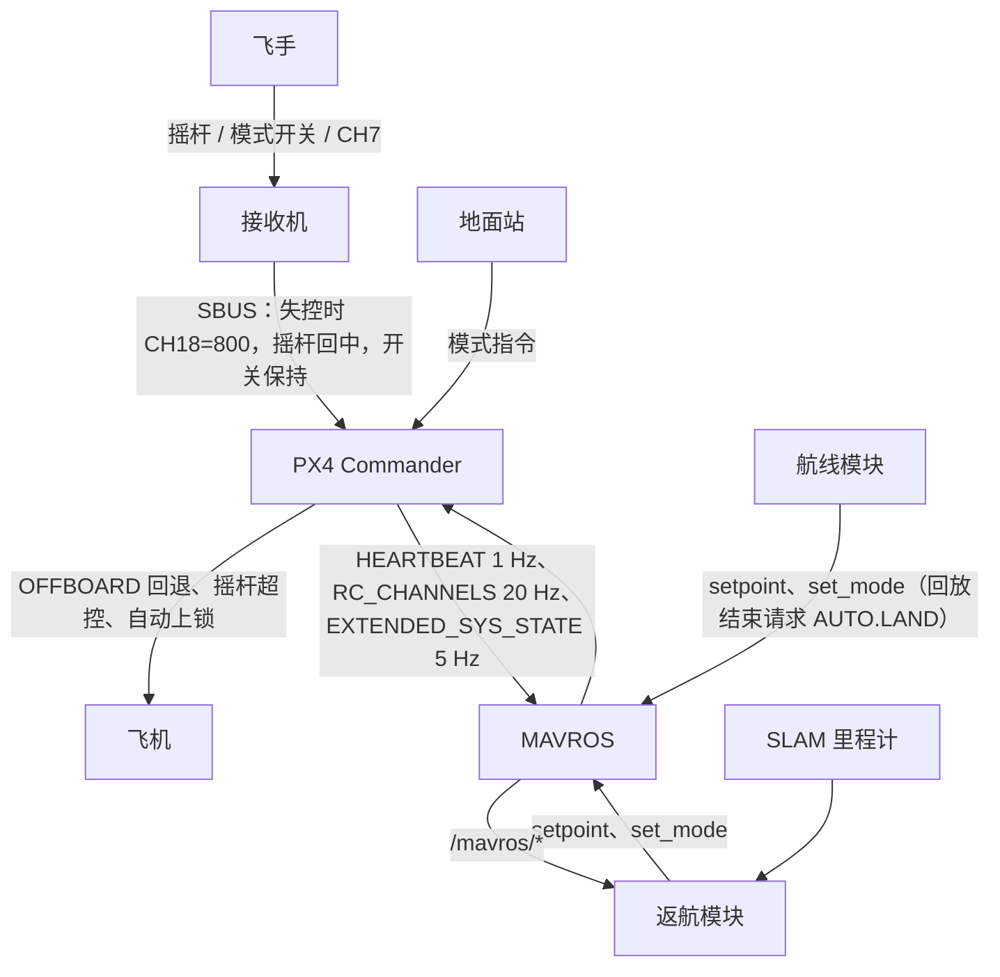

# 返航程序系统性分析（危害分析 + 闭环仿真）

| 项 | 内容 |
| --- | --- |
| 日期 | 2026-10-20 |
| 对象 | `dev` @ `b3db1c2`（实飞版本）；重构方案 [返航触发与状态机重构方案](../design/返航触发与状态机重构方案.md)（D1–D21） |
| 方法 | STPA 危害分析、PX4 源码核对、闭环仿真、时序预算（第 1 节） |
| 复现 | 先运行 `scripts/docker/run_tests.sh amd64`，再运行 `scripts/analysis/run_hazard_scenarios.sh amd64` |
| 状态 | 修改建议 M1–M7 已于 2026-10-20 确认，并写入重构方案（D22–D28）。本报告是当时的分析记录，实施以重构方案为准 |

## 0. 结论

1. **dev 的问题在真实代码上得到复现。** 用假飞控驱动 dev 的 `BacktrackUseCase`，跑 15 个场景、26 项检查，17 项失败（第 5 节）。失败项与代码审核结论 A2、A3、A4、A5、A8、A12、B1、B2、B4、R-23 和本报告的 G1 一一对应。
2. **最严重的一条是落地后自行起飞（H06a）。** 手动降落触地的瞬间关掉遥控器，dev 会在地面启动返航，15 s 后沿录制轨迹起飞，把整条航线飞回去再降落。
3. **实飞那次原地降落仍未复现。** 干净的"低电量返航中失控"在 dev 上能正常完成（H02）；暂停和被切出只会让飞机悬停，不会降落（H03、H08）。原因仍需 FT0 确定。
4. **PX4 源码给出三个方案里还没有的发现**（第 6 节）：
   - N1：OFFBOARD 断流后切到 POSCTL 只是"回退"，setpoint 恢复后 PX4 会自动回到 OFFBOARD。方案中"链路正常时被切出 OFFBOARD 就退出"的规则，会把这种回退误判为飞手接管。
   - N2：PX4 判定落地需要"指令下降 + 低推力"。摇杆回中或 OFFBOARD 原地保持时，PX4 永远不会报告落地。方案 D14 只看 PX4 的落地状态，正好在 H06a 的情形下失效。
   - N3：模式请求可能被静默丢弃（所有请求共用一个 1 s 节流），`set_mode` 成功只表示"已发出"，而且这个服务是在 20 Hz 控制回调里同步调用的。
5. **方案的状态机有一处完整性缺口（G1）**：任务开始后、OFFBOARD 确认之前，飞手在链路正常时拨开关，方案仍会申请 OFFBOARD，与飞手相争。
6. **建议**：按第 9 节修改方案，包括按正交区域重组状态机；把第 5 节的场景作为重构的验收测试，dev 的失败结果作为反例对照。

## 1. 方法与材料

| 步骤 | 做法 | 输出 |
| --- | --- | --- |
| 危害分析 | STPA：控制结构 → 不安全控制动作（UCA）→ 安全约束 | 第 2–4 节 |
| 一手材料 | PX4 `v1.15.4` 标签源码（本地 PX4-Autopilot 仓库，用 `git show v1.15.4:<路径>` 阅读）、用户提供的固件改动、MAVROS 消息定义、本仓库 dev 源码 | 第 6 节 |
| 闭环仿真 | [hazard_scenarios.cpp](../../scripts/analysis/hazard_scenarios.cpp)：真实的 `BacktrackUseCase` + 按源码写的 PX4 行为模型 | 第 5 节 |
| 时序预算 | 逐段列出延迟、数值和出处 | 第 8 节 |

**假飞控实现的 PX4 规则**（参数取 v1.15.4 默认值）：

| 规则 | 出处（PX4 v1.15.4） |
| --- | --- |
| OFFBOARD 信号可用：最近一次 setpoint 在 `COM_OF_LOSS_T`（1.0 s）内 | `commander/HealthAndArmingChecks/checks/offboardCheck.cpp` |
| OFFBOARD 信号丢失时回退 POSCTL，不改用户意图；信号恢复后自动回到 OFFBOARD | `commander/failsafe/failsafe.cpp`（`checkModeFallback`、`fromOffboardLossActParam`、`modifyUserIntendedMode`）；`commander/Commander.cpp`（`nav_state = modeFromAction(selectedAction, user_intention)`） |
| 开关通道的值变化时才动作 | `manual_control/ManualControl.cpp`（`processSwitches`） |
| 自动模式下摇杆变化超过 `COM_RC_STICK_OV`（30%）切到 POSCTL | `commander/Commander.cpp`、`manual_control/ManualControl.cpp` |
| 落地判定：贴地、低推力，爬升率控制模式下还要求指令下降，持续 `LNDMC_TRIG_TIME`（1.0 s）；落地后 `COM_DISARM_LAND`（2.0 s）自动上锁 | `land_detector/MulticopterLandDetector.cpp`、`commander/commander_params.c` |
| 已判定落地时，只有爬升指令才会离地 | `mc_pos_control/Takeoff/Takeoff.cpp` |
| HEARTBEAT 1 Hz；onboard 模式下 RC_CHANNELS 20 Hz | `mavlink/mavlink_main.cpp` |
| 模块侧：所有模式请求共用 1 s 节流 | 本仓库 dev 的 `ros_services.cpp:22-45` |

**接收机**按用户确认的设置：失控时持续输出帧，摇杆回中，开关和 CH7 保持，CH18 = 800。

**控制循环阻塞**按真实耗时计入仿真时间：节点是单线程 `ros::spin`，tick 阻塞期间既不发 setpoint，也不处理回调。

**模型的局限**（结论需在 SITL 和实飞中确认）：
- 动力学是一阶速度响应，没有风和 SLAM 噪声；
- 落地判定按上表条件简化；
- 接收机保持时间按 0 处理（一失控摇杆即回中），这是 H06a 的最坏情况；
- 摇杆超控按相邻两帧的跳变判断。

## 2. 控制结构与控制权

能改变飞机模式或 setpoint 的有五方：飞手、PX4 自身（回退、超控、自动上锁）、地面站、返航模块、航线模块。

- 本模块无法直接知道一次模式变化是谁造成的。PX4 的用户意图（`nav_state_user_intention`）不通过 MAVLink 发出，`/mavros/state` 只有实际模式，而且只有 1 Hz。
- 返航和航线两个模块共用同一个 MAVROS，飞控那边分不出是哪个节点发的指令。
- 这是"控制权"问题的根源：dev 和方案都靠"当前模式 + 链路状态"反推控制权。N1、G1 和航线冲突都出在这里。

## 3. 危害与不安全控制动作

| 编号 | 危害 |
| --- | --- |
| H1 | 撞地或撞障碍：落地后起飞、沿没飞过的直线移动、在未知地面降落 |
| H2 | 失去返航：失控后飞机悬停或漂移，没人能让它回来，直到电量耗尽 |
| H3 | 飞手无法取回控制：模块与飞手争夺模式 |
| H4 | 两个机载节点同时控制，轨迹异常 |

UCA 的类型：缺失（需要时没做）、错误（做了反而危险）、时机（太早、太晚或持续太久）。

| 编号 | 控制动作 | 类型 | 情形 | 危害 | dev | 方案 |
| --- | --- | --- | --- | --- | --- | --- |
| U01 | 启动返航 | 缺失 | 暂停后失控 | H2 | 违反（A5，H03） | 已覆盖：取消暂停；退出后失控开新任务（D7、D20） |
| U02 | 启动返航 | 缺失 | 起飞阶段确认的低电量 | H2 | 违反（A2，H05） | 已覆盖（D4） |
| U03 | 启动返航 | 错误 | 在地面 | H1 | 违反（B1，H06a、H06b） | **部分覆盖**：D14 依赖 PX4 的落地状态，H06a 情形下失效（N2） |
| U04 | 启动返航 | 错误 | 电量读数无效 | H1 | 违反（A12，H11） | 已覆盖（第 5.3 节） |
| U05 | 发布 setpoint | 缺失 | OFFBOARD 中控制循环阻塞超过 1 s | H2 | 违反（B2，H07） | 已覆盖（D21）；剩余同步服务调用（N3） |
| U06 | 发布 setpoint | 错误 | 没有控制权（航线模块正在飞） | H4 | 录制中不发；返航中与航线冲突 | 录制中不发（R-33）；返航中的冲突不在本轮范围 |
| U07 | 发布 setpoint | 错误 | 目标远离当前位置（投影失败后直线拉回） | H1 | 存在（B3） | 已覆盖（第 7.3 节，≤ 1 m） |
| U08 | 申请 OFFBOARD | 缺失 | 链路丢失时被切出 | H2 | 违反（A8，H08） | 已覆盖（D2） |
| U09 | 申请 OFFBOARD | 错误 | 飞手已接管（链路正常） | H3 | 返航中不申请 | **缺口 G1**：OFFBOARD 确认之前的接管没有处理 |
| U10 | 申请 POSCTL | 错误 | 链路丢失 | H2 | 违反（暂停，H03） | 已覆盖：退出要求链路正常；链路丢失时直接 AUTO.LAND |
| U11 | 申请 AUTO.LAND | 错误 | 飞手已接管 | H3 | 违反（B4，H09） | 已覆盖（第 7.6 节） |
| U12 | 申请 AUTO.LAND | 缺失 | 链路丢失时 AUTO.LAND 被超控切走 | H2 | 违反（R-23，H10） | 已覆盖（第 7.6 节） |
| U13 | 申请 AUTO.LAND | 错误 | 未知地面且电量充足 | H1 | 不升级，无限等待 | 已覆盖（D11） |
| U14 | 结束任务 | 错误 | 失控帧中的按键，或返航开始前就按下的按键 | H2 | 违反（A3、A4，H03、H04、H12） | 已覆盖（第 5.2 节、D20） |
| U15 | 结束任务 | 错误 | PX4 自身的回退被当作飞手接管 | H2 | 不适用（dev 不处理切出） | **缺口 N1** |
| U16 | 模式请求 | 时机 | 请求被丢弃或没生效而模块不知道 | H2、H3 | 存在（N3），靠周期性重发缓解 | 未覆盖 |
| U17 | 启动返航 | 时机 | 手动模式下失控，到取得 OFFBOARD 之间的漂移 | H1 | 约 2.1 s，加上接收机保持时间 | 同左；接收机保持时间需实测（第 8 节） |

## 4. 安全约束与不变量

每条约束都写成可以自动检查的条件，并指定验证方式。"穷举"指对重构后的 `step()` 遍历"状态 × 条件组合"。

| 编号 | 安全约束 | 可检查的条件 | 验证方式 |
| --- | --- | --- | --- |
| SC1 | 在地面不启动返航；任务中落地后不再起飞 | `airborne` 为假时不启动任务；任务中 `airborne` 为假时请求 AUTO.LAND。其中 `airborne = landed_state ≠ ON_GROUND 且 z − z_arm > 0.5 m`（N2） | 穷举；H06a、H06b |
| SC2 | 链路丢失时，任务中只处于 OFFBOARD 或 AUTO.LAND | 任务中且链路丢失时，模式意图 ∈ {OFFBOARD, AUTO.LAND} | 穷举；H03、H08（POSCTL 连续时间 < 3 s） |
| SC3 | 只有有效的飞手意图才能结束任务 | 结束任务时，必须是全程正常帧、晚于任务开始的短按，或链路正常时的外部切出且此前自身没有断流 | 穷举；H03、H04、H12；N1 新场景 |
| SC4 | 持有 OFFBOARD 时 setpoint 不断流 | 每拍发布；最大间隔 < 0.2 s；PX4 回退次数为 0 | H07（30 分钟录制）；RK3588 实测 |
| SC5 | 任务开始前不发布 setpoint | 处于未解锁、录制延时、录制状态时不发布 | 穷举 |
| SC6 | 飞手接管后不再争夺 | 链路正常时飞手接管后、新任务开始前，不请求 OFFBOARD 或 AUTO.LAND | 穷举；H09；G1 新场景 |
| SC7 | 目标有界 | setpoint 与当前位置的距离 ≤ 预瞄距离 + 1 m，且不为原点 | 穷举（随机位置） |
| SC8 | 等待有上限 | 每个等待状态都在时间或电量上限内离开 | 随机长序列的性质测试 |
| SC9 | 只在没有时间或无法定点时原地降落 | 请求 AUTO.LAND 时，满足以下之一：低电量、里程计中断、已落地、返航完成、起点附近的降落策略 | 穷举 |
| SC10 | 每个模式请求都有结果 | 请求后 3 s 内观察到目标模式，否则告警并按策略重发（方案 R-48：至少容忍一次心跳丢失） | 假飞控注入"请求被拒" |

## 5. 闭环仿真结果（dev）

标准出航：1 s 起飞到 3 m，依次向东、北、东飞约 20、15、20 m，59 s 后悬停；15.1 s 开始录制。

| 场景 | 情形 | 结果 | 关键数据 |
| --- | --- | --- | --- |
| H01 | 录制中单独失控 | 3 项通过 | 62.0 s 失控，64.2 s 进入 OFFBOARD，133.5 s 在录制起点上锁 |
| H02 | 低电量返航中失控，CH7 无跳变 | 3 项通过 | 返航继续，119.5 s 在录制起点上锁 |
| H03 | 同上，失控瞬间 CH7 跳变一帧 | 3 项失败 | 80.1 s 暂停并切 POSCTL，之后 180 s 一直悬停，距录制起点 18.8 m |
| H04 | 飞手按着 CH7 时低电量抢先触发 | 失败 | 63.5 s 返航开始的同一拍就暂停 |
| H05 | 录制延时内低电量 | 失败 | 整个飞行没有返航 |
| H06a | 手动降落，触地瞬间关遥控器 | 2 项失败 | 64.7 s 在地面启动返航；82.6 s 起飞，爬升到 3.04 m，沿整条航线飞回后才降落 |
| H06b | 飞控判定落地后、自动上锁前关遥控器 | 起飞检查通过，地面启动检查失败 | 66.1 s 在地面启动返航；66.6 s 飞控自动上锁，所以没有起飞 |
| H07 | 30 分钟录制后失控 | 失败 | 规划阻塞 4.7～4.8 s（随实际运行时间略有波动）；PX4 回退 POSCTL 约 3.8 s 后自动回到 OFFBOARD |
| H08 | 低电量返航中失控，随后地面站切出 OFFBOARD | 2 项失败 | 不重新申请控制权，POSCTL 悬停 115 s，直到仿真结束 |
| H09 | 到点悬停时飞手拨开关到 ALTCTL（链路正常） | 失败 | 5.1 s 后降落交接请求 AUTO.LAND，覆盖了飞手的选择 |
| H10 | AUTO.LAND 降落中失控，油门杆原本拉到最低 | 失败 | 失控瞬间摇杆跳变触发超控，AUTO.LAND 被切到 POSCTL，在 2.3 m 一直悬停 |
| H11 | 电量读数 -0.01 | 失败 | 63.5 s 触发返航 |
| H12 | 返航中 CH7 单帧跳变（链路正常） | 2 项失败 | 85.1 s 暂停，返航放弃 |
| H13 | 返航中控制循环卡顿 1.3 s（链路正常） | 2 项通过 | 86.0 s 飞控回退 POSCTL，86.3 s setpoint 恢复后自动回到 OFFBOARD，返航完成。dev 不处理被切出，所以通过；这个场景用来防止新实现把回退当作飞手接管（M1） |
| H14 | 返航刚开始、OFFBOARD 确认前飞手拨开关到 ALTCTL（链路正常） | 失败 | 63.7 s 飞手切到 ALTCTL；64.5 s 模块仍申请 OFFBOARD 并取得控制，之后还请求了 AUTO.LAND（G1、M4） |

对实飞现象的意义：
- 干净的"低电量返航中失控"在 dev 上能完成（H02）。
- 能让返航停下的是暂停（H03、H12）和被切出（H08）。摇杆失控值回中，所以表现为悬停，不是降落。
- 能导致降落的路径（点数不足、"点过近"、其他节点请求 AUTO.LAND、PX4 自身保护）不在这些场景里，仍需 FT0 区分。

## 6. 一手材料带来的新发现

### N1 OFFBOARD 断流后的回退会自动恢复

**依据：**
- `failsafe.cpp` 的 `checkModeFallback`：OFFBOARD 信号丢失时选择 `FallbackPosCtrl`；
- `modifyUserIntendedMode` 不改变用户意图；
- `Commander.cpp`：`nav_state = modeFromAction(selectedAction, user_intention)`。

所以断流期间实际模式是 POSCTL，setpoint 恢复后自动回到 OFFBOARD。H07 的仿真时间线就是这样：1827.1 s 回退，阻塞结束、setpoint 恢复后立即回到 OFFBOARD（约 3.8 s 后）。

**对 dev：** B2 的后果是"阻塞期间飞机处于 POSCTL"，而不是"返航开始不了"。上一轮对 Q4 的说明把后果说重了，在此更正。后台规划（D21）仍然需要：它消除这段回退，而且阻塞时间随录制长度超线性增长。

**对方案：** 第 6.3 节规则 4"链路正常且被切出 OFFBOARD → 退出"会把这种回退当作飞手接管，从而结束返航。回退的起因可能是 CPU 被 SLAM 抢占、MAVROS 卡顿等。

**建议（M1）：**
- 模块记录自己每次发布 setpoint 的时间。
- 切出之前，如果自身断流已达到 0.5 × `COM_OF_LOSS_T`，判为"回退"：保持任务、继续发布、不申请模式（PX4 会自动回来），告警 `OFFBOARD_FALLBACK`。
- 只有自身没有断流时发生的切出，才算外部切出。

**SITL 确认（2026-10-20）：** PX4 v1.15.4 SITL（SIH 四旋翼），`scripts/sitl/run_sitl_checks.sh`。OFFBOARD 悬停中停发 setpoint 3.5 s，7 次运行结果一致（按 ULog）：
- 最后一个 setpoint 后 1.02–1.11 s 回退 POSCTL（`COM_OF_LOSS_T` = 1.0 s），回退期间保持高度；
- 恢复发布后 0.02 s 回到 OFFBOARD，期间没有请求模式；
- `/mavros/state` 约 1 Hz，模块看到模式变化最多晚约 1 s，在 `fallback_window_s`、`fallback_timeout_s`（3 s）之内。

另据源码，回退期间推杆不改变用户意图：`Commander::manualControlCheck` 只在非手动模式下处理推杆接管，而回退所在的 POSCTL 是手动模式。飞手在回退期间推杆只临时生效，setpoint 恢复后飞控仍回到 OFFBOARD；要接管需切模式。

### N2 PX4 判定落地依赖"指令下降"

**依据：**
- `MulticopterLandDetector.cpp` 的 `_get_ground_contact_state`：地面接触要求低推力；在爬升率控制模式下，还要求轨迹 setpoint 的下降速度 ≥ 1.1 × `LNDMC_Z_VEL_MAX`，直到进入 maybe_landed。
- `Takeoff.cpp`：一旦判定落地，只有爬升指令才会离地。

**后果：** 触地瞬间链路丢失时，接收机输出回中摇杆，下降指令消失，PX4 永远不会判定落地，也不会自动上锁。OFFBOARD 原地保持也一样，因为位置 setpoint 不带下降速度。H06a 就是这种情形。

**对方案：** D14 用 `landed_state == ON_GROUND` 判断，在这种情形下失效。

**建议（M2）：**
- 落地保护改为"在空中"的正向判定：`airborne = landed_state ≠ ON_GROUND 且 z − z_arm > 0.5 m`，其中 `z_arm` 是解锁时的里程计高度。
- 不满足时不启动任务。任务中（悬停、准备阶段）不满足时直接请求 AUTO.LAND；AUTO.LAND 会给出下降指令，PX4 随后判定落地并上锁。
- 局限：降落在比起飞点高的平台上时，只能依赖 PX4 的判定；SLAM 的高度漂移需在实飞中评估。

另外，H06b 说明：PX4 已判定落地时，是 `COM_DISARM_LAND`（2 s）自动上锁避免了起飞。这个参数如果设为 0 或调大，dev 在 H06b 情形下也会起飞。

**SITL 确认（2026-10-20）：** 同一环境，摇杆用 MANUAL_CONTROL 模拟，飞机是否在地面按 ULog 真值确认：
- POSCTL 油门最低下降，触地（下降速度消失）后立即回中，观察 5–10 s：6 次有效运行中 `landed_state` 都没有变为 ON_GROUND，飞机一直解锁。其中一次估计高度漂移使推力降到下限，但下降速度指令为 0，地面接触始终不成立，与源码一致；
- 接着切到 OFFBOARD 保持当前位置：3 次有效运行中同样没有判定落地，一直解锁；
- 对照：油门保持最低，从地面开始约 3 s 判定落地，再过约 2 s（`COM_DISARM_LAND`）自动上锁。

SIH 中触地后测距不再参与高度融合，估计高度以约 0.1–0.3 m/s 漂移。回中或原地保持时高度控制跟着估计走，有时把飞机带离地面（7 次运行中 N2a 1 次、N2b 4 次），这些运行判为无效。这也说明，飞控未判定落地时，地面上的飞机并不稳定，估计高度的漂移会直接变成推力变化。M2 在悬停、准备阶段不在空中时请求 AUTO.LAND，让飞控给出下降指令、判定落地并上锁，正好避开这种状态。

### N3 模式请求可能被静默丢弃，且在控制回调里同步调用

**依据：**
- `ros_services.cpp:22-45`（dev）：所有模式请求共用一个 1 s 节流；被节流时返回 false，状态机并不知道。
- MAVROS `SetMode.srv`：`mode_sent` 的含义是"模式已解析，SET_MODE 已发出"，不表示飞控已经切换。
- `backtrack_node.cpp:152-153`（dev）：在 20 Hz 定时器回调里同步调用 `set_mode` 服务。

**后果：**
- 状态机以为请求已发出，实际被节流丢掉了；连续请求不同模式时，后一个可能被吞。
- MAVROS 响应慢时会拖住控制循环。

**建议（M3）：** 由一个 `ModeCommander` 统一负责模式请求：节流、记录每次请求、按 `/mavros/state` 观察是否生效、超时告警。服务调用移出控制回调，改为异步。

### N4 其他已核实的事实

- PX4 进入 OFFBOARD 只要求最近 1 s 内有 setpoint（`offboardCheck.cpp`）。dev 预发 20 帧（1 s）偏保守，可以缩短到约 0.3 s，失控后更快进入 OFFBOARD（M6）。
- onboard 模式下 EXTENDED_SYS_STATE 为 5 Hz，HEARTBEAT 为 1 Hz，RC_CHANNELS 为 20 Hz。机载实际频率以 `MAV_x_MODE` 配置为准。

## 7. 状态机结构：按正交区域重组

方案第 6 节的状态是一张平铺表，"重新申请控制权"叠加在任务状态上，"沿轨迹返航"和"回归路径"并列为两个状态。按职责可以拆成三个并行区域：

| 区域 | 状态 | 回答的问题 |
| --- | --- | --- |
| A 任务阶段 | 未解锁、录制前、录制、任务（悬停 → 准备 → 跟随 → 到点 → 交接）、已退出、飞控降落 | 现在要做什么 |
| B 控制权 | 无、申请中、持有、回退（N1）、重新申请、已交出 | 现在能不能做；只在任务中和退出交接时有效 |
| C 跟随方式 | 在路径上、回归路径 | 怎么跟踪路径；只在"跟随"阶段有效 |

区域之间只有以下耦合：
1. 区域 B 不处于"持有"时，区域 C 冻结进度（R-18）。
2. 区域 B 判定外部切出（链路正常、自身没有断流），或收到短按退出 → 区域 A 进入"已退出"。
3. 区域 B"重新申请"超时 → 按方案第 8.1 节升级 → 区域 A 进入"交接"。
4. 区域 A 的悬停、准备阶段让区域 B 进入"申请中"；交接阶段让区域 B 把控制交给 AUTO.LAND。
5. `airborne` 为假（M2）→ 区域 A 进入"交接"，直接请求 AUTO.LAND。

现有状态与新结构的对应关系：

| 现有状态（上报字符串） | 区域 A | 区域 B | 区域 C |
| --- | --- | --- | --- |
| `IdleDisarmed` | 未解锁 | 无 | — |
| `WaitRecordDelay` | 录制前 | 无 | — |
| `Recording` | 录制 | 无 | — |
| `Ch18HoverWait` | 任务·悬停 | 申请中或持有 | — |
| `ReturnPreOffboard` | 任务·准备 | 申请中或持有 | — |
| `ReturnActive` | 任务·跟随 | 持有 | 在路径上 |
| `ReturnRejoin` | 任务·跟随 | 持有 | 回归路径 |
| `LandingHover` | 任务·到点 | 持有 | — |
| `LandingTransition` | 任务·交接 | 交出中 | — |
| `Exited` | 已退出 | 已交出 | — |
| `AutoLandYield` | 飞控降落 | 无（链路丢失时重新请求 AUTO.LAND） | — |

好处：
- 每个区域的转移表都很小，可以分别穷举；组合行为只由上面五条耦合决定。
- "重新申请"和"回退"有了明确的位置，不再叠加在任务状态上。
- 上报给前端的状态字符串由三个区域推导，现有字符串保持不变。

## 8. 时序预算

| 场景 | 分段 | 时长 | 依据 |
| --- | --- | --- | --- |
| 录制中失控 → OFFBOARD 悬停 | 接收机宣布失控前的保持时间（期间沿用最后的杆量，模块看不到） | 未知，需实测 | 方案第 14.4 节第 5 步 |
| | 失控帧到达模块 | ≤ 0.05 s | RC_CHANNELS 20 Hz |
| | CH18 确认 | 1.0 s | `ch18_confirm_s` |
| | 预发 setpoint | 1.0 s（建议 0.3 s，M6） | `pre_offboard_setpoint_count` |
| | 模式请求生效 | 约 0.05 s | set_mode → PX4 |
| | 合计（从第一帧失控帧算起） | 约 2.1 s（仿真 H01 为 2.2 s） | |
| | 期间的漂移 | 保持时间 × 最后杆量对应的速度（`MPC_VEL_MANUAL` 最高 10 m/s），之后摇杆回中刹停 | `MPC_VEL_MANUAL` |
| 链路丢失时被切出 → 回到 OFFBOARD | 察觉模式变化 | ≤ 1.0 s | HEARTBEAT 1 Hz |
| | 重新申请 | ≤ 1.0 s | `offboard_attempt_interval_s`、1 s 节流 |
| | 合计 | 约 2.1 s 以内，期间 POSCTL 悬停 | |
| 链路正常时飞手拨开关接管 | 模块察觉 | ≤ 1.05 s | HEARTBEAT 1 Hz |
| OFFBOARD 断流 | 允许的最长阻塞 | < 1.0 s | `COM_OF_LOSS_T` |
| | dev 同步规划（amd64） | 10 分钟录制 0.61 s；30 分钟 4.8 s | 方案附录 A |
| 落地 → 上锁 | 地面接触 → 判定落地（需要指令下降） | ≥ 1.0 s | `LNDMC_TRIG_TIME` |
| | 判定落地 → 模块看到 `ON_GROUND` | ≤ 0.2 s | EXTENDED_SYS_STATE 5 Hz |
| | 判定落地 → 自动上锁 | 2.0 s | `COM_DISARM_LAND` |
| 模式请求未生效 → 察觉 | 节流 + 观察 | ≥ 2 s | 1 s 节流 + HEARTBEAT 1 Hz |

需要在硬件上实测：
- 接收机的保持时间；
- RK3588 在 SLAM 负载下的规划耗时和控制循环节拍；
- `set_mode` 服务的延迟；
- 机载链路上 RC_CHANNELS 和 EXTENDED_SYS_STATE 的实际频率。

## 9. 对重构方案的修改建议（待确认）

| 编号 | 修改 | 依据 |
| --- | --- | --- |
| M1 | 第 6.3 节规则 4：自身断流引起的回退不算外部切出；保持任务、继续发布，告警 `OFFBOARD_FALLBACK` | N1 |
| M2 | 落地保护改为"在空中"的正向判定：PX4 落地状态 + 与解锁高度的差 | N2 |
| M3 | 新增 `ModeCommander`：统一节流，观察请求是否生效，服务调用移出控制回调 | N3 |
| M4 | 任务开始后、OFFBOARD 确认前，链路正常时模式从任务开始时的模式变为 OFFBOARD 以外的模式，视为飞手接管，进入 `Exited` | G1 |
| M5 | 状态机按第 7 节的三个区域组织；上报字符串不变 | 第 7 节 |
| M6 | 预发帧数从 20 改为约 6（0.3 s） | N4 |
| M7 | 第 5 节的 15 个场景作为 R3 起的验收测试（H13、H14 对应 M1、M4；M2 由 H06a、H06b 覆盖）；dev 的结果作为反例对照 | 第 10 节 |

## 10. 证据计划

| 证据 | 通过标准 | 反例对照（dev） |
| --- | --- | --- |
| 闭环场景：第 5 节 H01–H14 | 新实现全部通过 | 26 项中 17 项失败；H13 在 dev 上通过，因为 dev 不处理被切出 |
| 穷举不变量：SC1–SC7、SC9 | 所有"状态 × 条件组合"0 违反 | dev 的转移分散在多处，无法穷举 |
| 随机长序列：SC8 | 10⁴ 条随机序列，没有等待超过上限 | — |
| 断流：30 分钟录制 | OFFBOARD 中 setpoint 最大间隔 < 0.2 s，PX4 回退 0 次（amd64 和 RK3588） | 4.7～4.8 s，1 次 |
| 失控后接管的时延 | 录制中失控：从第一帧失控帧到进入 OFFBOARD ≤ 1.5 s（采用 M6 后），仿真和 SITL 都要满足 | 约 2.2 s |
| 落地后不起飞 | H06a、H06b：触地后高度变化 < 0.3 m | 3.04 m |
| 模式请求可观测 | 注入"请求被拒"或"请求被吞"：3 s 内告警 | 没有告警 |
| RK3588 节拍 | SLAM 负载下飞行 30 分钟：tick 周期 p99 ≤ 60 ms，最大 ≤ 150 ms | 待测 |
| FT0 | 用日志确定那次原地降落的触发路径和时间点 | — |

通过标准在测试前确定；每个场景都必须在 dev 上失败或给出可对照的数据，否则说明测试本身没有判别力。H13 是例外：dev 不处理被切出，无法作为反例，它防止的是新实现引入的误判。

## 11. 局限与后续

- 那次原地降落的原因仍未确定，需要 FT0。
- 假飞控是按源码写的近似模型。N1（回退后自动恢复）和 N2（摇杆回中时不判定落地）已在 PX4 v1.15.4 SITL 中确认（第 6 节）。
- 重构完成后，`hazard_scenarios.cpp` 改为驱动新实现，作为闭环回归测试保留。
