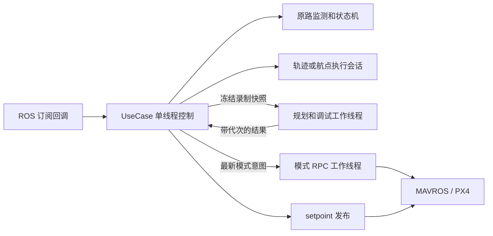

# 返航工程修复与验证

更新日期：2026-10-05。本文统一维护当前架构、接口、配置、修复记录、验证结果和后续计划。旧方案、测试报告和接口说明已移入 `archive/pre_2026-10-05/`，用于追溯，不能作为当前行为规范。算法依据与开源方案对照见 [算法库工程审核](../../trajectory_core/doc/工程审核与集成交接.md)。

## 结论与版本

本轮已实现 APP-01～14，并完成可读性整理。核心库继续只负责几何、空间 yaw 和受约束名义时间剖面；返航模块负责执行进度、原路监测、输入有效性、规划降级、飞控控制权和降落交接。无需另换生产轨迹后端即可满足当前工程接口需求。

适用范围：多旋翼、RK3588、实际速度 <1 m/s、录制 <1 h；返航尽量贴合原路，正常偏移 <0.3 m、硬上限 ≤0.5 m，无在线避障。源码回归及真实 ROS 节点联调通过；PX4 SIH 两次在解锁健康检查阶段失败，未执行返航。当前结果不能证明实机偏移和速度已达标，也不能表述为所有环境无 bug。

| 仓库/分支 | 状态 |
| --- | --- |
| 返航 `dev` | `feat/low-battery-rth` @ `bcb80e8` 已用 `--no-ff` 合并，合并提交 `b3db1c2` |
| 返航修复分支 | `fix/return-engineering-contracts`，逐项提交，未合回 dev，未推送 |
| 算法修复分支 | `fix/trajectory-engineering-contracts`，算法基线 `4857b87`；本轮只同步交接文档 |
| TOPPRA | 原工程对照保留，未在本轮引入生产返航链路或追加修改 |

## 执行架构与进度契约



`BacktrackNode` 使用串行 `ros::spin()` 和默认 20 Hz `WallTimer`。业务状态只在该线程读写；工作线程仅持有自己的录制快照、轨迹结果、调试依赖和最新模式意图。没有通用线程池或任务框架。规划、航点构建、CSV 与 RViz 采样在同一规划线程顺序执行；模式服务独立，避免阻塞 setpoint 发布。

实际位置在局部路径上的投影只设置参考前进边界，预瞄最多 0.20 m。参考名义时间 τ 以受限速率 `r=dτ/dt` 连续推进，可减速至零；名义剖面的 C0 停车结点仍被经过。执行状态满足：

```text
s_ref = s_nominal(τ)
ds_ref/dt = v_nominal(τ) × r
d²s_ref/dt² = a_nominal(τ) × r² + v_nominal(τ) × dr/dt
position / velocity / acceleration / yaw / yaw_rate = evaluateProgress(上述同一进度)
```

生成阶段预留一半切向、上升/下降加速度给时钟调速。Rejoin 通过同一时钟限速，不在输出后单独裁剪速度。飞机停止或比规划慢，参考可停留超过名义时长，不据此完成任务。yaw(s) 为分段线性，结点处 yaw_rate 可改变；目前不承诺 jerk 或 yaw 加速度连续。

暂停冻结执行；显式恢复时，在剩余路径 1 m 局部窗口内重新接入，参考速度从零开始。重新接入是新的执行起点，不承诺与暂停前参考位置连续。降级会话保留剩余索引及原路连接线，不能从录制末端重走。正常完结需实际和参考剩余弧长、三维终点误差均 ≤0.20 m，实际三维速度 ≤0.20 m/s；降级到点及完结要求速度 ≤0.10 m/s。

触发后保持触发位置、继续录制实际制动尾段，速度 ≤0.10 m/s 才冻结录制并提交规划。准备阶段输出位置+yaw，只有规划可用、距当前目标 ≤0.40 m、实际速度 ≤0.20 m/s、yaw 误差 ≤15° 时激活。yaw 不满足时持续保持位置；超时只记录日志。

## 失败、输入与控制权

所有运行时生成失败和规划异常都尝试独立的原始航点模式，包括 FIT_FAILED、PROFILE_INFEASIBLE、过密几何和配置错误。它保留原始非共线顶点，只移除同方向共线冗余点，逐段细分到 ≤0.30 m；当前点到达半径 0.05 m，停稳且对准下一段 yaw 才切换。每次仅发送当前 position+yaw，PX4 不缓存整条队列。原始路径不可用或录制未达业务最少点数时，执行既有直接降落流程。启动配置解析失败直接退出，不能依赖运行时降级掩盖错误配置。

odom/state/RC 接收及控制间隔统一用 steady；ROS 消息 stamp 单独用于消息年龄、录制和复位检查。odom 默认接收超时 0.25 s，state 为 0.50 s；适配层另检查 ROS stamp 的年龄范围 [-0.05,0.25] s、有限坐标速度和近单位四元数。重复/回退 stamp、突跳、断联模式分别处理。无效输入不录制、不推进、不激活、不完成。

控制期间输入失效进入 Paused，坐标仍可信时发送最后有效位置的零前馈，state 新鲜且仍 OFFBOARD 时请求 POSCTL；数据恢复不自动恢复任务。定位复位锁存至 DISARM，禁止继续发送旧坐标目标。新鲜 DISARM、AUTO.LAND 和外部模式接管优先于 odom 检查。两个 tick 之间的 DISARM/ARM 也被保留，新飞行复位路径、规划代次及电量/RC 触发锁存。

外部退出 OFFBOARD 时进入 ControlYield，清除 setpoint、模式请求和旧规划。仅 CH7 显式长按、输入有效且回到剩余原路 0.10 m 内时恢复。RC 丢失及低电量不会抢回外部控制。AUTO.LAND 锁存让步至 DISARM。

| 状态字符串 | 当前含义 |
| --- | --- |
| IdleDisarmed / WaitRecordDelay / Recording | 未解锁、录制延时、录制 |
| Ch18HoverWait / ReturnPreOffboard | 故障悬停或返航准备，制动、规划、对准及 OFFBOARD 预发送 |
| ReturnActive / ReturnRejoin | 正常跟随或同源低速接回 |
| Paused | 人工暂停、原路预算或输入异常暂停；异常原因见日志 |
| ControlYield | 外部退出 OFFBOARD，停止控制输出，等待显式恢复 |
| LandingHover / LandingTransition | 到点悬停及 POSCTL→AUTO.LAND 请求 |
| AutoLandYield | 飞控降落已接管，等待 DISARM |

取消采用代次丢弃结果，最多一个待处理规划请求；已经运行的求解/导出不能强杀，节点退出可能等待它完成。模式 RPC 已派发时不能撤回，但结果不驱动状态机，激活只依据新鲜 FCU state。未派发旧意图会被新意图或空意图清除。目前没有规划超时或强制终止机制；默认低电量 15% 的剩余电量是否覆盖悬停规划等待，仍需目标硬件和电池实测。

## 原路偏移预算与 PX4 配置

正常和降级都监控完整原始录制折线的局部分支三维距离；不对原始输入先外部抽稀，不用自交处任意更晚段的最小距离代替路径顺序。正常实测偏离达到 0.15 m 进入 Rejoin；降级/准备偏离达到该值暂停。以下预算达到 0.30 m，或实测达到 0.50 m，立即停进度、保持实际位置并请求 POSCTL：

```text
预测偏离 = 实测偏离 + 0.05 m 定位余量
         + 向外速度 × 0.10 s + 向外速度² / (2 × 0.50 m/s²)
```

默认拟合误差上限 0.08 m，预瞄 ≤0.20 m，轨迹三维速度 0.60 m/s，Rejoin ≤0.30 m/s。上述干预是基于定位、总延迟和实际制动能力的预算；不能把软件触发门槛等同于实机物理最大偏移证明。目标平台必须验证定位余量足够、响应不超过预算且制动能力不低于 0.50 m/s²。

position+velocity 中的速度是前馈，实际飞机仍可能更快；基础 position+yaw 模式也无法独立限制实际速度。目标 PX4 需配置并实测 XY/Z 速度上限 <1 m/s（初始建议各 0.60 m/s），以及与预算相符的制动。原地对准 yaw 由 PX4 限速，轨迹 yaw_rate_max=0.60 rad/s 仅约束运动轨迹；目标固件的有效 yaw 限制需验证。历史 v1.15.4 的 MC_YAWRATE_MAX=45 deg/s 试验保留在归档，不代表本轮验收。SIH 本轮参数仅修改临时仿真实例。

## ROS 接口与构建

| 输入 | 类型 / 约定 |
| --- | --- |
| /mavros/state | mavros_msgs/State，connected 才刷新状态接收时钟 |
| /Odometry_px4 | nav_msgs/Odometry；pose 在父 ENU，twist 在 child_frame_id，按姿态旋转到父 ENU |
| /mavros/rc/in | mavros_msgs/RCIn，CH7、CH18 及丢失检测 |
| /mavros/battery | sensor_msgs/BatteryState.percentage，0～1；NaN/无效百分比不触发低电量 |

| 输出 / 服务 | 类型 / 约定 |
| --- | --- |
| /mavros/setpoint_raw/local | PositionTarget，ENU 值交 MAVROS 转换；正常 mask=0x01C0，启用 acc 时为 0；位置+yaw 降级及保持为 0x09F8 |
| /px4_backtrack/state | String，上表状态，前端须新增 ControlYield |
| /status_rc_loss | Bool，丢失期间 true，恢复后 false |
| /px4_backtrack/low_battery | Bool，确认低电量后锁存至新飞行；暂停时告警但不自动恢复 |
| /px4_backtrack/debug/waypoints / trajectory | MarkerArray / Path，latched；默认开启 |
| /mavros/set_mode | SetMode，后台提交最新 OFFBOARD/POSCTL/AUTO.LAND 意图 |

配置入口为 [backtrack_params.yaml](../config/backtrack_params.yaml)、[trajectory_config.yaml](../config/trajectory_config.yaml)，通过 [launch](../launch/backtrack.launch) 加载。触发参数必须齐全；使用 YAML 的 CH7 2 s、CH18 确认 1 s/悬停 15 s、RC 超时 0.15 s/防抖 0.10 s、低电量 15%/确认 3 s。记录延时 15 s、最少 30 点、最大 15 Hz；预发送 20 帧、到点悬停 5 s。控制频率校验为 10～100 Hz，默认 20 Hz；实际输入频率应满足 freshness 门槛。改变这些参数需要按新预算复验。

```bash
# 容器 ROS_Noetic 内；两仓库均位于该工作空间 src
source /opt/ros/noetic/setup.bash
cd /root/ROS_Noetic/backtrack_ws
catkin_make --pkg trajectory_core px4_backtrack_optimised -DCMAKE_BUILD_TYPE=Release -j4
source devel/setup.bash
roslaunch px4_backtrack_optimised backtrack.launch
```

MAVROS 和定位源由工程提供；仅 launch 本节点不会启动飞控。公共头文件安装至 include/px4_backtrack，显式依赖 roslib、tf2、Threads。UseCase 的内部回调 API 新增 steady 接收时间，不应再把 ROS stamp 传作执行时钟；该类型不作为通用算法库接口。

## 问题与实施记录

- APP-01：所有轨迹生成失败统一尝试原始录制点的航点返航；包括配置错误和过密几何。没有可用路径或录制点未达业务最小数量时仍执行既有降落流程。配置错误保留日志，降级不能隐藏配置问题。测试覆盖错误配置可降级、无空间路径仍降落。
- APP-02：仅删除同方向共线点，保留每个非共线原始顶点，沿每条原始连接线细分到 0.3 m；不跨拐角。默认到点半径 0.05 m，切换前要求三维速度 ≤0.10 m/s 和下一段航向误差 ≤15°。位置+yaw 模式下由 PX4 控制原地 yaw 速度。覆盖短直角、未停稳、未对准、无效输入。
- APP-03：取消从头 restart 接口；暂停和恢复均保留当前剩余航点索引，不重建路径，不回到录制末端。恢复仍先固定当前位置，并由 APP-02 的停稳/航向门槛控制继续执行。
- APP-04：实际局部投影只设置最多 0.20 m 的预瞄边界，参考通过可减速的连续名义剖面时钟推进，保留剖面内停车结点。执行速度/加速度经链式求导后传入 evaluateProgress，yaw_rate 同步缩放；Rejoin 不再事后裁剪速度向量。停留可超过名义时长，不触发完成，随后可继续。生成阶段预留一半切向和竖直加速度预算给执行时钟。暂停冻结位置并清零前馈，恢复从零时钟速率开始。覆盖长时间停留、恢复、位置/速度一致性和低速限制。
- APP-05：完整原始点传入 core，不再在外部抽稀后以改变的折线做走廊证明。默认拟合预算 0.08 m，三维速度 0.6 m/s。新增有序原始折线局部三维监控，常规和降级路径共用；0.15 m 即进入慢速 Rejoin，降级偏离则停进度。预估偏离 = 实测偏离 + 定位余量 0.05 m + 向外速度×0.10 s + 向外速度²/(2×0.50 m/s²)，达到 0.30 m 或实测达到 0.50 m 即停进度、保持当前位置并请求 POSCTL。恢复必须显式操作且回到 0.10 m 内；安全停止不因 RC 丢失自动恢复。这是基于定位、延迟及制动假设的干预预算，不等同于实机物理上限证明。
- APP-06：控制循环和 RC/state/odom 接收时钟统一为 steady，ROS 消息 stamp 仅用于录制、消息年龄和复位检查；WallTimer 避免 ROS 时间停顿中断发布。默认 odom 0.25 s、state 0.50 s。有限值、四元数、重复/回退 stamp、突跳均检查；无效数据不推进、不完成、不激活、不录制。控制期间失效转暂停，位置坐标仍有效则发布最后位置零前馈，模式新鲜时请求 POSCTL，恢复必须显式操作。定位复位后禁止旧坐标 setpoint，锁存至 DISARM。DISARM 和 AUTO.LAND 优先于里程计检查。工程预算/频率校验，不允许正常轨迹 ≥1 m/s 或非零起止速度。飞行周期重置触发器锁存。
- APP-07：活动、Rejoin、降落前悬停，以及已确认 OFFBOARD 的准备阶段，外部退出 OFFBOARD 时进入 ControlYield，取消规划意图，冻结进度，清除所有 setpoint 和模式请求，优先于完成/降落判断。仅显式 CH7 长按且输入新鲜、剩余路径有效、回到恢复走廊内时恢复；RC 丢失和低电量不抢回外部控制。Paused 在已离开 OFFBOARD 后也不重复请求 POSCTL。AUTO.LAND 保持锁存至 DISARM。新增状态字符串 ControlYield，前端需显示。
- APP-08：规划/航点降级/CSV/RViz 放入专用单工作线程，控制循环只交付不可变录制快照并取结果；最多一个待处理请求，取消/暂停/新飞行/外部接管换代丢弃旧结果。调试最多 20000 个轨迹样本，异常只跳过导出。模式 RPC 独立工作线程，主循环每周期提交最新意图（含取消），未派发旧请求会被清掉；飞控状态确认仍是唯一激活依据。已经发出的 RPC 不能撤回，结果不会驱动状态转换；正在求解的算法不能强杀，取消只丢弃结果，节点析构会等待线程退出。阻塞规划和阻塞模式服务测试验证控制侧调用保持非阻塞。
- APP-09：正常轨迹完成要求实际剩余弧长、参考剩余弧长、三维位置误差均 ≤0.20 m 且三维实际速度 ≤0.20 m/s；降级终点速度 ≤0.10 m/s 才完成。Rejoin 末端也支持同样完成判据。覆盖竖直仍在运动不能完成、参考尚未走完不能完成，以及实际仅 0.1 m/s 的闭环返航直至终点。

- APP-10（复核追加）：原安装规则引用不存在的 include/px4_backtrack_optimised，修正为实际 px4_backtrack 命名空间目录；显式声明 roslib、tf2 依赖，避免靠 MAVROS 间接提供头文件和链接。以 catkin install 验证安装产物。

- APP-11（联合复核追加）：准备/等待规划阶段同样监控原路偏离并取消旧规划；正常和降级均需起始位置接近、三维低速和 yaw 对准才能激活。新鲜外部模式接管优先于里程计失效；回调保存 tick 之间的 DISARM 边沿，避免快速重新 ARM 沿用旧任务。覆盖阻塞规划期间漂移、外部退出同时无效 odom、两个 tick 间解除再解锁。

- APP-12（接口复核追加）：再次生成失败时清空旧轨迹与参考进度，避免会话复用返回上次成功结果；降级到点半径拒绝 NaN/非正数，防止比较失效导致错误推进。新增先成功后失败和无效半径回归。

- 可读性整理：把启动配置校验集中到具名参数检查，合并正常/Rejoin 的同源 setpoint 装配，按顺序集中控制步骤；规划线程和模式服务线程保持专门职责，无通用任务框架。会话状态异常时保持有效当前位置，避免默认原点目标。新增统一 clang-format 风格。

- APP-13（恢复场景复核追加）：恢复时先在 1m 局部剩余路径重新接入。正常参考可向实际进度重设零速度起点，降级只向前调整剩余索引并先接入原始连接线，均不回到已完成路径。修正准备态距离门槛误阻止航点间暂停恢复的问题；正常和降级共用恢复流程并保持 yaw 对准。覆盖航点之间暂停、手动沿路前移、零前馈重定位。

- APP-14（运动中触发复核追加）：触发后先固定点制动，继续录制真实制动/悬停尾段；三维速度 ≤0.10 m/s 才冻结原路并提交规划，避免未记录的惯性尾段被误判为越界。规划等待期仍监控冻结路径，结果到达后从当前局部实际位置零速接入，防止长规划期间回到旧起点。覆盖以 0.6 m/s 触发、规划尚未开始、尾段进入快照和停稳后激活。

### 独立提交索引

| commit | 工作内容 |
| --- | --- |
| `279fe5f` | fix(APP-01): 规划失败统一降级到原始航点返航 |
| `a174be6` | fix(APP-02): 保留原路拐角并停稳转向后切换航点 |
| `2f556f5` | fix(APP-03): 暂停恢复保留剩余航点进度 |
| `2c357d8` | fix(APP-04): 连续参考进度与速度加速度航向前馈保持一致 |
| `e13dad5` | fix(APP-05): 按原始三维路径监控偏离及制动预算 |
| `ca54e3b` | fix(APP-06): 校验输入新鲜度并隔离失效数据和定位复位 |
| `a8651d3` | fix(APP-07): 外部退出 OFFBOARD 后让出控制并显式恢复 |
| `11f2ab9` | fix(APP-09): 实际和参考进度收敛且三维停稳后完成返航 |
| `1174752` | fix(APP-08): 后台规划和模式服务保持控制发布非阻塞 |
| `6b1330d` | fix(APP-10): 修复头文件安装并声明直接 ROS 依赖 |
| `3985eaf` | fix(APP-11): 规划准备态同样执行偏离保护并优先让出控制 |
| `6a62353` | fix(APP-12): 生成失败清除旧轨迹并拒绝无效航点半径 |
| `4376710` | refactor: 明确配置检查与控制流程并统一参考目标输出 |
| `90ad85c` | fix(APP-13): 局部重新接入剩余路径并消除航点间恢复死锁 |
| `a1f54e1` | fix(APP-14): 运动触发录制制动尾段并从实际位置接入规划 |
| `a6af99f` | test: 验证真实 ROS 控制链路与曲线导数及最大规模边界 |

## 验证结果与复现

验证使用 Docker ROS_Noetic 的隔离 `/tmp/trajectory-core-ros-validation`，两仓库源目录链接到挂载目录，build/devel/install 均在 `/tmp`；未覆盖用户工作空间构建产物。主机为 x86_64，不以该耗时代表 RK3588。

| 检查 | 最终结果 / 边界 |
| --- | --- |
| Release 联合构建及 install | 通过；节点和公共头文件安装产物存在 |
| 返航回归 | 11 个目标、84 个唯一 testcase，通过；含长时间停留、慢飞、曲线 yaw 导数、暂停恢复、自交局部投影、输入失效、控制让步和降级 |
| 核心库联合回归 | 12 个目标、140 个唯一 testcase，通过；没有修改算法源码 |
| ASan + UBSan + LeakSanitizer | Debug 全量 84 个功能用例通过，无报告错误；Release 才断言耗时门槛 |
| 最大录制量级 | 54,002 点，规划故意阻塞，Release 最大控制调用约 1.57 ms；包含冻结路径与快照。不是 RK3588 或复杂路线的时间证明 |
| 真实 ROS 节点联调 | 通过；模式 RPC 阻塞约 2.002 s，40 帧，最大发布间隔约 50.12 ms；0.1 m/s 合成实际跟随到终点、AUTO.LAND/DISARM、odom 丢失暂停、外部退出 OFFBOARD、真实 FIT_FAILED 航点降级 |
| PX4 SIH | 两轮解锁被健康检查拒绝；第二轮等待 20 s 后 commander check 仍 FAILED。未执行返航，不计飞控闭环通过 |
| RK3588 / 实飞 | 未执行；实际速度、物理偏移、定位、延迟、制动和电量待验收 |

真实 ROS 联调是独立 master 和合成 FCU，不包含 PX4 飞行动力学；终点误差约 0.20 m 对应当前完成容差，不作为原路偏移数据。Debug+sanitizer 最大规模调用约 0.17 s，不能用于生产发布频率验收。最初 PIE sanitizer 可执行文件启动出现无堆栈 DEADLYSIGNAL，隔离构建改用非 PIE 后稳定完成；泄漏检测保持开启。

```bash
# 验证工作空间内运行；catkin 汇总会重复统计嵌套 XML，以 testcase 去重为准
source /opt/ros/noetic/setup.bash
catkin_make -C /tmp/trajectory-core-ros-validation run_tests_trajectory_core \
  run_tests_px4_backtrack_optimised -j4
catkin_test_results /tmp/trajectory-core-ros-validation/build/test_results

# 新工作空间同样可运行此脚本；它自己创建并清理独立 ROS master
source /tmp/trajectory-core-ros-validation/devel/setup.bash
python3 /root/ROS_Noetic/backtrack_ws/src/px4_backtrack_optimised/tests/integration/ros_control_scenarios.py \
  --node /tmp/trajectory-core-ros-validation/devel/lib/px4_backtrack_optimised/backtrack_node \
  --config-dir /root/ROS_Noetic/backtrack_ws/src/px4_backtrack_optimised/config \
  --output-dir /tmp/return-ros-contracts
```

Sanitizer 使用独立 `/tmp/return-sanitizer-ws`，Debug、`-fsanitize=address,undefined -fno-omit-frame-pointer`，可执行链接再加 `-no-pie`，shared 链接保留 sanitizer，`ASAN_OPTIONS=detect_leaks=1:halt_on_error=1`、`UBSAN_OPTIONS=halt_on_error=1:print_stacktrace=1`。耗时断言仅 Release；所有规模、状态与结果断言仍在 Debug 运行。

最小可审查证据见 [验证汇总](evidence/2026-10-05/validation_summary.json)、[ROS 联调结果](evidence/2026-10-05/ros_result.json)、[SIH 健康检查记录](evidence/2026-10-05/sih_health_check.txt)。原始日志及调试 CSV 保存在容器 `/tmp/return-*`，不提交大型 rosbag。测试入口见 `tests/unit/`、`tests/integration/ros_control_scenarios.py`。

## 后续统一计划

1. **先修复独立 PX4 仿真环境并完成闭环。** 保留解锁健康检查，定位 SIH 初始状态漂移和系统健康失败；锁定 PX4/MAVROS 版本。覆盖直线、20°/90°、短段、竖直、爬升转弯、闭合/自交、运动中触发、yaw 限速、fallback、暂停和异常输入。统计原始路线正确分支的三维偏移，不能用目标追踪误差或 P95 代替最大值。
2. **在 RK3588 验证完整工程预算。** 最大录制量级和复杂路径，调试开启/关闭，慢求解/模式 RPC，内存、冻结快照、发布最大间隔、规划耗时和剩余电量；据实测决定是否需要规划等待期限。要求实际速度 <1 m/s，验证定位 0.05 m、反应 0.10 s、制动 ≥0.50 m/s² 的假设，重新分配预算。
3. **做受控实飞和合并审核。** 先验收定位、控制权与低电量保护，再覆盖正常/降级的偏移 <0.3 m、最大 ≤0.5 m。确认前端 ControlYield、odom 坐标约定及实际 PX4 速度/yaw 参数；通过后审核修复分支，再决定合回 dev。
4. **复用到航线飞行模块。** 继续使用独立 trajectory_core 与同一一致进度契约，业务明确航点穿越/停车、yaw 来源、完成与控制权；不复制返航触发器或 MAVROS 逻辑进算法库。
5. **最后优化保守调速。** 按算法审核方案收紧区间界，再评估 TOPPRA 实际收益；始终保留完整走廊/运动后验检查、C0 停车和变化 yaw。TOPPRA 修改仍放其 dev 分支逐项提交。目前不引入新的生产后端。
