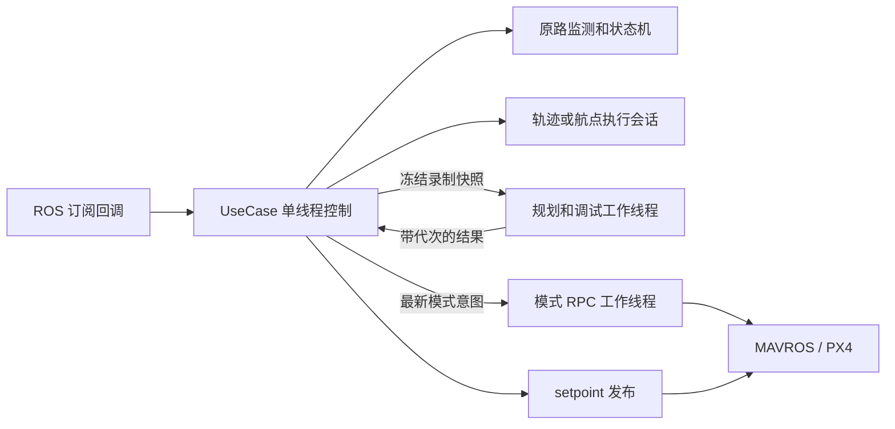
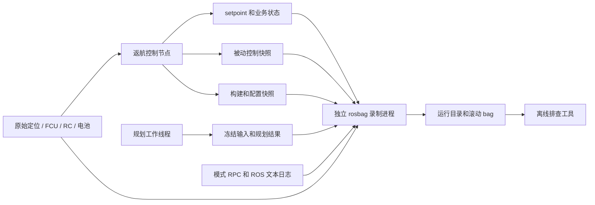

# 返航工程修复与验证

更新日期：2026-10-08。本文统一维护当前架构、接口、配置、修复记录、运行日志、验证结果和后续计划。旧方案、测试报告和接口说明已移入 `archive/pre_2026-10-05/`，用于追溯，不能作为当前行为规范。算法依据与开源方案对照见 [算法库工程审核](../../trajectory_core/doc/工程审核与集成交接.md)。

## 结论与版本

APP-01～16 及可读性整理保留。本次新增独立运行日志：被动控制观测、完整规划证据、rosbag 监督录制与离线排查；保留原 CSV 和 RViz 流程。核心库继续只负责几何、空间 yaw 和受约束名义时间剖面；返航模块负责执行进度、原路监测、输入有效性、规划降级、飞控控制权和降落交接。无需另换生产轨迹后端即可满足当前工程接口需求。

适用范围：多旋翼、RK3588、实际速度 <1 m/s、录制 <1 h；返航尽量贴合原路，正常偏移 <0.3 m、硬上限 ≤0.5 m，无在线避障。源码回归及真实 ROS 节点联调通过；Gazebo 理想外部定位下直线、直角、规划失败航点降级和运动中触发的返航/降落闭环通过。纯光流未能进入返航，GPS 场景触发原路保护暂停。实际定位由激光雷达 SLAM 提供，理想输入不能替代真实 SLAM、RK3588 和实飞验收，也不能表述为所有环境无 bug。

| 仓库/分支 | 状态 |
| --- | --- |
| 返航 `dev` | `feat/low-battery-rth` @ `bcb80e8` 已用 `--no-ff` 合并，合并提交 `b3db1c2` |
| 返航修复分支 | `fix/return-engineering-contracts`，逐项提交，未合回 dev，未推送 |
| 返航日志分支 | `feat/return-diagnostics`，基于修复分支 `1152820` 新建；日志功能逐项提交，未合回 dev，未推送 |
| 算法匹配版本 | `fix/trajectory-engineering-contracts` @ `597fd03`，算法源码基线 `4857b87`；本次日志工作未修改算法 |
| TOPPRA | 原工程对照保留，未在本轮引入生产返航链路或追加修改 |

本次联合构建使用上述算法修复版本的 `evaluateProgress` 接口。算法原目录目前的 `dev` @ `f27f3ad` 不具备该匹配接口，直接用它构建本返航分支会失败；搭建工作空间时先核实两个源码版本。日志验证的 98 个 C++、31 个 Python 用例和真实 ROS 管线结果见下文；2026-10-06 的 Gazebo、sanitizer 与 86 用例记录作为此前工程基线保留。

## 执行架构与进度契约



`BacktrackNode` 使用串行 `ros::spin()` 和默认 20 Hz `WallTimer`。业务状态只在该线程读写；工作线程仅持有自己的录制快照、轨迹结果、调试依赖和最新模式意图。没有通用线程池或任务框架。规划、航点构建、CSV 与 RViz 采样在同一规划线程顺序执行；模式服务独立，避免阻塞 setpoint 发布。

实际位置在局部路径上的投影只设置参考前进边界，预瞄最多 0.20 m。参考名义时间 τ 以受限速率 `r=dτ/dt` 连续推进，可减速至零；名义剖面的 C0 停车结点仍被经过。执行状态满足：

```text
s_ref = s_nominal(τ)
ds_ref/dt = v_nominal(τ) × r
d²s_ref/dt² = a_nominal(τ) × r² + v_nominal(τ) × dr/dt
position / velocity / acceleration / yaw / yaw_rate = evaluateProgress(上述同一进度)
```

生成阶段预留一半切向、上升/下降加速度给时钟调速。Rejoin 通过同一时钟限速，不在输出后单独裁剪速度。飞机停止或比规划慢，参考可停留超过名义时长，不据此完成任务。yaw(s) 为分段线性，结点处 yaw_rate 可改变；目前不承诺 jerk 或 yaw 加速度连续。

暂停冻结执行；显式恢复时，在剩余路径 1 m 局部窗口内重新接入，参考速度从零开始。重新接入是新的执行起点，不承诺与暂停前参考位置连续。降级会话保留剩余索引及原路连接线，不能从录制末端重走。正常完结需实际和参考剩余弧长、三维终点误差均 ≤0.20 m，实际三维速度 ≤0.20 m/s；降级到点及完结要求速度 ≤0.10 m/s。

触发后保持触发位置、继续录制实际制动尾段，速度 ≤0.10 m/s 才冻结录制并提交规划。准备阶段输出位置+yaw，只有规划可用、距当前目标 ≤0.40 m、实际速度 ≤0.20 m/s、yaw 误差 ≤15° 时激活。yaw 不满足时持续保持位置；超时只记录日志。

## 失败、输入与控制权

所有运行时生成失败和规划异常都尝试独立的原始航点模式，包括 FIT_FAILED、PROFILE_INFEASIBLE、过密几何和配置错误。它保留原始非共线顶点，只移除同方向共线冗余点，逐段细分到 ≤0.30 m；当前点到达半径 0.05 m，停稳且对准下一段 yaw 才切换。每次仅发送当前 position+yaw，PX4 不缓存整条队列。原始路径不可用或录制未达业务最少点数时，执行既有直接降落流程。启动配置解析失败直接退出，不能依赖运行时降级掩盖错误配置。

odom/state/RC 接收及控制间隔统一用 steady；ROS 消息 stamp 单独用于消息年龄、录制和复位检查。odom 默认接收超时 0.25 s，state 为 1.50 s；适配层另检查 ROS stamp 的年龄范围 [-0.05,0.25] s、有限坐标速度和近单位四元数。重复/回退 stamp、突跳、断联模式分别处理。无效输入不录制、不推进、不激活、不完成。

控制期间输入失效进入 Paused，坐标仍可信时发送最后有效位置的零前馈，state 新鲜且仍 OFFBOARD 时请求 POSCTL；数据恢复不自动恢复任务。定位复位锁存至 DISARM，禁止继续发送旧坐标目标。新鲜 DISARM、AUTO.LAND 和外部模式接管优先于 odom 检查。两个 tick 之间的 DISARM/ARM 也被保留，新飞行复位路径、规划代次及电量/RC 触发锁存。

外部退出 OFFBOARD 时进入 ControlYield，清除 setpoint、模式请求和旧规划。仅 CH7 显式长按、输入有效且回到剩余原路 0.10 m 内时恢复。RC 丢失及低电量不会抢回外部控制。AUTO.LAND 锁存让步至 DISARM。

| 状态字符串 | 当前含义 |
| --- | --- |
| IdleDisarmed / WaitRecordDelay / Recording | 未解锁、录制延时、录制 |
| Ch18HoverWait / ReturnPreOffboard | 故障悬停或返航准备，制动、规划、对准及 OFFBOARD 预发送 |
| ReturnActive / ReturnRejoin | 正常跟随或同源低速接回 |
| Paused | 人工暂停、原路预算或输入异常暂停；异常原因见日志 |
| ControlYield | 外部退出 OFFBOARD，停止控制输出，等待显式恢复 |
| LandingHover / LandingTransition | 到点悬停及 POSCTL→AUTO.LAND 请求 |
| AutoLandYield | 飞控降落已接管，等待 DISARM |

取消采用代次丢弃结果，最多一个待处理规划请求；已经运行的求解/导出不能强杀，节点退出可能等待它完成。模式 RPC 已派发时不能撤回，但结果不驱动状态机，激活只依据新鲜 FCU state。未派发旧意图会被新意图或空意图清除。目前没有规划超时或强制终止机制；默认低电量 15% 是否覆盖规划等待及剩余返航，仍需目标硬件和电池实测。航点模式保留密集顶点且逐点停稳转向，本轮 1.5 m 出航场景的降级执行约 79.8 s，正常轨迹约 29.4 s；不能假定降级耗时接近正常轨迹，也不能假定固定电量阈值足够。

## 原路偏移预算与 PX4 配置

正常和降级都监控完整原始录制折线的局部分支三维距离；不对原始输入先外部抽稀，不用自交处任意更晚段的最小距离代替路径顺序。正常实测偏离达到 0.15 m 进入 Rejoin；降级偏离达到该值暂停；正常准备态继续固定点保持，按 0.30 m 预测预算干预。以下预算达到 0.30 m，或实测达到 0.50 m，立即停进度、保持实际位置并请求 POSCTL：

```text
预测偏离 = 实测偏离 + 0.05 m 定位余量
         + 向外速度 × 0.10 s + 向外速度² / (2 × 0.50 m/s²)
```

默认拟合误差上限 0.08 m，预瞄 ≤0.20 m，轨迹三维速度 0.60 m/s，Rejoin ≤0.30 m/s。上述干预是基于定位、总延迟和实际制动能力的预算；不能把软件触发门槛等同于实机物理最大偏移证明。目标平台必须验证定位余量足够、响应不超过预算且制动能力不低于 0.50 m/s²。

position+velocity 中的速度是前馈，实际飞机仍可能更快；基础 position+yaw 模式也无法独立限制实际速度。目标 PX4 需配置并实测 XY/Z 速度上限 <1 m/s（初始建议各 0.60 m/s），以及与预算相符的制动。原地对准 yaw 由 PX4 限速，轨迹 yaw_rate_max=0.60 rad/s 仅约束运动轨迹；目标固件的有效 yaw 限制需验证。本轮 Gazebo 使用 PX4 v1.15.4、MAVROS 1.20.1，临时设置 MC_YAWRATE_MAX=45 deg/s 和 XY/Z 速度上限 0.60 m/s；结束后恢复原值。该参数组合仍需在目标固件与机型复验。

## ROS 接口与构建

| 输入 | 类型 / 约定 |
| --- | --- |
| /mavros/state | mavros_msgs/State，connected 才刷新状态接收时钟 |
| /Odometry_px4 | nav_msgs/Odometry；pose 在父 ENU，twist 在 child_frame_id，按姿态旋转到父 ENU |
| /mavros/rc/in | mavros_msgs/RCIn，CH7、CH18 及丢失检测 |
| /mavros/battery | sensor_msgs/BatteryState.percentage，0～1；NaN/无效百分比不触发低电量 |

| 输出 / 服务 | 类型 / 约定 |
| --- | --- |
| /mavros/setpoint_raw/local | PositionTarget，ENU 值交 MAVROS 转换；正常 mask=0x01C0，启用 acc 时为 0；位置+yaw 降级及输入/安全保持为 0x09F8；状态机固定点保持为 0x01C0、速度及 yaw_rate 前馈均为零 |
| /px4_backtrack/state | String，上表状态，前端须新增 ControlYield |
| /status_rc_loss | Bool，丢失期间 true，恢复后 false |
| /px4_backtrack/low_battery | Bool，确认低电量后锁存至新飞行；暂停时告警但不自动恢复 |
| /px4_backtrack/debug/waypoints / trajectory | MarkerArray / Path，latched；默认开启 |
| /px4_backtrack/log/control / planning | ControlDiagnostics / PlanningTrace，运行控制快照与完整规划证据，见日志章节 |
| /px4_backtrack/log/configuration / recorder_status | String JSON，构建/配置快照与独立录制健康 |
| /mavros/set_mode | SetMode，后台提交最新 OFFBOARD/POSCTL/AUTO.LAND 意图 |

配置入口为 [backtrack_params.yaml](../config/backtrack_params.yaml)、[trajectory_config.yaml](../config/trajectory_config.yaml)，通过 [launch](../launch/backtrack.launch) 加载。触发参数必须齐全；使用 YAML 的 CH7 2 s、CH18 确认 1 s/悬停 15 s、RC 超时 0.15 s/防抖 0.10 s、低电量 15%/确认 3 s。记录延时 15 s、最少 30 点、最大 15 Hz；预发送 20 帧、到点悬停 5 s。控制频率校验为 10～100 Hz，默认 20 Hz；实际输入频率应满足 freshness 门槛。改变这些参数需要按新预算复验。

```bash
# 容器 ROS_Noetic 内；两仓库均位于该工作空间 src，算法版本先按上表核实
source /opt/ros/noetic/setup.bash
cd /root/ROS_Noetic/backtrack_ws
catkin_make --force-cmake --pkg trajectory_core px4_backtrack_optimised \
  -DCMAKE_BUILD_TYPE=Release \
  -DBACKTRACK_BUILD_REVISION="$(git -C src/px4_backtrack_optimised describe --always --dirty)" -j4
source devel/setup.bash
roslaunch px4_backtrack_optimised backtrack.launch
```

MAVROS 和定位源由工程提供；仅 launch 本节点不会启动飞控。公共头文件安装至 include/px4_backtrack，显式依赖 roslib、tf2、Threads。UseCase 的内部回调 API 新增 steady 接收时间，不应再把 ROS stamp 传作执行时钟；该类型不作为通用算法库接口。

## 运行日志与离线排查

### 职责与记录内容

运行日志用于复盘“输入是什么、状态为何变化、参考为何停住、实际飞机与参考差多少、规划为何失败、模式请求是否发出、录制是否健康”。它与成功规划后的 CSV 图形导出并行存在。`debug_enable_csv_dump`、CSV 文件格式、目录和采样步长均保留；规划失败仍可从新日志恢复完整原始输入。



架构只有三个职责：控制/规划线程发布证据，独立 Python 节点监督成熟 `rosbag record`，离线 Python 工具读取证据生成报告。业务层诊断读取已保存的状态，不重新投影路径、不推进执行时钟；控制回调先派发输出，再发布快照，不写日志文件。完整规划数组在规划线程序列化。磁盘写入、LZ4 压缩、有界缓冲、分片轮转交给 rosbag；没有在控制链路加入自制日志队列或通用记录框架。录制失败不终止返航，但 CPU、内存和磁盘仍共享计算平台，需要实测日志开启后的调度余量。

| 证据 | 内容 / 频率 |
| --- | --- |
| `control` | 每个控制 tick（默认 20 Hz）：实际位置/速度/yaw、FCU 模式/解锁、输入年龄和拒绝原因、状态/触发/操作、录制点数、规划状态、参考/实际弧长、时钟速率、原路预算、降级索引、准备的 setpoint 与模式意图 |
| `planning` | 工作线程的 `started`、`finished`、必要时 `discarded`；每个阶段都带相同的完整原始点/yaw/时间、实际 core 配置，以及状态、错误文字、警告和后验检查摘要。latched 保留最新阶段 |
| `configuration` | 启动时 latched JSON：`build_revision`、节点实例、私有参数 XML、原轨迹配置路径/YAML、`use_sim_time`；先于配置校验发布 |
| `recorder_status` | 约 1 Hz 的墙钟心跳：状态、运行 ID、目录、错误、进程/退出码、剩余空间；latched。健康变化另写 ROS WARN/ERROR |
| 原始话题与 `/rosout` | 原始输入、实际发布的 setpoint/状态、CSV/RViz 相关可视化、ROS 文本；模式 RPC 的 request started/result INFO 也会进入离线事件 |

默认原始话题为 `/Odometry_px4`、`/mavros/state`、`/mavros/rc/in`、`/mavros/battery`、`/mavros/setpoint_raw/local`、`/px4_backtrack/state`、`/status_rc_loss`、`/px4_backtrack/low_battery`、两个 debug 可视化话题、四个日志话题、`/rosout` 和 `/clock`。它们不包含整个 SLAM 点云、PX4 ulog 或所有 MAVROS 诊断；通过 `log_topics` 追加有具体排查用途的质量/融合话题，避免无目的录制大流量传感器。

每次录制监督节点启动创建唯一 `run_<UTC时间>_<随机后缀>/`，内含 `manifest.json`、`recorder.log` 和多个 `flight_*.bag`。一份 run 可以覆盖多次 ARM/DISARM 和控制节点重启；不是每次 ARM 创建新目录。manifest 记录监督配置、命令、轨迹配置、已收到的运行配置历史和退出状态。`node_instance_id` 在控制节点启动时生成；工具按 `node_instance_id + flight_id + plan_id` 关联规划，避免不同节点重启后重复 ID 混在一起。

### 参数与绝对保存路径

参数位于 [backtrack_params.yaml](../config/backtrack_params.yaml)，由 launch 加载至 `/backtrack_node`；监督节点的私有 `config_namespace` 默认 `/backtrack_node`。参数在启动时读取，更改后重启相应节点。自定义启动方式应让监督节点指向控制节点的实际参数命名空间。

| 参数 | 默认值 | 含义 |
| --- | --- | --- |
| `log_enable` | `true` | 同时启用诊断发布和独立录制；关闭不会关闭 CSV/RViz |
| `log_output_dir` | `""` | 留空使用运行用户 `~/.ros/backtrack_logs`；非空必须是绝对路径，不展开 `~`，拒绝相对路径 |
| `log_split_size_mb` | `64` | 每片约 64 MiB，至少 64 MiB，且不得低于按 `record_max_hz` 计算的完整 latched 预算；不满足时拒绝启动录制。消息边界和索引会使文件略超门槛 |
| `log_max_splits` | `16` | rosbag 轮转保留的历史片数；Noetic 还可能保留当前一片，结束后也可为 17 片，不是硬 16 片上限。较早证据会被删除 |
| `log_buffer_mb` | `32` | rosbag 有界录制缓冲，单位 MiB；满队列可能丢记录并告警 |
| `log_min_space_mb` | `256` | 启动前检查最低剩余空间；运行时由 rosbag 和监督健康检测告警/暂停录制 |
| `log_keep_runs` | `5` | 包含当前 run，启动时优先清理确认已关闭、未被进程锁住的旧 run |
| `log_topics` | 默认核心话题 | 如设置，必须是非空绝对 ROS 话题名列表；与核心列表合并，不能通过它删除必要证据 |

例如希望文件随 Docker 挂载保留，在 YAML 中配置：

```yaml
log_enable: true
log_output_dir: "/root/ROS_Noetic/backtrack_ws/flight_logs"
# 可选：追加实际定位质量/复位或融合诊断话题
# log_topics: ["/slam/quality"]
```

这里是**容器内绝对路径**，应替换为实际挂载目录；只有这个目录映射到主机，日志才能在容器删除后继续保留。主机路径不能直接当成未挂载的容器路径使用。默认 `~/.ros` 属于容器运行用户，通常不在当前工作空间挂载内。CSV 的 `debug_csv_output_dir` 独立配置，不随 `log_output_dir` 改变。

默认分片窗口名义上约 `17×64 MiB=1.06 GiB/run`，不是硬字节上限；保留运行数与活动文件、索引、大消息会影响总占用。`--repeat-latched` 将当前配置与最新完整规划输入重复保存到新片；这有助于晚订阅和轮转后的复盘，但不能恢复已删除的控制历史或更早的规划。

Noetic rosbag 的 `--repeat-latched` 若在每片重放的数据大于分片门槛，可能不断开新片。压力测试中，54,000 点规划消息约 2.16 MB，底层直接使用 1 MiB 分片会触发开包循环，观察到至少 4514 次开片；原 RViz 和规划 latched 数据合计更大。因此启动前按一小时录制上界验证：点数 `ceil(3600×record_max_hz)+2`，每点 512 B，加 20,000 个可视化样本×256 B 和 4 MiB 余量，向上取整到 MiB，再与 64 MiB 取最大值。默认 15 Hz 和 20 Hz 均可用 64 MiB；100 Hz 至少 185 MiB，可设置 256。这个预算用于内置日志/可视化，不覆盖用户追加的大型 latched 点云/地图；追加话题时应核实合计大小、分片和录制缓冲，不能只按默认值保证完整保存。

### 启动、查看与导出报告

按“ROS 接口与构建”中的命令构建并 source 工作空间后，`backtrack.launch` 同时启动控制节点和监督节点。可以先检查：

```bash
rosparam get /backtrack_node/log_output_dir
rostopic echo -n 1 /px4_backtrack/log/recorder_status
rostopic echo -n 1 /px4_backtrack/log/control
```

健康心跳应显示 `state: recording`、实际 run 目录和空错误；出现 `failed` / `insufficient_space` 时先处理保存路径、权限、磁盘或 rosbag 进程。修改 ROS 参数但不重启不能改变已运行录制进程的输出目录。

结束时正常退出 roslaunch，使监督节点向 rosbag 发送 SIGINT、等待索引完成并写 manifest；必要时才升级终止信号。检查 manifest 的 `closed`、`interrupted`、`error`，并确认没有 `.bag.active`。分析时使用实际 run 目录：

```bash
# 在 ROS Noetic 环境中；将最后一级替换为 recorder_status 输出的真实目录
rosrun px4_backtrack_optimised inspect_flight_log.py \
  /root/ROS_Noetic/backtrack_ws/flight_logs/run_20261008T120000_000000Z_example \
  --output-dir /tmp/backtrack_log_report

# 也可以只分析指定分片；工具会检查可见的分片缺口
rosrun px4_backtrack_optimised inspect_flight_log.py \
  /absolute/log/run/flight_2026-10-08-12-00-00_0.bag \
  /absolute/log/run/flight_2026-10-08-12-00-00_1.bag \
  --output-dir /tmp/backtrack_log_report
```

运行目录输入默认在原目录生成报告；单 bag 默认生成旁边的 `<bag名>_inspection/`。推荐显式指定独立报告目录，保留原始证据目录。工具只读 bag，不自动修改或 reindex；读取 ROS 消息定义使用 bag 内动态定义，不需要 import 本包生成消息。

| 输出 | 用法 |
| --- | --- |
| `summary.json` | 按节点实例/飞行/规划分组，统计已收到样本的速度、原路/轨迹偏移、参考领先、控制间隔和耗时；列出序号缺口、缺字段、损坏、配置、录制状态/空间和告警 |
| `events.log` | 人可读状态/保护/触发/操作变化、规划结果、yaw 超时、模式意图与 RPC 回执、ROS WARN/ERROR；同一状态心跳和最近操作不每帧重复 |
| `planning_<节点>_<flight>_<plan>.json` | 原始顺序的完整规划位置/yaw/时间和有效 core 配置；可从失败、finished 或 discarded 阶段恢复。相同 ID 对应不同输入时保留替代证据并告警 |

返回码 `0` 表示没有读取级错误，但仍可能有警告；`2` 表示无完成 bag、未完成/损坏、缺 ROS 读取环境或报告写入失败。报告中的 `null` 表示无效、非有限或不可用，不替换成零；规划输入另列 `nonfinite_fields` 的原字段位置及 NaN/Infinity 类型，以保留失败原因。

`build_revision` 是 **CMake 配置时**嵌入二进制的标签，不是运行时仓库 HEAD。普通增量编译未必刷新标签；上述构建命令强制重配并显式传入 `git describe --always --dirty`。如果此前 CMake cache 中显式填写旧标签，重配时也应更新该参数。运行后以 configuration/manifest 中的标签定位实际二进制，源码目录后来切换分支不会改变已经构建的节点。

### 字段的时间、坐标和有效性

| 字段 | 解释 |
| --- | --- |
| `header.stamp`、bag 时间、`odom_stamp`、原始点时间 | ROS 时间；仿真可暂停、归零或跳变。不能用于判断控制墙钟间隔 |
| `steady_time`、规划 `steady_time_s`、操作时间 | 单调执行时钟；同一运行环境内用于间隔和输入接收年龄，不当作 UTC 日期，也不与 ROS stamp 相减 |
| `tick_sequence` / `node_instance_id` | uint64 控制回调序号，每节点实例从 1 开始；跨实例重新开始是正常重启。中间缺口表示未收到相应诊断，不能直接当成控制未运行 |
| `tick_interval` / `tick_cost` | 回调入口间隔 / 入口到控制、状态、模式意图派发的耗时。cost **不含后续诊断查询和序列化**；要结合下周期 interval、原始 setpoint 发布间隔及录制健康评估影响 |
| `odom_receipt_age` / `state_receipt_age` | steady 接收年龄；`-1` 表示未接受过消息，其他负值暴露时钟异常；结合 `inputs_fresh`、拒绝原因与 reset 标志读取 |
| `projected_s` / `target_s` / `reference_time` / `clock_rate` | 实际局部投影 / 参考弧长 / 连续名义时间 τ / `dτ/dt`；参考领先统计为 target−projected。按 `projection_valid` / `trajectory_valid` 门控 |
| `cross_track_error` / `route_distance` | 前者是相对生成轨迹的跟踪误差，后者是相对原始录制折线正确局部分支的三维距离，不能相互代替 |
| `route_predicted_deviation` | 原路制动预算；结合 `route_projection_valid`、`route_prediction_valid` 和最近 `route_safety_evaluation_time`。缓存值不是每一帧的新安全评估 |
| `operation_sequence` / `operation` | 最近操作原因变化时递增并锁存在快照；不是逐次重复尝试计数。具体服务尝试看 `/rosout` 的 started/result |
| `effective_config` / `acceleration_budget_scale` | 已应用半加速度预算并开启一致加速度输出的完整 core 配置 / `0.5`。原业务/轨迹配置在 configuration 和 manifest；不要复现时再次乘半预算 |
| `generation_cost_ms` | core 求解调用的墙钟耗时，不含请求等待、完整输入序列化、降级构建、CSV/RViz 和结果交付；不能当成总规划等待时间 |

规划原始数组保持**出航录制顺序**，不是已经逆序的返航曲线；逆序和切线 yaw 在 `TrajectorySession` 内处理。复现时应使用相同预处理及有效 core 配置，或从原业务配置重建该会话，避免重复缩放。`finished` 表示计算阶段结束，实际采用还需看 control 中的操作/会话状态；随后 `discarded` 表示结果因取消、换代或退出未交付。

控制快照的实际位置、旋转后的实际速度、规划原始点和准备的 setpoint 都是父 `map` 的 **ENU/SI 值**。原始 `/Odometry_px4` 的 twist 仍是该输入消息声明的 child 坐标；快照中的速度是返航适配层转换后的父坐标值。`/mavros/setpoint_raw/local` 是交给 MAVROS 的 ENU 数值；`coordinate_frame=FRAME_LOCAL_NED` 是 MAVROS 请求选择器，不能据此把 ROS bag 数值读成已经转换后的 NED。它不是 FCU 端接收/执行证据，分析飞控端仍需相应遥测或 PX4 ulog。

快照 setpoint 表示本 tick 准备/派发的目标，需结合 `should_publish_setpoint`、`setpoint_present`、type mask 和 acceleration presence；被忽略的零速度/加速度不能当作真实有效前馈。实际 ROS 发布看原始话题，RPC `sent` 也只代表服务请求返回认可，是否切换以新鲜 `/mavros/state` 为准。工具将 setpoint 和普通 ROS 文本关联到最近控制快照，仅是接收上下文；录制进程告警保留来源，不归因到飞机。ROS/bag 时间回退或跨文件重叠会另行告警。

### 常见排查与保留边界

| 现象 | 优先查看 |
| --- | --- |
| 返航停住或准备时间很长 | state、输入年龄/失败原因、yaw 超时、规划状态、clock_rate、projected/target 和模式 RPC/新鲜 FCU 状态 |
| 原路偏离或突然暂停 | route 两个 validity、最近评估时间、实测距离与预测预算、route_safety_hold/input_hold、定位拒绝和复位；再核实原始定位及 setpoint |
| 规划失败但继续飞 | planning status/message、完整输入与有效配置、fallback_ready/索引、原始 position+yaw setpoint；CSV 缺失本身不代表日志缺输入 |
| 飞机慢于规划或长期悬停 | 实际三维速度、参考领先、reference_time、clock_rate 的变化；不能只用名义 duration 判断完成 |
| 日志有序号缺口/开始片段不存在 | 监督健康、recorder.log 的队列/磁盘警告、bag split 编号和保留配置；不要把缺记录伪造成正常控制 |

保留策略删除旧片后，最新 latched 输入通常仍可找到，但早期状态、旧计划或事故前输入可能已经永久缺失。故障发生后应及时保存整个 run 和报告；若需要 <1 h 全程证据，依据实际话题流量增大保留窗口并验证磁盘容量，不依赖默认 16 片覆盖固定时长。`.bag.active`、损坏分片和未关闭 manifest 都应保留原件；需要恢复时先复制，再在副本上尝试 `rosbag reindex`，未写入的数据无法恢复，工具不会自动做修复。

清理只针对该监督器创建、确认关闭且未被锁住的旧 run。活动或异常退出后未确认关闭的目录会保留，因此实际目录数可能超过 `log_keep_runs`；这不是严格全磁盘配额。确认无进程占用并备份需要的证据后再人工处理异常目录。剩余空间不足会造成暂停/失败和告警；不会因此停止飞行控制，也不能据此承诺日志完整。

已经被 worker 领取的请求记录 started/finished，算完后取消或换代可记录 discarded。尚在 pending、未被领取就取消/覆盖的请求可能没有 planning trace；控制快照仍可显示提交/取消与 plan ID，不能把没有 trace 解释成计算失败，也不能保证恢复这类未执行请求的精确冻结输入。原始话题、ROS 传输、诊断发布队列和 rosbag 缓冲均存在丢记录可能；故障告警不提供确切丢弃数量。

初始化配置错误可能使控制节点在订阅建立前退出，因此不能保证录到启动 configuration topic。独立监督器仍保存可读取的原始参数/轨迹 YAML 到 manifest，并录制已收到的 ROS 错误与自身状态；本次错误 YAML 场景验证了这一行为。没有 control 快照时不能生成实际控制进度统计。

离线最大偏移/速度只是已收到且 validity 允许的采样最大值。它不是连续时间最大值证明，不能把“没有看到超限”写成整机 0.3/0.5 m 验收完成；实际 SLAM 质量、FCU 执行、RK3588 的持续录制负载和实飞仍需单独验证。

### 2026-10-08 日志验证

| 检查 | 结果 / 边界 |
| --- | --- |
| C++ 返航回归 | 98 个唯一 testcase 通过；新增诊断被动性、输入原因、规划成功/失败/取消证据覆盖 |
| Python 录制和离线工具 | 31 项通过（录制监督 16、离线排查 15）；含绝对路径/分片容量拒绝、保留/锁、关闭子进程、缺片/损坏、实例隔离、失败原始输入、NaN、健康心跳去重及冻结时钟下的数字分片顺序 |
| Release 联合构建、安装后实际运行 | 通过；使用上表匹配 core 修复接口，安装的节点/消息/录制及排查工具可运行 |
| 真实 ROS 节点与 rosbag 管线 | 492 个控制快照、4 个规划 trace、2 个节点实例和配置历史；正常 CSV 两份保留，FIT_FAILED 的 56 个原始点完整保存并可离线读取 |
| 参考停留、保护和控制权 | 参考停止、odom 丢失暂停/恢复、ControlYield、约 2 s 模式 RPC 阻塞均通过；实际 setpoint 发布最大间隔 <0.051 s |
| 日志配置故障隔离 | 故意设置相对保存路径后日志节点报告失败；返航节点仍约 20 帧/s 输出 |
| 安装后 launch 的四场景 | enabled：有控制/配置/真实 bag；disabled：无诊断、无日志目录；轨迹 YAML 类型错误：控制初始化退出，监督器仍录 status/rosout，manifest 保留原参数和错误 YAML，未录到启动 configuration topic；1 MiB 无效分片被拒绝、不创建日志目录，主节点仍有 29 个控制快照 |
| 冻结 ROS 时间和路径探测 | `/clock` 固定为 10 s 时仍收到监督墙钟心跳；相对路径及已有普通文件作为目录均明确失败 |
| 默认 64 MiB 完整 latched 压力 | 实际 C++ 诊断/可视化发布器生成 54,000 原始点（约 3599.93 s 录制量）、54,003 Marker 和 20,000 Pose；3 片 bag 均保留完整规划/RViz，冻结 `/clock=10 s`。全体及只读最后一片离线解析返回 0，最后一片恢复完整 54,000 点 |
| 压力快照与关闭 | 合成控制快照 295 帧，缺号 0；间隔平均/P99/最大 49.9999/50.0825/50.1073 ms，订阅到达最大 50.5006 ms；两次 PlanningTrace 发布调用约 1.44/2.00 ms。SIGINT 退出码 0、无 active、未升级终止信号 |
| 文件关闭与证据质量 | manifest closed、interrupted=false，无 active 文件；已收到区间中无中间诊断序号缺口。两个实例首序号为 4/3，有两条缺前段提示，另有故意制造的 recorder_unhealthy 告警；不能宣称零告警或全程无丢样 |

本次是真实 ROS 节点、独立 master、合成 FCU/定位与真实 rosbag 文件，不是本轮重新跑 Gazebo 或实机。结果统一见 [日志验证证据](evidence/2026-10-08/logging_validation.json)，总计 129 个唯一回归用例（98+16+15），零测试错误/失败；被测二进制的构建标签为 `6ac6346`，后续工具/测试修订单独提交。压力部分是 x86_64 上的合成发布器、一次近一小时量级快照，不是实际持续飞行一小时或真实控制节点的全部负载；RK3588 及真实持续录制未验收。冻结时钟下分片可具有相同 ROS 开始时间，离线工具按分片数字索引读入，避免把 `_10` 排在 `_2` 前而误报节点重启。

组件分片排序压力复读中，修复前曾误报一次序号复位，修复后为零；它绕过产品参数，不代表产品允许小分片。[C++ 压力源快照](evidence/2026-10-08/pressure_probe.cpp) 与 [Python 驱动快照](evidence/2026-10-08/pressure_probe.py) 仅用于审计，包含临时绝对路径和端口 11329，复现前需人工调整并使用隔离 master，不能直接连接飞行 master。

在包源码目录执行 Python 回归：`python3 -m unittest discover -s tests/unit -p 'test_flight_log_*.py' -v`。在已构建的工作空间根目录、source `devel/setup.bash` 后，可复现包含日志的合成控制场景：

```bash
python3 src/px4_backtrack_optimised/tests/integration/ros_control_scenarios.py \
  --node "$PWD/devel/lib/px4_backtrack_optimised/backtrack_node" \
  --config-dir "$PWD/src/px4_backtrack_optimised/config" \
  --recorder "$PWD/devel/lib/px4_backtrack_optimised/record_flight_log.py" \
  --inspector "$PWD/devel/lib/px4_backtrack_optimised/inspect_flight_log.py" \
  --output-dir /tmp/return-log-validation

# 另一个 shell：catkin_make install 后 source install/setup.bash，验证安装后的 launch
python3 src/px4_backtrack_optimised/tests/integration/ros_logging_launch_smoke.py \
  --launch "$(rospack find px4_backtrack_optimised)/launch/backtrack.launch" \
  --output-dir /tmp/return-log-launch-validation
```

两个脚本自行创建、清理独立 ROS master，不连接当前 PX4 或用户 ROS master；不要以这些合成场景代替飞行动力学验收。全包测试仍使用下文 catkin 命令。

## 问题与实施记录

- APP-01：所有轨迹生成失败统一尝试原始录制点的航点返航；包括配置错误和过密几何。没有可用路径或录制点未达业务最小数量时仍执行既有降落流程。配置错误保留日志，降级不能隐藏配置问题。测试覆盖错误配置可降级、无空间路径仍降落。
- APP-02：仅删除同方向共线点，保留每个非共线原始顶点，沿每条原始连接线细分到 0.3 m；不跨拐角。默认到点半径 0.05 m，切换前要求三维速度 ≤0.10 m/s 和下一段航向误差 ≤15°。位置+yaw 模式下由 PX4 控制原地 yaw 速度。覆盖短直角、未停稳、未对准、无效输入。
- APP-03：取消从头 restart 接口；暂停和恢复均保留当前剩余航点索引，不重建路径，不回到录制末端。恢复仍先固定当前位置，并由 APP-02 的停稳/航向门槛控制继续执行。
- APP-04：实际局部投影只设置最多 0.20 m 的预瞄边界，参考通过可减速的连续名义剖面时钟推进，保留剖面内停车结点。执行速度/加速度经链式求导后传入 evaluateProgress，yaw_rate 同步缩放；Rejoin 不再事后裁剪速度向量。停留可超过名义时长，不触发完成，随后可继续。生成阶段预留一半切向和竖直加速度预算给执行时钟。暂停冻结位置并清零前馈，恢复从零时钟速率开始。覆盖长时间停留、恢复、位置/速度一致性和低速限制。
- APP-05：完整原始点传入 core，不再在外部抽稀后以改变的折线做走廊证明。默认拟合预算 0.08 m，三维速度 0.6 m/s。新增有序原始折线局部三维监控，常规和降级路径共用；0.15 m 即进入慢速 Rejoin，降级偏离则停进度。预估偏离 = 实测偏离 + 定位余量 0.05 m + 向外速度×0.10 s + 向外速度²/(2×0.50 m/s²)，达到 0.30 m 或实测达到 0.50 m 即停进度、保持当前位置并请求 POSCTL。恢复必须显式操作且回到 0.10 m 内；安全停止不因 RC 丢失自动恢复。这是基于定位、延迟及制动假设的干预预算，不等同于实机物理上限证明。
- APP-06：控制循环和 RC/state/odom 接收时钟统一为 steady，ROS 消息 stamp 仅用于录制、消息年龄和复位检查；WallTimer 避免 ROS 时间停顿中断发布。默认 odom 0.25 s、state 1.50 s。有限值、四元数、重复/回退 stamp、突跳均检查；无效数据不推进、不完成、不激活、不录制。控制期间失效转暂停，位置坐标仍有效则发布最后位置零前馈，模式新鲜时请求 POSCTL，恢复必须显式操作。定位复位后禁止旧坐标 setpoint，锁存至 DISARM。DISARM 和 AUTO.LAND 优先于里程计检查。工程预算/频率校验，不允许正常轨迹 ≥1 m/s 或非零起止速度。飞行周期重置触发器锁存。
- APP-07：活动、Rejoin、降落前悬停，以及已确认 OFFBOARD 的准备阶段，外部退出 OFFBOARD 时进入 ControlYield，取消规划意图，冻结进度，清除所有 setpoint 和模式请求，优先于完成/降落判断。仅显式 CH7 长按且输入新鲜、剩余路径有效、回到恢复走廊内时恢复；RC 丢失和低电量不抢回外部控制。Paused 在已离开 OFFBOARD 后也不重复请求 POSCTL。AUTO.LAND 保持锁存至 DISARM。新增状态字符串 ControlYield，前端需显示。
- APP-08：规划/航点降级/CSV/RViz 放入专用单工作线程，控制循环只交付不可变录制快照并取结果；最多一个待处理请求，取消/暂停/新飞行/外部接管换代丢弃旧结果。调试最多 20000 个轨迹样本，异常只跳过导出。模式 RPC 独立工作线程，主循环每周期提交最新意图（含取消），未派发旧请求会被清掉；飞控状态确认仍是唯一激活依据。已经发出的 RPC 不能撤回，结果不会驱动状态转换；正在求解的算法不能强杀，取消只丢弃结果，节点析构会等待线程退出。阻塞规划和阻塞模式服务测试验证控制侧调用保持非阻塞。
- APP-09：正常轨迹完成要求实际剩余弧长、参考剩余弧长、三维位置误差均 ≤0.20 m 且三维实际速度 ≤0.20 m/s；降级终点速度 ≤0.10 m/s 才完成。Rejoin 末端也支持同样完成判据。覆盖竖直仍在运动不能完成、参考尚未走完不能完成，以及实际仅 0.1 m/s 的闭环返航直至终点。

- APP-10（复核追加）：原安装规则引用不存在的 include/px4_backtrack_optimised，修正为实际 px4_backtrack 命名空间目录；显式声明 roslib、tf2 依赖，避免靠 MAVROS 间接提供头文件和链接。以 catkin install 验证安装产物。

- APP-11（联合复核追加）：准备/等待规划阶段同样监控原路偏离并取消旧规划；正常和降级均需起始位置接近、三维低速和 yaw 对准才能激活。新鲜外部模式接管优先于里程计失效；回调保存 tick 之间的 DISARM 边沿，避免快速重新 ARM 沿用旧任务。覆盖阻塞规划期间漂移、外部退出同时无效 odom、两个 tick 间解除再解锁。

- APP-12（接口复核追加）：再次生成失败时清空旧轨迹与参考进度，避免会话复用返回上次成功结果；降级到点半径拒绝 NaN/非正数，防止比较失效导致错误推进。新增先成功后失败和无效半径回归。

- 可读性整理：把启动配置校验集中到具名参数检查，合并正常/Rejoin 的同源 setpoint 装配，按顺序集中控制步骤；规划线程和模式服务线程保持专门职责，无通用任务框架。会话状态异常时保持有效当前位置，避免默认原点目标。新增统一 clang-format 风格。

- APP-13（恢复场景复核追加）：恢复时先在 1m 局部剩余路径重新接入。正常参考可向实际进度重设零速度起点，降级只向前调整剩余索引并先接入原始连接线，均不回到已完成路径。修正准备态距离门槛误阻止航点间暂停恢复的问题；正常和降级共用恢复流程并保持 yaw 对准。覆盖航点之间暂停、手动沿路前移、零前馈重定位。

- APP-14（运动中触发复核追加）：触发后先固定点制动，继续录制真实制动/悬停尾段；三维速度 ≤0.10 m/s 才冻结原路并提交规划，避免未记录的惯性尾段被误判为越界。规划等待期仍监控冻结路径，结果到达后从当前局部实际位置零速接入，防止长规划期间回到旧起点。覆盖以 0.6 m/s 触发、规划尚未开始、尾段进入快照和停稳后激活。

- APP-15（Gazebo 集成追加）：实际 MAVROS state 由默认 1 Hz FCU heartbeat 驱动，原 0.50 s 超时会在正常消息间隙误暂停。默认改为 1.50 s 并保留真实丢失保护；增加 20 Hz 控制/1 Hz state 的执行与失联回归。模式接管反馈延迟仍取决于 heartbeat 周期，不能按 20 Hz 控制循环假定；原路预算由 odom 监控独立执行。

- APP-16（Gazebo 集成追加）：正常准备态不把 Rejoin 的 0.15 m 门槛误用作暂停门槛；yaw 对准时继续固定点纠偏，满足激活条件后由正常 Rejoin 接回。所有准备态仍执行 0.30 m 预测预算/0.50 m 硬门槛，降级仍在 0.15 m 暂停。覆盖 0.16 m 保持后接回和阻塞规划期间 0.26+0.05 m 预算超限取消。

### 独立提交索引

| commit | 工作内容 |
| --- | --- |
| `279fe5f` | fix(APP-01): 规划失败统一降级到原始航点返航 |
| `a174be6` | fix(APP-02): 保留原路拐角并停稳转向后切换航点 |
| `2f556f5` | fix(APP-03): 暂停恢复保留剩余航点进度 |
| `2c357d8` | fix(APP-04): 连续参考进度与速度加速度航向前馈保持一致 |
| `e13dad5` | fix(APP-05): 按原始三维路径监控偏离及制动预算 |
| `ca54e3b` | fix(APP-06): 校验输入新鲜度并隔离失效数据和定位复位 |
| `a8651d3` | fix(APP-07): 外部退出 OFFBOARD 后让出控制并显式恢复 |
| `11f2ab9` | fix(APP-09): 实际和参考进度收敛且三维停稳后完成返航 |
| `1174752` | fix(APP-08): 后台规划和模式服务保持控制发布非阻塞 |
| `6b1330d` | fix(APP-10): 修复头文件安装并声明直接 ROS 依赖 |
| `3985eaf` | fix(APP-11): 规划准备态同样执行偏离保护并优先让出控制 |
| `6a62353` | fix(APP-12): 生成失败清除旧轨迹并拒绝无效航点半径 |
| `4376710` | refactor: 明确配置检查与控制流程并统一参考目标输出 |
| `90ad85c` | fix(APP-13): 局部重新接入剩余路径并消除航点间恢复死锁 |
| `a1f54e1` | fix(APP-14): 运动触发录制制动尾段并从实际位置接入规划 |
| `a6af99f` | test: 验证真实 ROS 控制链路与曲线导数及最大规模边界 |
| `b1fe505` | fix(APP-15): 默认状态超时适配 MAVROS 一赫兹心跳 |
| `bf43e82` | chore: 为输入暂停和定位复位补充原因日志 |
| `88fd4ae` | fix(APP-16): 准备态按制动预算保持并在激活后接回 |
| `3127b48` | feat: 新增被动控制快照、节点实例和完整规划成功/失败/丢弃证据 |
| `ebde65f` | feat: 独立 rosbag 监督录制，绝对保存路径、空间检查、分片和运行保留策略 |
| `6ac6346` | feat: 离线事件/统计/规划输入报告，明确缺失和录制健康 |
| `673e523` | test: 修正创建测试子进程的 helper 名，避免 nose 误识别，保持 Noetic 测试发现正常 |
| `f2a6b86` | fix: 缺规划输入时说明未领取取消等可能性，不把提示单独判定为录制丢失 |
| `a5844aa` | fix: 校验完整 latched 数据的分片容量，拒绝可能反复开包的小分片 |
| `62690da` | fix: 分片按数字索引读取，避免冻结 ROS 时间下词典排序误报序号复位 |
| `3db947f` | test: 固化真实 ROS 录制/控制联调、安装启动四场景、大规模 latched 压力及紧凑证据 |

## 2026-10-06 工程基线验证与复现

验证使用 Docker ROS_Noetic 的隔离 `/tmp/trajectory-core-ros-validation`，两仓库源目录链接到挂载目录，build/devel/install 均在 `/tmp`；未覆盖用户工作空间构建产物。主机为 x86_64，不以该耗时代表 RK3588。

| 检查 | 最终结果 / 边界 |
| --- | --- |
| Release 联合构建及 install | 通过；节点和公共头文件安装产物存在 |
| 返航回归 | 11 个目标、86 个唯一 testcase，通过；含长时间停留、慢飞、曲线 yaw 导数、暂停恢复、自交局部投影、输入失效、控制让步和降级 |
| 核心库联合回归 | 12 个目标、140 个唯一 testcase，通过；没有修改算法源码 |
| ASan + UBSan + LeakSanitizer | Debug 全量 86 个功能用例通过，无报告错误；Release 才断言耗时门槛 |
| 最大录制量级 | 54,002 点，规划故意阻塞，Release 最大控制调用约 1.57 ms；包含冻结路径与快照。不是 RK3588 或复杂路线的时间证明 |
| 真实 ROS 节点联调 | 通过；模式 RPC 阻塞约 2.001 s，40 帧，最大发布间隔约 50.36 ms；0.1 m/s 合成实际跟随到终点、AUTO.LAND/DISARM、odom 丢失暂停、外部退出 OFFBOARD、真实 FIT_FAILED 航点降级 |
| PX4 SIH | 两轮解锁被健康检查拒绝；第二轮等待 20 s 后 commander check 仍 FAILED。未执行返航，不计飞控闭环通过 |
| Gazebo 光流 / GPS | 纯光流定位未就绪、OFFBOARD 被拒绝；GPS 进入返航/Rejoin，实测输入偏离约 0.250 m、预测达到 0.300 m 后正确暂停并请求 POSCTL，未完成正常返航 |
| Gazebo 理想 SLAM 输入 / 直线 | 完整返航、AUTO.LAND/DISARM 和场景检查通过；实际录制折线三维最大偏离 0.0856 m、速度峰值 0.3271 m/s、终点误差 0.1208 m，活动发布最大间隔 54.75 ms |
| Gazebo 理想 SLAM 输入 / 直角 | 完整返航、AUTO.LAND/DISARM 和场景检查通过；实际录制折线三维最大偏离 0.0897 m、速度峰值 0.3144 m/s、终点误差 0.0881 m，活动发布最大间隔 54.04 ms |
| Gazebo 理想 SLAM 输入 / 航点降级 | 合法严格走廊触发 FIT_FAILED 后逐点返航、降落通过；mask=0x09F8，无速度/yaw_rate 前馈，执行 79.8 s、速度峰值 0.1489 m/s、发布最大间隔 54.86 ms；未导出原始折线，精确偏移尚未验收 |
| Gazebo 理想 SLAM 输入 / 运动触发 | 触发时速度约 0.2350 m/s，后续记录约 0.46 s、0.0815 m 制动尾段；正常返航/降落通过，最大偏移 0.0963 m、速度峰值 0.2216 m/s、终点误差 0.1965 m、发布最大间隔 55.28 ms |
| RK3588 / 实飞 | 未执行；实际速度、物理偏移、定位、延迟、制动和电量待验收 |

真实 ROS 联调是独立 master 和合成 FCU，不包含 PX4 飞行动力学；终点误差约 0.20 m 对应当前完成容差，不作为原路偏移数据。Debug+sanitizer 最大规模调用约 0.17 s，不能用于生产发布频率验收。最初 PIE sanitizer 可执行文件启动出现无堆栈 DEADLYSIGNAL，隔离构建改用非 PIE 后稳定完成；泄漏检测保持开启。

```bash
# 验证工作空间内运行；catkin 汇总会重复统计嵌套 XML，以 testcase 去重为准
source /opt/ros/noetic/setup.bash
catkin_make -C /tmp/trajectory-core-ros-validation run_tests_trajectory_core \
  run_tests_px4_backtrack_optimised -j4
catkin_test_results /tmp/trajectory-core-ros-validation/build/test_results

# 新工作空间同样可运行此脚本；它自己创建并清理独立 ROS master
source /tmp/trajectory-core-ros-validation/devel/setup.bash
python3 /root/ROS_Noetic/backtrack_ws/src/px4_backtrack_optimised/tests/integration/ros_control_scenarios.py \
  --node /tmp/trajectory-core-ros-validation/devel/lib/px4_backtrack_optimised/backtrack_node \
  --config-dir /root/ROS_Noetic/backtrack_ws/src/px4_backtrack_optimised/config \
  --output-dir /tmp/return-ros-contracts
```

Sanitizer 使用独立 `/tmp/return-sanitizer-ws`，Debug、`-fsanitize=address,undefined -fno-omit-frame-pointer`，可执行链接再加 `-no-pie`，shared 链接保留 sanitizer，`ASAN_OPTIONS=detect_leaks=1:halt_on_error=1`、`UBSAN_OPTIONS=halt_on_error=1:print_stacktrace=1`。耗时断言仅 Release；所有规模、状态与结果断言仍在 Debug 运行。

工程基线证据见 [验证汇总](evidence/2026-10-06/validation_summary.json)、[ROS 联调结果](evidence/2026-10-06/ros_result.json)、[Gazebo 直线结果](evidence/2026-10-06/gazebo_ideal_straight.json)、[Gazebo 直角结果](evidence/2026-10-06/gazebo_ideal_l.json)、[航点降级结果](evidence/2026-10-06/gazebo_ideal_fallback_l.json)、[运动触发结果](evidence/2026-10-06/gazebo_ideal_moving_straight.json)及 [GPS 保护结果](evidence/2026-10-06/gazebo_gps.json)。2026-10-05 目录保留上一版 84 用例和 SIH 记录，不能覆盖后续结果。原始日志、CSV、rosbag 保存在容器 `/tmp/return-gazebo-*`；源码回归入口为 `tests/unit/`、`tests/integration/ros_control_scenarios.py`。

## 2026-10-06 SLAM 接入与仿真边界

用户确认实机由激光雷达 SLAM 发布 `/Odometry_px4`。工程现有 `odom_forward` 仅复制 pose/header 到 `/mavros/vision_pose/pose`，本轮未修改该仓库。返航读取的 SLAM 坐标必须与 PX4 接收 ENU setpoint 所使用的融合坐标一致；相同 frame_id 字符串不能证明这一点。必须核实实际 SLAM 的速度坐标约定，不能把父坐标速度作为 child 速度再旋转一次。

为隔离算法与定位，本轮临时桥接 Gazebo `iris_opt_flow` 模型的 ENU pose，依据仿真时间差分速度并转到 body，发布 `/Odometry_px4`，再通过原有转发节点接入 PX4。返回控制的输入与录制点均来自该理想定位。只验收这一输入条件下的飞行动力学、参考进度、yaw、原路跟随和降落；不覆盖 SLAM 误差、重定位、地图坐标变化或 GPS 精度。

仿真使用独立 ROS master 和临时 MAVROS，保留用户原有 PX4/Gazebo。先保存参数、停用外部融合 `EKF2_EV_CTRL=0`，再配置 `EKF2_GPS_CTRL=0`、`EKF2_OF_CTRL=0`、`EKF2_HGT_REF=3`，最后启用 `EKF2_EV_CTRL=11`（水平位置、竖直位置、yaw；现有转发不提供视觉速度）。若外部高度融合在切换参考前已经启动，会保留旧高度偏置；本轮首次坐标差 2.27/3.50 m，因此起飞前终止。修正初始化顺序后直线差 0.0112 m、直角差 0.0184 m。参数来自本地 v1.15.4 源码；目标版本不能直接照搬枚举。解锁始终由 PX4 自身检查，未绕过健康检查。

暂存复现脚本在容器 `/tmp/run_return_gazebo.py`、`/tmp/gazebo_return_scenario.py`、`/tmp/gazebo_odometry_bridge.cpp`、`/tmp/analyze_return_gazebo.py`；运行前 source ROS 和验证工作空间，场景参数 `straight`、`l`、`fallback_l` 或 `moving_straight`，分别使用独立输出目录。临时脚本依赖当前模型、端口和目录，不能用于实机。试验结束请求降落、确认 DISARM、恢复全部临时参数并清理自己启动的 ROS 进程。

理想定位的偏移是模型位置对其实际录制三维折线的距离，在 ReturnActive/Rejoin 期间取最大值；该轮直线/L 无自交，最近线段指标适用。2026-10-06 降级验证时 worker 不导出失败原始点 CSV，因此只确认完整返航、输出、速度和发布间隔，不提供其精确原路偏移结论；本次新规划日志补充失败输入，但没有据此重新认证此前仿真的偏移。运动尾段的时长/位移按记录点时间和最近 odom 样本计算，包含回调收时误差；最后一个录制点不一定就是停稳瞬间，15 Hz 录制节流仍生效。GPS 的真值插值指标仅保留为探索数据，尚未认证时间对齐，不能用于物理上限结论。发布最大间隔仅按连续控制状态统计，降落交接不计作发布缺口。

目前输入检查能拒绝非有限值、超时、时间回退和明显突跳；不能从一条新鲜 Odometry 判断 SLAM 是否可靠、EKF 是否健康或两者是否逐渐漂移。后续必须验证定位质量/协方差、复位事件、PX4 融合状态和坐标残差的消费方式，并按实测结果修订 0.05 m 定位余量。这是整机剩余验收项，不能以软件保护门槛宣称已保证 0.3/0.5 m。

## 后续统一计划

1. **先验收实际 SLAM 接入并补全仿真矩阵。** 核实 `/Odometry_px4` 的父/child 坐标、速度语义、stamp、质量/复位，以及与 PX4 融合位置/yaw 的一致性；据真实系统确定失效保护输入。理想定位直线、直角、运动触发和航点降级闭环已通过，继续覆盖短段、竖直、爬升转弯、闭合/自交、yaw 限速、暂停和异常输入；为降级补齐原始折线证据再验收偏移。GPS/光流场景先解决融合精度和初始化，再验收偏移；SIH 作为可选环境复查健康失败，不阻塞已有 Gazebo 链路。按原始路线正确分支的三维真值取最大值，不能用目标追踪误差或 P95 代替。
2. **在 RK3588 验证完整工程预算。** 最大录制量级和复杂路径，CSV/RViz/日志开启与关闭、连续录制和轮转、慢求解/模式 RPC，内存、冻结快照、发布最大间隔、规划耗时和剩余电量；按实际流量确定完整录制窗口，据实测决定是否需要规划等待期限。要求实际速度 <1 m/s，验证定位 0.05 m、反应 0.10 s、制动 ≥0.50 m/s² 的假设，重新分配预算。
3. **做受控实飞和合并审核。** 先验收定位、控制权与低电量保护，再覆盖正常/降级的偏移 <0.3 m、最大 ≤0.5 m。确认前端 ControlYield、odom 坐标约定及实际 PX4 速度/yaw 参数；通过后审核修复分支，再决定合回 dev。
4. **复用到航线飞行模块。** 继续使用独立 trajectory_core 与同一一致进度契约，业务明确航点穿越/停车、yaw 来源、完成与控制权；不复制返航触发器或 MAVROS 逻辑进算法库。
5. **最后优化保守调速。** 按算法审核方案收紧区间界，再评估 TOPPRA 实际收益；始终保留完整走廊/运动后验检查、C0 停车和变化 yaw。TOPPRA 修改仍放其 dev 分支逐项提交。目前不引入新的生产后端。
