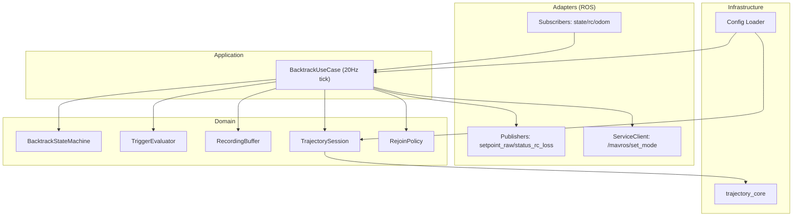
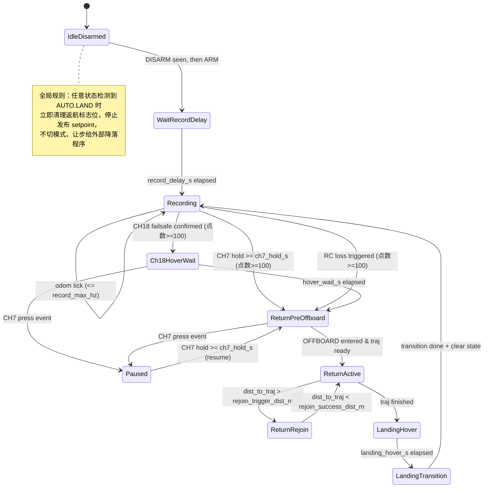

# 返航实现技术文档（C++ 重构版）

面向：ROS1 Noetic + MAVROS + PX4（以 v1.15.4 为主要验证目标）  
语言/标准：C++17  
目的：描述“新返航程序”的分层架构、状态机、ROS 接口与关键行为，使团队在不阅读源码的前提下能够复现、联调与验收。

> 说明：本文件描述的是“新 C++ 返航程序”。旧版 Python 程序与旧文档仅作为行为对齐依据。

---

## 1. 目标与硬约束

### 1.1 必须满足的外部行为（与旧版对齐）

- 触发机制与优先级完全一致：
  - 通道 7：长按启动；返航/等待中“按下事件”立即暂停并切 `POSCTL`；支持断点续航
  - 通道 18：低电平确认后进入 15s 固定点悬停等待，等待结束才返航；等待中恢复也不自动取消（仅通道 7 取消）
  - RC 消息丢失：基于 `/mavros/rc/in` 消息停止更新触发
  - `AUTO.LAND` 优先级最高：不触发返航、不发布 setpoint、不切模式，清除返航相关标志位
- 飞行周期复位策略保留：必须经历一次 DISARM，下一次 ARM 才进行复位并在延时后开始录制（延时可配置，默认 15s）
- 返航完成后的降落过渡保留：`OFFBOARD -> POSCTL -> AUTO.LAND`（为规避 PX4 v1.15.4 的已知问题，固定实现，不做参数化）

### 1.2 ROS 接口硬约束

- Topic/Service 名称与消息类型固定（不新增接口）：
  - 发布：`/mavros/setpoint_raw/local`（`mavros_msgs/PositionTarget`）
  - 发布：`/status_rc_loss`（`std_msgs/Bool`）
  - 订阅：`/mavros/state`（`mavros_msgs/State`）
  - 订阅：`/mavros/rc/in`（`mavros_msgs/RCIn`）
  - 订阅：`/Odometry_px4`（`nav_msgs::Odometry`）
  - 调用：`/mavros/set_mode`（`mavros_msgs/SetMode`）

### 1.3 控制输出约束

- setpoint 发布必须稳定周期性（固定 20Hz）
- 控制使用 `PositionTarget`：
  - 默认控制：`position + velocity + yaw + yaw_rate`
  - `acceleration` 为可选项（若启用则额外输出 `afx/afy/afz` 并更新 `type_mask`）

---

## 2. 运行条件与依赖

### 2.1 依赖

- ROS1 Noetic（`roscpp`）
- MAVROS（可与 PX4 连通，`/mavros/set_mode` 可用）
- 轨迹生成库：`trajectory_core`（配置可由 YAML 加载）

### 2.2 前置条件（验收前必须满足）

- `/mavros/state` 持续更新且能正确反映 `armed` 与 `mode`
- `/Odometry_px4` 持续更新且坐标/朝向与实际一致
- `/mavros/rc/in` 在遥控器正常时持续更新
- 飞控允许进入 `OFFBOARD`，且能跟踪 setpoint（否则返航无法执行）

---

## 3. 坐标系与单位约定

### 3.1 里程计输入

- `/Odometry_px4`：`nav_msgs::Odometry`
  - 位置：ENU（x=East, y=North, z=Up）
  - yaw：绕 +Z 轴，逆时针为正（rad）
  - 时间戳：使用 `msg->header.stamp.toSec()` 作为录制的原始时间参考；生成轨迹输入时会重建单调递增的相对时间轴（见 10.1）

### 3.2 setpoint_raw 输出

- 发布话题：`/mavros/setpoint_raw/local`
- 消息：`mavros_msgs::PositionTarget`
- `coordinate_frame`：填 `FRAME_LOCAL_NED`
- **坐标转换约定**：实现端不做 ENU→NED 转换，直接使用 ENU 的数值与 yaw（系统约定由 MAVROS 完成对应处理）。

> 联调要求：若出现方向/高度符号错误，首先排查系统链路是否存在“重复转换/未转换”问题；本实现侧不做任何坐标变换。

---

## 4. ROS 接口定义

### 4.1 订阅（输入）

- `/mavros/state`（`mavros_msgs::State`）
  - `armed`：飞行周期复位与触发条件
  - `mode`：`AUTO.LAND` 优先级判断、`OFFBOARD` 进入判断
- `/Odometry_px4`（`nav_msgs::Odometry`）
  - 录制航迹（位置 + yaw + timestamp）
  - 执行阶段的当前位置、偏离轨迹距离判定
- `/mavros/rc/in`（`mavros_msgs::RCIn`）
  - 通道 7（index=6）按钮逻辑
  - 通道 18（index=17）故障触发
  - RC 消息丢失检测基准（消息是否持续到达）

### 4.2 发布（输出）

- `/mavros/setpoint_raw/local`（`mavros_msgs::PositionTarget`）
  - 20Hz 稳定发布（返航、固定点悬停、预发送 OFFBOARD 等阶段）
- `/status_rc_loss`（`std_msgs::Bool`）
  - 语义保持旧版：当 `channels.size()>=18` 时，每次收到 `/mavros/rc/in` 都发布一次：
    - `True`：通道 18 值 `>= 900`
    - `False`：通道 18 值 `< 900`

### 4.3 服务（调用）

- `/mavros/set_mode`（`mavros_msgs::SetMode`）
  - 仅使用：`OFFBOARD`、`POSCTL`、`AUTO.LAND`

---

## 5. 配置文件与参数约定

配置分为两份：

1) **返航节点参数 YAML**：通过 launch 的 `rosparam` 加载（触发开关、延时、阈值等）  
2) **trajectory_core 配置 YAML**：由返航节点通过“配置文件路径参数”加载，不热更新

### 5.1 返航节点参数（建议字段与默认值）

> 参数名允许后续调整，但需在文档与实现中保持一致。

- `publish_hz`: `20.0`（固定，建议仍写出用于自检）
- `record_delay_s`: `15.0`
- `record_min_points`: `100`
- `record_max_hz`: `10.0`（录制上限：对高频 odom 做节流）

- `enable_trigger_ch7`: `true`
- `ch7_pressed_threshold`: `1500`（`<1500` 视为按下）
- `ch7_hold_s`: `2.0`（长按启动）

- `enable_trigger_ch18`: `true`
- `ch18_failsafe_threshold`: `900`（`<900` 判定失控）
- `ch18_confirm_s`: `1.0`（持续时长确认）
- `ch18_hover_wait_s`: `15.0`（固定点悬停等待）

- `enable_trigger_rc_loss`: `true`
- `rc_loss_timeout_s`: `0.15`（多久未收到 `/mavros/rc/in` 判定丢失）
- `rc_loss_debounce_s`: `0.1`（防抖，持续丢失则触发）

- `pre_offboard_setpoint_count`: `20`（写死也可；本文档描述为固定 20）

- `rejoin_trigger_dist_m`: `0.5`
- `rejoin_success_dist_m`: `0.1`
- `rejoin_v_max_m_s`: `0.3`
- `rejoin_lookahead_time_s`: `0.5`（建议默认；可按实测调整）

- `landing_hover_s`: `5.0`（返航结束后的固定点悬停）

### 5.2 trajectory_core 配置路径参数

- `trajectory_config_path`: `""`（必填；由 launch 指定）
  - 返航节点启动时读取该路径并加载 `trajectory_core::TrajectoryConfig`
  - 不支持运行时热更新

---

## 6. 分层架构（DDD）

### 6.1 分层原则

- Domain（领域层）：返航业务规则，不依赖 ROS/MAVROS
- Application（应用层）：编排 Domain 与外部 I/O，形成“可运行用例”
- Adapters（适配层）：ROS Topic/Service 的输入输出适配
- Infrastructure（基础设施层）：trajectory_core、YAML 加载、时间/数学工具等

### 6.2 模块职责（建议拆分）

- Domain
  - `BacktrackStateMachine`：状态机（状态迁移、动作请求）
  - `RecordingBuffer`：航迹录制与节流（<=10Hz），输出 Waypoint 序列
  - `TriggerEvaluator`：通道 7/18/RC 丢失的触发判定（可配置启用）
  - `TrajectorySession`：轨迹生成结果与执行进度（时间轴 t、暂停点、采样缓存）
  - `RejoinPolicy`：偏离轨迹检测、回归目标计算、速度限幅
- Application
  - `BacktrackUseCase`：每个 20Hz tick 计算应发布的 setpoint、是否切模式、是否进入/退出录制
- Adapters (ROS)
  - Subscribers：`/mavros/state`、`/mavros/rc/in`、`/Odometry_px4`
  - Publishers：`/mavros/setpoint_raw/local`、`/status_rc_loss`
  - Service client：`/mavros/set_mode`
- Infrastructure
  - `trajectory_core`：轨迹生成、`Trajectory::evaluate(t)`
  - YAML：加载 `trajectory_config_path`（以及返航节点 rosparam）

### 6.3 分层图（Mermaid）

---

## 7. 状态机设计

### 7.1 状态枚举（建议）

- `IdleDisarmed`：未 ARM 或启动初期
- `WaitRecordDelay`：检测到“DISARM 之后的 ARM”，复位并等待 `record_delay_s`
- `Recording`：录制航迹（<=10Hz）
- `Ch18HoverWait`：通道 18 触发后的 15s 固定点悬停等待
  - 进入时：锁定当前位置作为悬停目标
  - 预发送固定点 setpoint 达到 `pre_offboard_setpoint_count` 次后开始尝试切 `OFFBOARD`
  - **15s 倒计时从进入 `Ch18HoverWait` 后开始**（不依赖是否已切入 OFFBOARD）
  - 期间持续 20Hz 发送固定点 setpoint（维持悬停，保证 setpoint 流不断）
  - 倒计时结束后进入 `ReturnPreOffboard`
- `ReturnPreOffboard`：返航触发后，预发送 setpoint 并切 `OFFBOARD`
- `ReturnActive`：沿轨迹执行（含偏离检测）
- `ReturnRejoin`：偏离过远，慢速回归到轨迹（回归后返回 `ReturnActive`）
- `Paused`：通道 7 按下事件导致暂停（切 `POSCTL`，不发布 setpoint，保留轨迹/进度）
- `LandingHover`：轨迹结束后固定点悬停 `landing_hover_s`
- `LandingTransition`：执行 `OFFBOARD -> POSCTL -> AUTO.LAND` 过渡并清理

> `AUTO.LAND` 不是“内部状态”，而是外部飞控模式；一旦检测到 `AUTO.LAND`，状态机强制回退到 `Recording/Idle` 逻辑并清空返航标志位（详见 7.3）。

补充约定（与实现对齐）：

- `Ch18HoverWait` 阶段会**持续尝试**进入 `OFFBOARD`（以获得更稳定的固定点悬停），但不把“成功切入 OFFBOARD”作为倒计时前置条件：
  - 进入时锁定当前位置作为悬停目标
  - 预发送固定点 setpoint 达到 `pre_offboard_setpoint_count` 次后开始尝试 `set_mode=OFFBOARD`（建议对服务调用做节流，例如 1Hz）
  - 15s 倒计时从进入 `Ch18HoverWait` 起计时；即使暂时未进 OFFBOARD，也继续倒计时与固定点发布，避免因“无法切模”而卡死不返航
  - 监测告警：若进入 `Ch18HoverWait` 后连续 `5.0s` 仍未切入 `OFFBOARD`，应输出 `WARN/ERROR` 日志（包含当前模式、计数器、失败原因）
- 15s 等待结束后仍然需要进入返航初始化流程（生成轨迹、初始化会话、建立时间轴进度等）。因此，结束时会先进入 `ReturnPreOffboard`：
  - 若此刻已经处于 `OFFBOARD`，则 `ReturnPreOffboard` 跳过切模式流程，直接生成轨迹并进入 `ReturnActive`
  - 若此刻仍未进入 `OFFBOARD`，则 `ReturnPreOffboard` 继续执行“预发送 setpoint + 切 OFFBOARD”的策略，避免在等待阶段切模失败导致返航无法开始

### 7.2 状态机图（Mermaid）

> **状态图补充说明**：
> - 所有返航触发（CH7/CH18/RC丢失）均在触发时检查点数是否 >= `record_min_points`，点数不足时不进入返航相关状态，仅记录错误日志
> - `Paused` 状态下不会恢复录制；若需重新录制，必须经历完整的飞行周期复位（DISARM -> ARM）
> - `AUTO.LAND` 是全局优先级最高的外部模式，不是状态机内部状态

### 7.3 `AUTO.LAND` 优先级处理（全局规则）

任意 tick 若检测到 `mavros/state.mode == "AUTO.LAND"`：

- 不允许进入/维持 `Ch18HoverWait`、`ReturnPreOffboard`、`ReturnActive`、`ReturnRejoin`、`LandingHover`
- 不发布 `/mavros/setpoint_raw/local`
- 不主动调用 `/mavros/set_mode`
- 清理返航相关标志位（相当于“让步给一键降落/外部程序”）

---

## 8. 录制流程（/Odometry_px4）

### 8.1 何时开始录制（飞行周期复位）

- 节点启动时不会立即录制
- 只有在检测到一次 `armed: True -> False`（DISARM）后，下一次 `False -> True`（ARM）才认为进入“新飞行周期”
- 新飞行周期开始时：
  - 清空录制缓存、清空返航会话、复位内部计数器
  - 进入 `WaitRecordDelay` 并等待 `record_delay_s`（默认 15s，可配）
- `WaitRecordDelay` 到期后进入 `Recording`

### 8.2 录制内容与节流

- 每次录制点包含：
  - `x,y,z`：来自 `odom.pose.pose.position`
  - `yaw`：从 `odom.pose.pose.orientation` 计算（只记录 yaw）
  - `t`：**相对时间戳**，使用 `odom.header.stamp.toSec() - first_odom_stamp`
    - 确保从 0 开始单调递增
    - 若系统时间戳不可靠，可用固定 dt（0.1s）累加替代
- 录制频率：
  - 以 `/Odometry_px4` 的消息流为输入
  - 但实际写入缓存有上限：`record_max_hz`（默认 10Hz）
- 录制期间只要进入 `Ch18HoverWait/Return*` 等返航相关状态，停止录制（暂停也不允许录制）

> **注意**：`trajectory_core` 的 `Waypoint.timestamp` 主要用于时间质量检查（单调性、间隙检测），不保证复现原始时序。生成的轨迹有独立的内部时间轴 `[0, duration]`，断点续航基于 `t_progress`（轨迹内部时间）实现，与录制时间戳无关。

### 8.3 录制点数下限（触发时检查）

**检查时机**：在任何触发条件（通道 7 长按、通道 18 确认、RC 丢失）满足时，**立即检查**录制点数是否 >= `record_min_points`（默认 100，约等于 10 秒 @10Hz）。

**点数不足时的行为**：
- 记录错误日志（建议包含当前点数与阈值）
- **不进入**返航相关状态（`Ch18HoverWait`、`ReturnPreOffboard` 等）
- 不切模式，不发布 setpoint
- 保持当前 `Recording` 状态继续录制

> **重要**：点数检查必须在触发时完成，而不是等到悬停结束或进入 `ReturnPreOffboard` 后再检查。这样可以避免"悬停 15s 后才发现点数不足"的无效等待。

---

## 9. 触发机制（与旧版一致，可配置启用）

### 9.1 通道 7（启动/暂停）

- 通道：`/mavros/rc/in.channels[6]`
- 判定按下：值 `< ch7_pressed_threshold`（默认 1500）

规则：

- 启动返航（Recording/Paused 时有效，且不在 `AUTO.LAND`）：
  - 按住持续 `>= ch7_hold_s`（默认 2.0s）
  - 进入 `ReturnPreOffboard`
- 暂停返航（在 `Ch18HoverWait` 或任意 `Return*` 状态时）：
  - 检测到一次“按下事件”（未按下 -> 按下）
  - 立即进入 `Paused` 并调用 `set_mode=POSCTL`
  - 停止发布 setpoint，保留轨迹会话与进度（断点续航）

### 9.2 通道 18（故障触发 + 15s 等待）

- 通道：`/mavros/rc/in.channels[17]`
- 判定失控：值 `< ch18_failsafe_threshold`（默认 900）
- 确认：持续失控 `>= ch18_confirm_s`（默认 1.0s）

行为：

- 确认后进入 `Ch18HoverWait`：
  - 锁定进入时的当前位置为“固定点悬停目标”
  - 固定点重复发布持续 `ch18_hover_wait_s`（默认 15s）
  - 等待结束后进入 `ReturnPreOffboard`
- 若等待阶段通道恢复正常：仅记录日志，不自动取消等待；取消需通道 7 按下事件

### 9.3 RC 消息丢失（基于消息停止）

- 若 `enable_trigger_rc_loss=true`：
  - 在 ARM 且不在 `AUTO.LAND` 时：
    - 超过 `rc_loss_timeout_s`（默认 0.15s）未收到新的 `/mavros/rc/in`
    - 再等待 `rc_loss_debounce_s`（默认 0.1s）仍未恢复
    - 触发返航，进入 `ReturnPreOffboard`

---

## 10. 轨迹生成（trajectory_core 接入）

### 10.1 Waypoint 构造

`trajectory_core` 的输入 Waypoint 同时包含“空间顺序”和“时间戳单调性”两类约束：

- **空间顺序（返航语义）**：返航应从当前位置沿录制路径回到起飞点，因此输入给库的 `position/yaw` 应使用录制序列的逆序（从最新点回到最早点）。
- **时间戳单调性（库的输入约束）**：`Waypoint.timestamp` 应为单调递增序列。若直接对录制序列做逆序并保留原始 `t`，会导致时间戳递减，从而触发库的时间异常检测（甚至回退/报错）。

因此，构造 Waypoint 时采用以下规则：

1) 位置与 yaw：使用录制点序列的逆序。
2) timestamp：**不直接使用逆序后的原始录制时间戳**，而是将其镜像成一个从 0 开始单调递增的相对时间轴：
   - `t_new[i] = t_rec_last - t_rec_rev[i]`
   - 其中 `t_rec` 是录制缓存中的相对时间戳（见 8.2）
   - 这样 `t_new` 会从 0 增加到总录制时长，同时保留原始采样间隔关系

> 备注：本项目的断点续航基于轨迹内部时间轴 `t_progress` 实现，`t_new` 的主要作用是满足库的时间质量检查，而不是复现录制时序。

### 10.2 轨迹生成时机

进入 `ReturnPreOffboard` 时，根据前置状态有不同行为：

**若从 Recording/Paused 进入**（未在 OFFBOARD）：
1. 锁定当前位置作为临时悬停目标
2. 以 20Hz 发布固定点 setpoint
3. 连续发布超过 `pre_offboard_setpoint_count` 次后，调用 `set_mode=OFFBOARD`
4. 同步生成轨迹（期间继续发布固定点 setpoint，保证 setpoint 流不断）
5. 检测到 OFFBOARD 且轨迹就绪后进入 `ReturnActive`

**若从 Ch18HoverWait 进入**（已在 OFFBOARD）：
1. 继续发送固定点 setpoint（维持悬停，保证 setpoint 流不断）
2. 同步生成轨迹
3. 生成完成后立即进入 `ReturnActive`

**若从 Paused 恢复**（轨迹已存在）：
1. 预发送 setpoint + 切 OFFBOARD（若未在 OFFBOARD）
2. 不重新生成轨迹，继续使用已有轨迹和冻结的 `t_progress`

**轨迹生成流程**：
- 读取并冻结当前录制缓存（确保执行过程中录制不再变化）
- 点数检查已在触发时完成（见 8.3 节），此处不再重复检查
- 使用 `trajectory_config_path` 加载 `TrajectoryConfig`
- 调用 `TrajectoryGenerator::generate(waypoints, config)`
- 根据生成结果处理：
  - **成功**：创建 `TrajectorySession`，保存 `traj` 指针，记录 `t_start`，预采样缓存（建议 `dt=0.05`）
  - **失败（退化处理）**：若 `trajectory_core` 返回失败（如拟合失败、速度剖面不可行等），启用退化模式：
    - 将录制点序列重采样为每 0.3m 一个点的稀疏路径
    - 使用 `/mavros/setpoint_position/local`（`geometry_msgs/PoseStamped`）逐点发送
    - 记录警告日志，标记当前处于退化模式
    - 退化模式下不支持断点续航（暂停后恢复将重新从头开始）

> **关于轨迹生成耗时**：轨迹生成采用同步方式，生成期间**持续发布固定点 setpoint 以维持悬停**，因此不会因生成耗时而中断 setpoint 流。无需硬性规定生成耗时上限，但建议尽量控制在合理范围内（如 <500ms）以提升用户体验。

### 10.3 轨迹执行时间轴（断点续航一致性）

- 轨迹内部时间轴使用 `t`（秒），对齐 `Trajectory::evaluate(t)`
- 会话维护：
  - `t_progress`：当前执行进度（轨迹时间）
  - `t_progress` 的推进由“运行中的 wall time”累加而来
- 暂停/恢复：
  - 进入 `Paused` 时冻结 `t_progress`
  - 恢复时继续从冻结的 `t_progress` 往后推进（不重规划、不重置时间轴）

---

## 11. 返航执行与控制输出（20Hz）

### 11.1 OFFBOARD 进入策略（预发送 + 切模式）

- `ReturnPreOffboard` 阶段：
  - 以 20Hz 发布“当前位置 setpoint”（raw setpoint，目标与当前位置一致）
  - 连续发布超过 `pre_offboard_setpoint_count=20` 次后，调用 `/mavros/set_mode` 切到 `OFFBOARD`
  - 检测到 `state.mode == "OFFBOARD"` 后进入 `ReturnActive`

`Ch18HoverWait` 阶段同样使用“预发送后切 OFFBOARD”的策略，确保等待期间也能稳定悬停；但 **15s 等待结束后仍要进入 `ReturnPreOffboard`** 来完成“轨迹生成 + 会话初始化”。若等待阶段已经处于 `OFFBOARD`，则 `ReturnPreOffboard` 应跳过切模式流程并直接进入 `ReturnActive`。

### 11.2 PositionTarget 填充规则

默认（方案 B）：

- `coordinate_frame = FRAME_LOCAL_NED`
- `type_mask`：忽略 `afx/afy/afz`，启用 `position + velocity + yaw + yaw_rate`
- 字段：
  - `position.(x,y,z)`：来自轨迹状态 `state.position`
  - `velocity.(x,y,z)`：来自轨迹状态 `state.velocity`
  - `yaw`：来自 `state.yaw`
  - `yaw_rate`：来自 `state.yaw_rate`

加速度可选：

- 当轨迹配置/实现选择输出加速度时：
  - 清除 `IGNORE_AFX/IGNORE_AFY/IGNORE_AFZ`
  - 填充 `acceleration_or_force.(x,y,z)`（字段名以消息定义为准）

### 11.3 偏离轨迹回归（Rejoin 安全机制）

目的：避免暂停后/扰动后导致“当前位置距离轨迹过远”时直接继续沿轨迹而产生危险大机动。

触发条件：

- 在 `ReturnActive` 中，每个 20Hz tick 计算：
  - `d = || p_current - p_traj(t_progress) ||`
  - 若 `d > rejoin_trigger_dist_m`（默认 0.5m），进入 `ReturnRejoin`

回归目标（预瞄点）：

- 在 `ReturnRejoin` 中：
  - 计算轨迹上“距离当前位置最近”的时间 `t_nearest`（推荐在预采样序列上做最近邻搜索）
  - 取预瞄时间：
    - `t_target = clamp(t_nearest + rejoin_lookahead_time_s, 0, traj.duration())`
  - 发布目标：`Trajectory::evaluate(t_target)` 的 setpoint（yaw 跟随轨迹）

慢速约束：

- 对发布的 `velocity` 做限幅：
  - `||v|| <= rejoin_v_max_m_s`（默认 0.3m/s）
  - 可采用缩放方式：`v = v * min(1, v_max/||v||)`

回归成功判据：

- 若 `|| p_current - p_traj(t_progress) || < rejoin_success_dist_m`（默认 0.1m）：
  - 退出 `ReturnRejoin` 回到 `ReturnActive`

时间轴策略：

- `ReturnRejoin` 期间不推进 `t_progress`（冻结进度），避免“越追越远”
- `t_nearest` 是每个 tick 基于“当前实际位置”实时重算的（暂停恢复后也重算，不复用暂停前的 `t_nearest`）
- 回归成功时，将 `t_progress` 更新为 `max(t_progress, t_nearest)`：
  - 默认保证 `t_progress` 单调不回退（更符合“继续沿原轨迹剩余时间走”的直觉）
  - 若未来需要支持“允许回退到更早的最近点”，可将策略改为 `t_progress = t_nearest`（需在验收中明确该行为）
- 回到 `ReturnActive` 后从更新后的 `t_progress` 继续推进

嵌套情况：`ReturnRejoin` 期间被通道 7 暂停

- 暂停进入 `Paused` 时：冻结 `t_progress`，停止发布 setpoint，并切 `POSCTL`（与其它暂停一致）
- 恢复时：仍先走 `ReturnPreOffboard` 以确保重新进入 `OFFBOARD`；进入 `OFFBOARD` 后回到“恢复前的逻辑态”
  - 若恢复前处于 `ReturnRejoin`：恢复后仍从 `ReturnRejoin` 继续（`t_progress` 仍冻结，重新计算 `t_nearest/t_target`）
  - 若恢复前处于 `ReturnActive`：恢复后先回到 `ReturnActive`，并按常规偏离检测决定是否再次进入 `ReturnRejoin`

### 11.4 完成判据

- 当 `t_progress >= traj.duration()`：
  - 进入 `LandingHover`

---

## 12. 返航结束与自动降落

### 12.1 终点固定点悬停（5s）

- 进入 `LandingHover` 时锁定当前位姿为悬停目标（固定点）
- 持续 20Hz 发布该固定点 setpoint，持续 `landing_hover_s`（默认 5s）

### 12.2 模式切换过渡（固定实现）

为规避 PX4 v1.15.4 在 `OFFBOARD -> AUTO.LAND` 直接切换时可能出现的异常行为：

1) 调用 `set_mode=POSCTL`
2) `sleep(1.0s)`（固定，不参数化）
3) 调用 `set_mode=AUTO.LAND`
4) 清理返航会话与状态机标志位，回到等待下一次飞行周期的逻辑

---

## 13. 关键并发/线程模型（建议实现方式）

- ROS 回调线程：更新"最新输入快照"
  - `current_state`
  - `last_rc_msg_time`
  - `last_odom`（含 yaw、position、stamp）
  - `last_rc_channels`
- 20Hz 主循环（`ros::Timer` 或独立线程 + `ros::Rate(20)`）：
  - 驱动状态机 tick
  - 产生并发布 `PositionTarget`
  - 检测 RC 丢失（基于 `now - last_rc_msg_time`，与 setpoint 发布同频）
  - 执行必要的 set_mode 调用（需带失败重试/节流）
  - 同步生成轨迹（在 `ReturnPreOffboard` 状态，生成期间继续发布固定点 setpoint）

要求：

- 输入快照访问需线程安全（mutex 或原子变量）
- set_mode 调用需限频，避免频繁刷服务
- **OFFBOARD 模式下 setpoint 发布不可中断**：
  - 轨迹生成期间，持续发布固定点 setpoint（当前位置悬停）以维持 OFFBOARD 模式
  - 轨迹生成完成后，无缝切换到轨迹 setpoint 发布
  - 无需硬性规定轨迹生成耗时上限，允许无人机在生成期间原地悬停等待
  - 15s 等待期间（`Ch18HoverWait`）的 setpoint 发布同样不可中断

---

## 14. 验收清单（不看源码也可验证）

### 14.1 基础连通性

- `/mavros/set_mode` 存在且可调用
- `/mavros/state`、`/Odometry_px4`、`/mavros/rc/in` 连续更新
- `/status_rc_loss` 随 `/mavros/rc/in` 更新且符合通道 18 规则

### 14.2 飞行周期复位与延时录制

- 启动节点时 DISARM
- 先 DISARM->ARM 后，等待 `record_delay_s` 后才开始录制

### 14.3 通道 7：启动 / 暂停 / 恢复

- 录制点数 >=50 后长按通道 7 >=2s：进入返航，预发送 20 次后切 OFFBOARD
- 返航中按下通道 7：立即暂停，切 POSCTL，停止发布 setpoint
- 再次长按通道 7：恢复返航，继续沿原轨迹剩余时间轴走

### 14.4 通道 18：确认 + 15s 固定点等待 + 返航

- 通道 18 <900 持续 >=1s：进入 15s 固定点等待（倒计时日志建议输出）
- 等待期间通道 18 恢复：不自动取消
- 15s 到期：进入返航流程

### 14.5 RC 消息丢失触发

- 让 `/mavros/rc/in` 真实停止更新 >0.25s：触发返航
- 若在 0.1s 防抖内恢复：不触发

### 14.6 `AUTO.LAND` 优先级

- 处于 `AUTO.LAND` 时触发任一触发条件：不应进入返航、不发布 setpoint、不切模式
- 返航途中外部切换到 `AUTO.LAND`：节点应立即让步并清标志位
